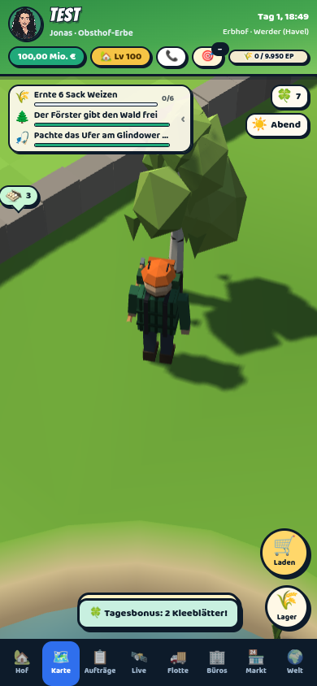

# v426 – Holzfäller pendelt am Baum

Die 4,8 Sekunden lange Nutzeraufnahme zeigt einen Arbeiter mit orangefarbener Kopfbedeckung, der in der Waldfläche wiederholt hin und her läuft. Die Untersuchung hat einen reproduzierbaren Zielkonflikt gefunden: `staffTreeSpot` wählte zunächst eine freie Nachbarzelle und zog die Position danach auf 0,7 Einheiten an den Stamm. So konnte der Bedienplatz wieder in der gesperrten Baumzelle liegen. Routenfolge und Kollisionsausweichen arbeiteten dann gegeneinander.

Im reproduzierten 30-Sekunden-Ablauf: vorher 39 Richtungswechsel, danach 0. Im geprüften Bestand lagen vorher 64 Baum-Arbeitsplätze in gesperrten Zellen, danach 0. Das sind Messwerte des reproduzierten Spielablaufs, keine aus dem Video geschätzten Weltkoordinaten.

Das Vorziehen endet jetzt vor der ersten gesperrten Zelle beziehungsweise Wand. Es verwendet bereits die auf zwei Nachkommastellen gerundeten Koordinaten der Wegplanung. Alte gespeicherte Fällaufträge mit gesperrtem Ziel werden ab der tatsächlichen Figurposition neu geplant. Die vorhandene Neuplanung erhält die verbleibende Arbeitszeit; Geld, Inventar und Belohnungen werden nicht verändert. Kein allgemeines Abschalten von Kollisionen und keine neue Spielstandmigration.

## Prüfungen

- `node worker-motion-v351.test.js`: alle 15 Bewegungs-/Werkzeugprüfungen bestanden. Neuer Regressionstest für frische und per JSON geladene alte Baumaufträge; Richtungswechsel, erreichbares Ziel und stabiler Arbeitsplatz geprüft. Bestehende Camp-, Werkzeug-, Pausenende-, Zaun- und Fahrradprüfungen weiter grün.
- Vollständiger Hof in Chromium/SwiftShader bei 390×844: alter gespeicherter Auftrag mit tatsächlich gesperrtem Ziel, 600 Simulationsschritte. Ziel korrigiert, 0 Richtungswechsel, Figur stabil am Arbeitsplatz, Geld und Inventar gleich, keine JavaScriptfehler. [Messwerte](assets/v426/messwerte.json).
- Syntax und Diff geprüft. Kein echter Handy-/Safari-Test. Der individuelle Nutzer-Spielstand lag nicht vor; Aufnahme studiert und Fehlerursache im Spiel reproduziert.

Gesamt-/SW426, team426. Waffen/worldview425 und alle anderen Assetstände bleiben erhalten. Ergänzung im noch offenen PR133.
