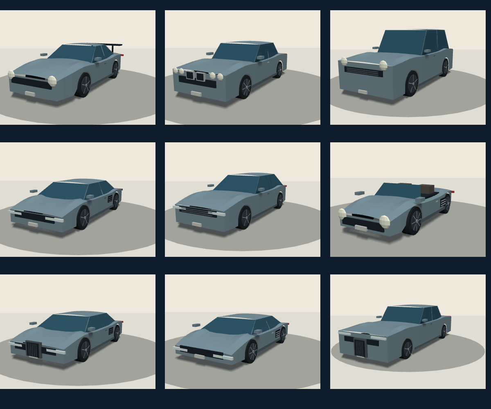
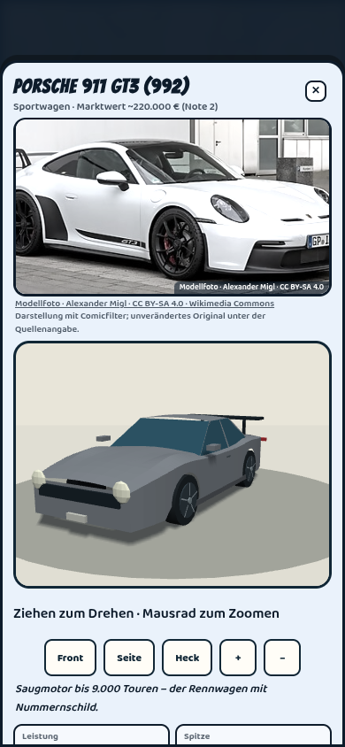

# 3D-Autos im Auktionshaus · v471

Alle 127 Katalogautos können in der Modellansicht und im Auto-Los mit „Auto in 3D ansehen“ geöffnet werden. Fotos und Bildnachweise bleiben erhalten. Ein WebGL-Kontext wird erst auf Wunsch erzeugt; beim Schließen, Neuzeichnen oder Modellwechsel freigegeben. Front, Seite, Heck und Zoom sind erreichbar. Betrachten kostet nichts.

`carmodels.js` ergänzt die vorhandene Gallardo-Geometrie mit parametrischen Formfamilien für Coupés, Limousinen, Kombis, SUV, klassische Wagen und Roadster. Modellbezogene Radstände stammen aus den bestehenden Technikprofilen; ergänzte äußere Maße sind gerundete Darstellungswerte. Karosseriewölbung, Keilform, Kabinenlage, offene Dächer, Radhausöffnungen, Frontsignaturen und Spoiler variieren. BMW-Doppelgrill/alte Doppelscheinwerfer, Porsche-Rundleuchten und unterschiedliche Luxuswagen-/Sportwagenfronten helfen bei der Zuordnung.

Die Modelle sind **stilisierte, familienbasierte Annäherungen**, keine 127 einzeln anhand von Konstruktionszeichnungen rekonstruierten Originale. Detailtreue und Sondermodellmerkmale erreichen noch nicht bei jedem Wagen den einzeln ausgearbeiteten Gallardo. Leistungsdaten, Auktionen, Preise und Spielstände werden nicht geändert. Garage und Rennen nutzen dieselbe Quelle; Radnetze werden im Rennen nun je Modell gecacht statt gemeinsam als „generic“.

## Prüfung

- `node auktionsautos-v471.test.js`: 127 Modelle, 127 unterschiedliche Körpernetze; endliche Koordinaten, Bodenkontakt, korrekter Profil-Radstand, Lackwechsel ohne Änderung der Katalogdaten, vollständiges Modell jeweils unter 6.000 Dreiecken (Maximum Gallardo: 5.657).
- `node auktionsautos-v471.browser.js`: Chromium/SwiftShader, tatsächlicher Auktionsdialog bei 390 × 844; Öffnen, Seitenansicht, Zoom, Schließen und Modellwechsel ohne JavaScript-Fehler.
- Neun repräsentative WebGL-Ansichten visuell geprüft: Porsche GT3, BMW E30, G63, Ferrari 458, RS6, 550 Spyder, Chiron, Countach und Phantom.
- Syntax, geänderte Cacheverweise und Diff geprüft. Kein echtes iPhone/Safari oder Handy-Bildratenbenchmark.

Ladereihenfolge: carmodels/auction3d vor racecars; Modellaufbau erst nach Laden von racehandling. Neue Dateien im SW enthalten. Gesamt471; auction/racing/racecars/carmodels/auction3d471, Gallardo-Vorschau470 und übrige Assetstände erhalten.
