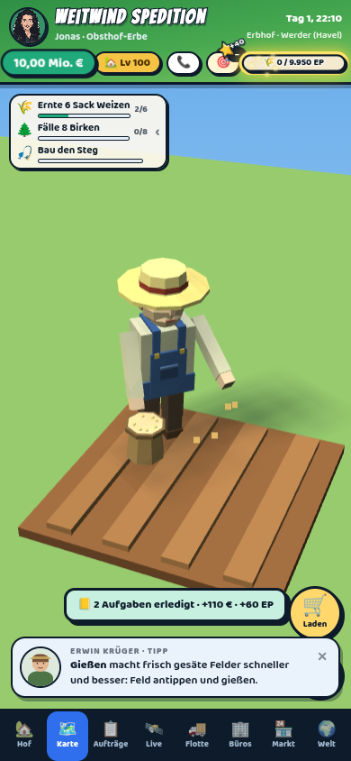

# Aussaat v406

Bisher führte der Abschluss einer Feldarbeit Ernte und Neusaat unmittelbar nacheinander aus. Die Figur schwang dabei stets eine Sichel. Das erklärt die sofort wieder bepflanzten Felder.

Die Ernte hinterlässt jetzt ein leeres Feld. Der Landwirt plant anschließend einen eigenen Säauftrag. Währenddessen hält die linke Hand einen Saatbeutel; die rechte greift zur Saat und streut nach vorn. Die Sichel bleibt dabei ausgeblendet. Pro Streubewegung entstehen höchstens sechs Körner mit 0,7 s Lebensdauer und Schwerkraft; keine dauerhaften Einzelobjekte auf den Feldern.

## Reihenfolge und Zeit

- Neue Feldaufträge speichern ihre Absicht als `fieldMode`. Bei alten gespeicherten Aufträgen werden der Auftragstext und der Feldzustand berücksichtigt.
- Ein Ernteauftrag pflanzt auch dann nicht nach, wenn der Spieler das Feld zwischenzeitlich selbst geleert hat.
- Saatgut wird einmal beim Abschluss des eigenständigen Säauftrags bezahlt; erst dann beginnt das Wachstum. Bei Sammelaufträgen bleibt die bisherige Abschlussbuchung erhalten, erfolgt also nach allen Säbewegungen.
- Bei sichtbaren Feldern im Nahbereich dauert eine vollständige Säbewegung mindestens 1,6 s pro Feld, auch bei schneller Spieluhr. Dafür wird nur die Fertigstellung dieses Auftrags zurückgehalten. Andere Figuren, Welt und Uhr laufen weiter.
- Beim Verlassen der Ansicht, in Ich-Perspektive, bei verdeckter Seite und außerhalb des sichtbaren Nahbereichs läuft die zeitgesteuerte Hintergrundarbeit ohne Animation weiter. Die Ansichtszeit steht an der Figur, nicht im Spielstand.
- Schon belegte/entfernte Felder werden nicht erneut besät. Bestehende Geld-, Saatgut-, Freigabe- und Mengenprüfungen bleiben in Kraft.

## Prüfung

`node aussaat-v406.test.js`: fünf Prüfgruppen einschließlich Ernte ohne Saatkosten/Neusaat, alte und manuell geleerte Aufträge, zwei Felder bei 30× (64 Säbilder à 0,05 s, höchstens zwölf kurzlebige Körner, keine Sichel), Hintergrundarbeit und Schutz manuell bepflanzter Felder.

`node field-menu-v303.test.js`: zehn Menü-/Kosten-/Auswahlprüfungen; die erwartete Ernte→leeres Feld→separate Aussaat wurde aktualisiert. `node worker-motion-v351.test.js`: vierzehn bestehende Lauf-, Sitz-, Werkzeug-, Pausen- und Wegeprüfungen bestanden.

`node aussaat-v406.browser.js`: Chromium/SwiftShader bei 390 × 844, tatsächliche Feld-/Figurenmodelle und Personal-/Pflanzlogik auf einer isolierten Bühne. Leeres Feld nach Ernte, Saatbeutel und Streuhand statt Sichel, Körner und Neubepflanzung erst nach abgeschlossenem Sägang bei 30×; keine JavaScript-Seitenfehler. Server: `python3 -m http.server 8002 --bind 127.0.0.1`; URL über `LOGISTIKA_TEST_URL`, Bildordner über `LOGISTIKA_ARTIFACT_DIR` einstellbar.

Syntaxprüfungen und `git diff --check`. Kein Test auf echtem iPhone/Safari, keine neue Mobilgeräte-Leistungsmessung.
