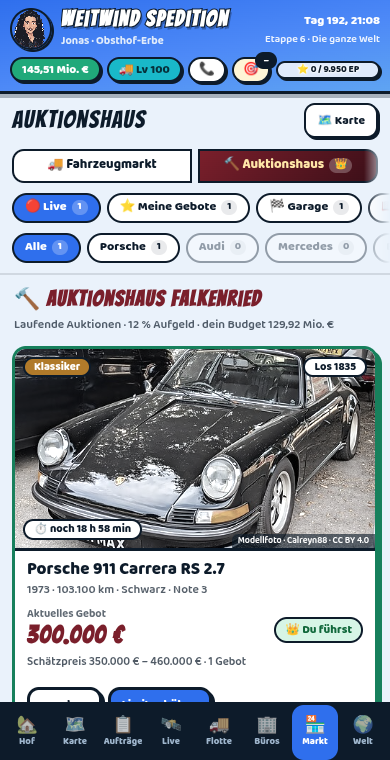
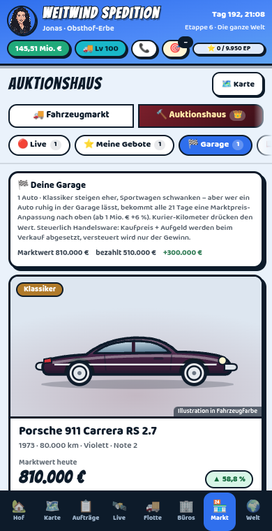

# Autofotos und Fahrzeugdaten – v372

## Fehler und Ergebnis

Der gemeldete Carrera RS 2.7 bekam über die Wikipedia-Markensuche ein Titelbild eines modernen grünen 911. Das Los konnte unabhängig davon ein Baujahr 1975 und schwarzen Lack auswürfeln. Weitere falsche Varianten waren u. a. R8 V10 Spyder statt R8 4.2, G 350 statt G 63, McLaren 720S statt 765LT und ein moderner Ford GT statt der Generation 2005. Artikel-Titelbilder können sich zudem jederzeit ändern. Der bisherige Farbdetektor schätzte aus Bildpixeln die Lackierung und schrieb diese nachträglich in Lose und Garage. Der Comic-Cache unterschied Bildquellen nur anhand ihrer URL-Länge.

Jetzt haben alle 127 Katalogmodelle eine feste, anhand von Dateiseite und Foto gesichtete Commons-Datei. Die 500-Pixel-Fotos liegen unter `cars/photos/` (zusammen rund 7,1 MB). `carphotos.js` ist die verbindliche Modellzuordnung einschließlich sichtbarer Grundfarbe, Urheber, Lizenz, Quelldatei und SHA-256. `cars/credits.json` enthält dieselben Angaben für die ausgelieferten Dateien. Das Spiel verwendet keine Wikipedia-Titelbilder, Artikelweiterleitungen, Markensuche, alten localStorage-Fotozuordnungen oder unkontrollierten KI-Bild-Overrides mehr.

Das RS-Foto ist [1973 Porsche 911 Carrera RS 2.7.jpg](https://commons.wikimedia.org/wiki/File:1973_Porsche_911_Carrera_RS_2.7.jpg), Calreyn88, CC BY 4.0; die Dateiseite ordnet es ausdrücklich dem Carrera RS 2.7 und schwarzen Porsche-Coupés zu. Im Browser erscheint dieses klassische schwarze Auto statt des modernen grünen 911.

## Daten und Darstellung

- Neue Lose übernehmen die sichtbare Grundfarbe des zugeordneten Modellfotos sofort. Die Namen bezeichnen allgemeine Farben, keine vermeintlich aus Pixeln ermittelten Werkslack-Codes.
- Bestehende Lose, Einlieferungen und Garagenautos behalten ihren gespeicherten Lack. Stimmt dessen Farbwert nicht mit dem freigegebenen Foto überein, erscheint eine ausdrücklich gekennzeichnete Illustration in Fahrzeugfarbe. Ein Foto eines andersfarbigen Autos wird nicht darübergelegt. Nachladen aktualisiert jeden Bildrahmen einzeln, auch wenn dasselbe Modell in zwei Lackierungen auf der Seite steht.
- Fotos sind als **Modellfoto** mit Urheber/Lizenz und Quellenlink gekennzeichnet. Es handelt sich um Referenzbilder des Typs, nicht um fotografierte individuelle Auktionslose. Comicfilter wie bisher; Originalfoto/Illustration bei Filter- bzw. Ladefehlern.
- `carBuildYears`/`carValidYear` begrenzen neue Baujahre auf den jeweiligen Katalogzeitraum. Konkrete Varianten wurden gegenüber früheren pauschalen Baureihenzeiträumen eingegrenzt, u. a. Boxster 2.5, 928 S4, 930 3.3, 280 SL, 500 SL 326 PS, Miura P400, erste Ausführung von Continental GT und Aventador. Der frühe abgebildete AMG GT S wird mit 510 statt den 522 PS seiner Modellpflege geführt. Die bestehenden Marktwert-/Gebotsregeln bleiben erhalten.
- `S.ah.modelYears372` korrigiert einmalig nur unmögliche Baujahre vorhandener Auto-Lose/Garagenautos: RS 1975 → 1973. Keine Neuwürfelung, keine Veränderung von IDs, Geboten, Limits, Kaufpreisen, Kilometerständen, Zustand oder Besitz. Vergangene Auktionsergebnisse bleiben unverändert. Reguläres Speichern sichert die Migration.
- Neuer Comic-Cache `/__carcomic/v4/<id>/<vollständiger SHA>.jpg`. Gleich lange Quelladressen können nicht mehr denselben Schlüssel erzeugen. Fertige und laufende Filteraufträge müssen weiterhin zur freigegebenen Quelle passen. Alte v3-Ergebnisse werden nicht gelesen.
- Service Worker kennt die neuen lokalen Fotoverzeichnisse; Manifest und geänderte Skripte tragen Version 372. Fotos werden beim tatsächlichen Bedarf geladen und danach zwischengespeichert.

## Nachhaltige Pflege

`node carpics.mjs --check` prüft offline alle 127 IDs, Quellen-/Lizenzangaben, Bilddateien und SHA-256 sowie die Übereinstimmung von `credits.json` und Manifest. Ohne `--check` werden ausschließlich fehlende/beschädigte freigegebene Dateien von der festen Bildquelle wiederhergestellt; `--force` lädt dieselben Quellen neu. Andere Bytes werden abgelehnt, statt still ein anderes Foto freizugeben. Auch die bestehende manuelle GitHub-Aktion verwendet diesen Importer; sie wurde nicht ausgeführt.

Neue Modelle/Fotos immer visuell und anhand der konkreten Variante prüfen. Datei, Farbe, Lizenz, Fingerabdruck und Metadaten gemeinsam aktualisieren. Kein pauschales Markenfoto und kein dynamisches Titelbild als Ersatz. Bei einer neuen Generation/anderen technischen Ausführung gegebenenfalls eine eigene Modell-ID verwenden. Die Bilddateien behalten ihre in Manifest/Commons ausgewiesenen Lizenzen; sie werden nicht pauschal unter die Code-Lizenz gestellt.

## Prüfung

- `node carpics.mjs --check`: 127/127 Zuordnungen, Bilddateien und Lizenzdatensätze stimmen überein.
- `node autofotos-v372.test.js`: sechs bestandene Prüfgruppen, darunter 20 neue Lose je Modell (2.540 Lose), obere/untere Baujahrgrenzen und Referenzjahre, einmalige Migration eines alten Spielstands, verworfene alte Fotozuordnung, Lackschutz, falsche Modell-/Quellenkennung, Cachewechsel und echter Zuschlag/Wiedereinlieferung mit einmaliger Geldbuchung.
- `node autofotos-v372.browser.js`: Chromium, 390 × 760 mit Touch. Der gemeldete Los-Fall mit altem falschem Fotocache zeigt den schwarzen klassischen RS und 1973; Geld/Gebote/Limits/Lack bleiben identisch. Losdetails, Garage mit abweichendem Lack, zwei gleichzeitige Farben desselben Modells, alle 127 tatsächlichen Bilddateien dekodiert, keine Wikipedia-/Wikimedia-Anfrage aus dem Spiel, keine Seitenfehler. Defektes Comicfoto fällt auf dieselbe Originaldatei und danach die Illustration zurück. Ein verzögertes Filterergebnis nach einem Quellenwechsel wird verworfen.
- Syntaxprüfung und `git diff --check` bestanden. Aktuelles main einschließlich PR #88/v370 integriert; parallele offene v371 bleibt separat.

Nicht auf echtem iPhone/Safari geprüft. Die visuelle Modellprüfung ist keine vollständige Herstellerprüfung jeder Ausstattungsoption oder Fahrgestellnummer. Zulassungsjahr, Modelljahr und Produktionsjahr können voneinander abweichen; das Spiel führt weiterhin das Baujahr. Der Online-Wiederherstellungsmodus wurde nicht für alle Dateien erneut ausgeführt, weil alle freigegebenen Dateien bereits lokal vorliegen; der Offline-Prüfmodus und die echten Browserdateien wurden geprüft.
