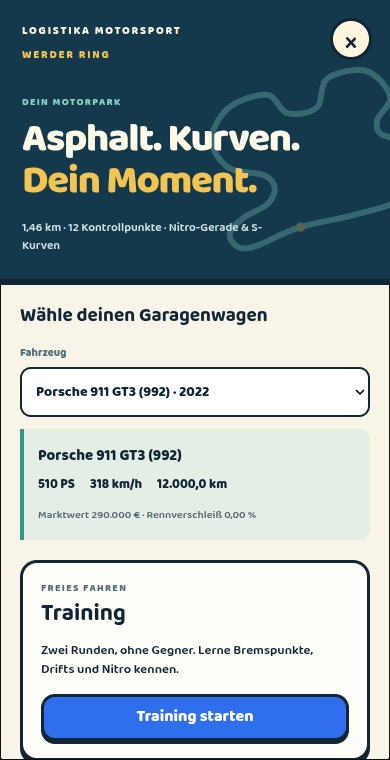
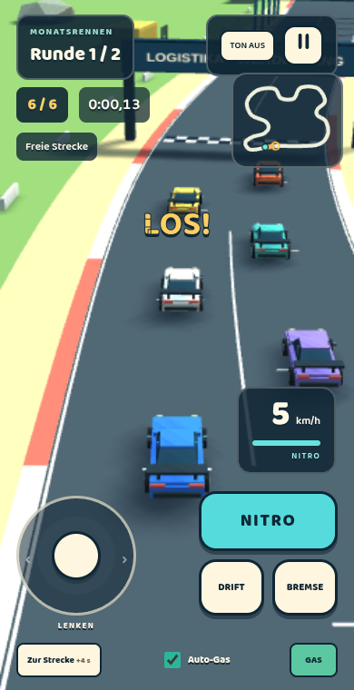
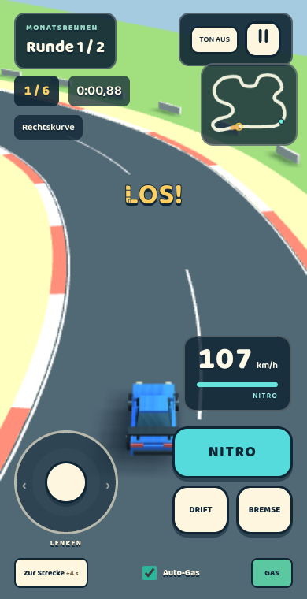
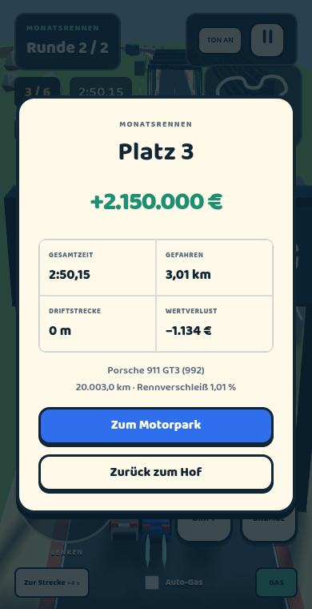
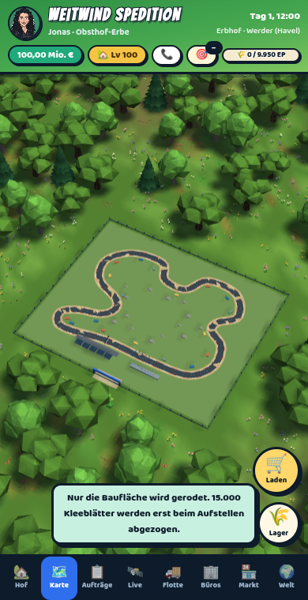

# Autorennbahn · v461

Im Hofladen unter **Kleeblätter → Freizeit → Autorennbahn** für **15.000 Kleeblätter**. Die Vorschau belegt 26 × 22 Kacheln, lässt sich drehen und abbrechen. Bezahlt und gerodet wird erst beim bestätigten Aufstellen. Die Bahn steht danach fest; Antippen öffnet den Motorpark. Alternativ führt der Motorpark-Knopf am verfügbaren Garagenauto direkt hinein.

Die Miniatur und die separate Fahrwelt verwenden denselben zusammenhängenden Rundkurs: rund **1,46 km**, lange Gerade, S-Kurven, engere Driftkurven, Boxengasse, Startbrücke und Tribüne. Die Miniatur besitzt weniger Geometriedetails. Beim Fahren werden weder Wald noch Insel/Karte im Hintergrund gezeichnet oder simuliert; die Speditionszeit steht dabei. Die Fahrwelt enthält keine Bäume.

## Spielen

- Eigenes, verfügbares Garagenauto auswählen. Kurierfahrzeuge und eingelieferte Autos bleiben gesperrt; reine Rennstreckenautos dürfen hier fahren. Die 127 Katalogmodelle verwenden ihre vorhandenen Leistungsdaten, Lackfarben und vereinfachte Low-Poly-Bauformen. Bei fehlender Beschleunigungsangabe gilt eine gemeinsame Näherung.
- Links per Joystick lenken, rechts Bremse, Drift und Nitro halten. Auto-Gas ist zunächst aktiv und abschaltbar; ein eigener Gasknopf bleibt erreichbar. Auf dem Desktop: WASD/Pfeile, Leertaste für Drift, Umschalt für Nitro, R zurück zur Strecke, Escape für Pause. Ton nutzt die Hof-Einstellung und lässt sich direkt umschalten.
- Training: beliebig oft, zwei Runden, ohne Geldgewinn. Monatsrennen: zwei Runden gegen fünf KI-Fahrer mit vergleichbarer Motorleistung. Vorwärts zu passierende Kontrollpunkte verhindern Abkürzungen/Rückwärtswertung; der nächste Punkt ist in der Minikarte markiert. Zurücksetzen führt zum zuletzt bestätigten Streckenabschnitt und kostet vier Sekunden.
- Ein Monatsstart pro **Spielmonat mit 30 Spieltagen**. Nicht nach Echtzeit-Kalender. Der Sieg bringt je nach Speditionsetappe 250.000 bis 5.000.000 €. Plätze 2–6 erhalten 64/43/29/19/12 % davon. Abbrechen oder Neuladen verbraucht den Start ohne Preisgeld. Die Spielzeit muss außerhalb des Motorparks weiterlaufen, um den nächsten Monat zu erreichen.
- Tatsächlich gefahrene Kilometer erhöhen den Kilometerstand. Zusätzlicher Rennverschleiß steigt mit Strecke, Nitro und Kollisionen; er senkt den Garagen- und Auktionswert. Es wird kein fiktiver Reparaturbetrag abgebucht. Im Ergebnis stehen Zeit, Driftstrecke, gefahrene Kilometer und Wertverlust.

## Speicherung und Grenzen

`S.farm.race` wird erst beim Bau angelegt; ältere Spielstände brauchen keine Migration. Die Teilnahme wird vor dem Start reserviert. Kilometer/Verschleiß werden etwa alle drei Fahrsekunden, beim Pausieren und beim Verlassen der Seite gesichert. Preisgeld, Umsatz, Finanzbucheintrag und Monatsergebnis werden gemeinsam gespeichert, gegen Wiederholung geschützt und bei Speicherfehler zurückgerollt. Ein Speicherfehler pausiert die Fahrt bzw. lässt die Ergebnisgutschrift erneut versuchen. Ein harter Betriebssystem-Abbruch ohne Seitenereignis kann die letzten noch nicht gesicherten Sekunden verlieren; ein abgebrochener Monatsstart erhält beim Laden keinen Preis.

Die Rodung entfernt nur Bäume an der Baufläche einschließlich kleinem Abstand für überstehende Kronen. Hintergrundbewuchs und Nachwuchs bleiben dort gesperrt. Wege, Wasser, Berg, bestehende Gebäude und besondere Orte sind keine Bauflächen. Außerhalb dieser Fläche werden keine Baumdatensätze geändert; See und Gebirge behalten ihre Regeln. Rodung gibt kein zusätzliches Holz.

Fahrphysik/Kontrollpunkte sind DOM-frei in `racedrive.js`, Kurs und Modelle in `racetrack.js`, Oberfläche/Transaktionen/Renderer in `racing.js`. Eigener Renderer, feste Physikschritte mit gedeckeltem Bilddelta, höchstens 64 Reifenspursegmente, adaptive Auflösung. Audioquellen, Steuerungslistener, Texturen und GPU-Netze werden beim Verlassen freigegeben. Das Fahrspiel verwendet rund 13.620 Streckendreiecke; die Inselminiatur bleibt unter 6.000. Keine externen Pakete oder Online-Abhängigkeiten im Rennspiel.

## Prüfung

- `node autorennbahn-v461.test.js`: zwölf Gruppen; 127 Modelle mit endlichen Koordinaten/Geometriebudget, Kursprojektion, Randsteine/Kies ohne umgedrehte Flächen, Beschleunigung/Bremse/Drift/Nitro/Kollision, acht KI-Fahrzeuge aus mehreren Klassen, Reihenfolge/Rückwärtsfahrt, Zurücksetzen und kompletter Lauf mit freier Fahrphysik.
- `node autorennbahn-v461.browser.js`: echte Spielskripte; Altbestand, fehlgeschlagener Kauf, geschützte Flächen, begrenzte Rodung, gleichzeitige Touchlenkung/Nitro, Kilometer-/Verschleiß-Rollback, einmaliges Preisgeld, Monatswechsel, Neuladen, Wiederverkauf.
- `node autorennbahn-v461.fahrt.browser.js`: echte Tastatur, Auto-Gas-Schalter, Motor-Audio/Pause, vollständige Physik-/KI-Runden im beschleunigten Prüfablauf und echte Ergebnisgutschrift. Ergebnis bei Desktop, 390 und 320 Pixeln kontrolliert.
- `node autorennbahn-v461.welt.browser.js`: Vorschau ohne Kauf, Drehen/Aufstellen, Miniatur und Hintergrundmasken, Eintritt per Hofobjekt, keine Hof-Renderbilder während des Rennens, Fortsetzung nach Beenden.
- Regressionen: Autofotos372, Platzierung347, Arbeiter351, Gebirge429, Wasser386 und Tierleben446.

Für die Browserprüfungen zunächst `python3 -m http.server 8018` im Repository starten; alternativ `LOGISTIKA_TEST_URL` setzen.

Browserläufe: Chromium mit SwiftShader, keine Messung echter Handy-Bildraten. **Kein echter iPhone-/Safari-Test**; dort bleiben Leistung, Tonfreigabe und das gleichzeitige Halten mehrerer Finger noch zu prüfen.

