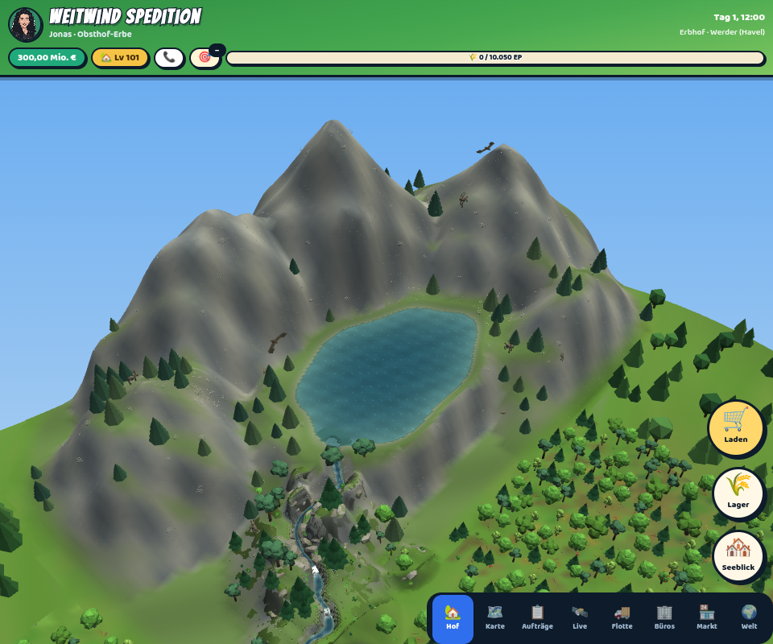
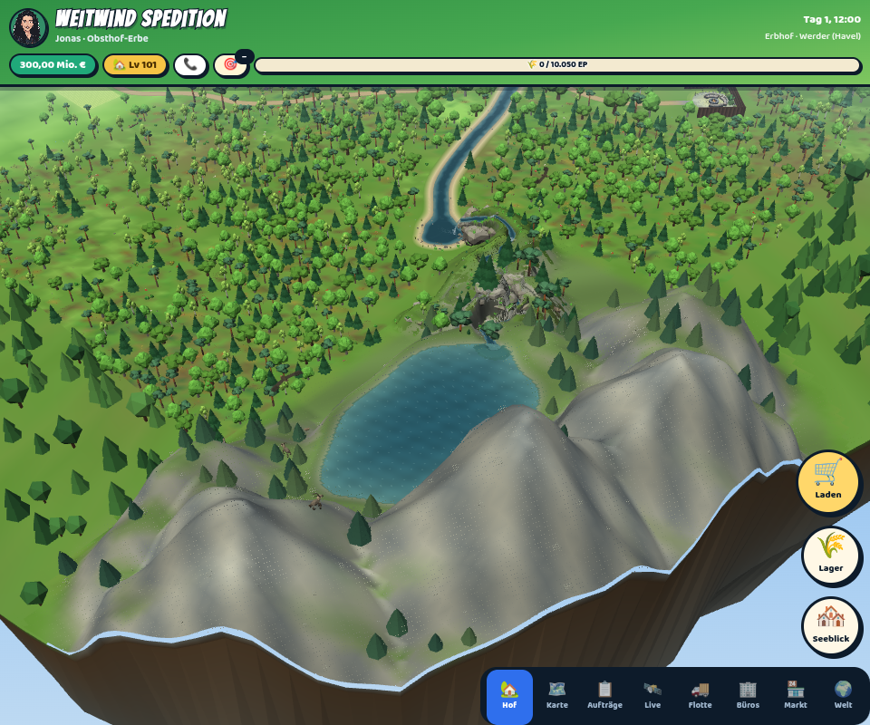
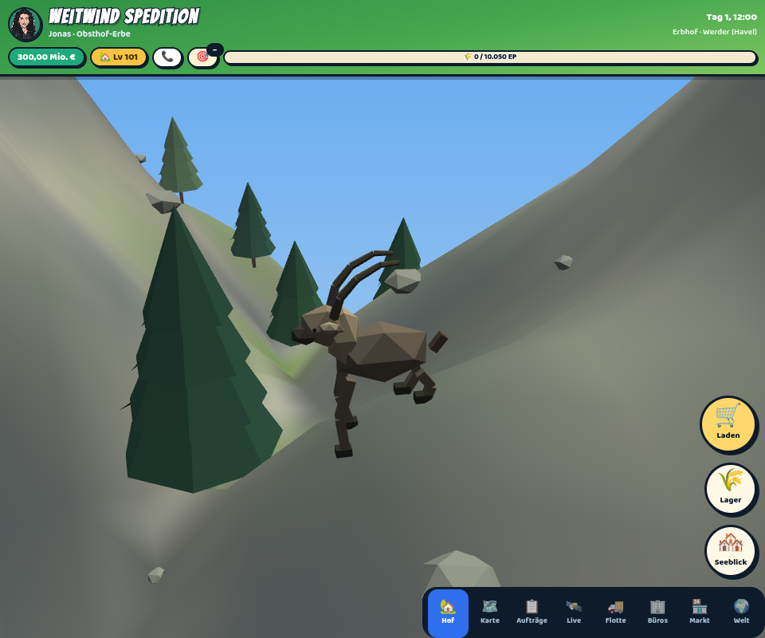
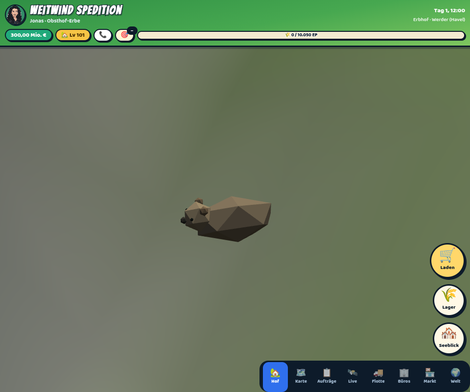
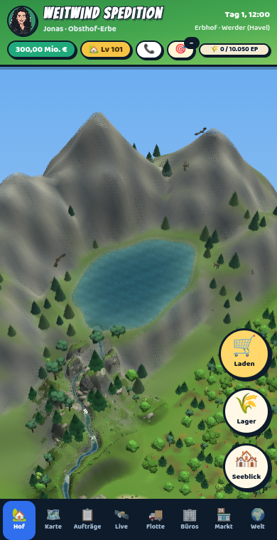
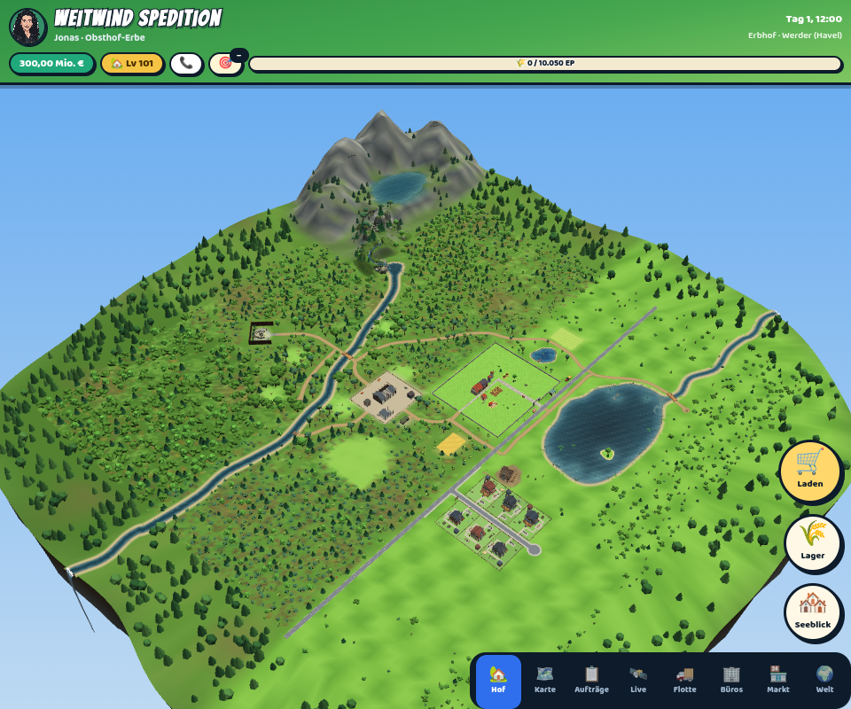

# Quellgebirge und Bergsee – v375

## Gestaltung nach der Bildvorlage

Die mitgelieferte Aufnahme zeigt einen türkisfarbenen Bergsee, einen offenen Talraum, dunkle Nadelbäume unterhalb der Baumgrenze sowie kahle, gegliederte Felsgrate mit Schuttflächen. Diese Merkmale sind als eigene 3D-Geometrie in den markierten Nordostbereich der Spielinsel übertragen. Das Referenzfoto selbst wird nicht im Spiel oder Repository verwendet.

Das Gebirge wächst hinter dem bisherigen Quellgebiet aus der Insel: sechs unterschiedlich hohe und gegliederte Rücken, bewaldete untere Hänge, offene Ufer, einzelne Blöcke und Schuttfächer. Höhen- und neigungsabhängige Farben unterscheiden Wiese, Ufer, feuchten Stein und kahle Hochlagen. Dieselben Oberflächennormalen dienen Nah- und Fernmodell; das reduziert die sichtbaren Helligkeitsunterschiede während des Übergangs.

## Wasser und Inselrand

Der unregelmäßig geformte See liegt bei `(80, -149)` auf Höhe `10,4`, mit etwa `40 × 26` Einheiten Ausdehnung. Sichtbar sind ein tieferer türkiser Kern, ein flacherer heller Ufersaum und eine ruhige bewegte Wasseroberfläche. Es gibt keine darübergelegte Foto-Fläche.

Am südwestlichen Ufer verlässt das Wasser den See über eine abfallende Rinne. Ihr letzter Punkt `(53,5, -138,7, 6,55)` stimmt mit dem Anfang des bisherigen Bergbachs überein. Der Ablauf setzt sich über die vorhandenen Kaskaden und den Wasserfall ins untere Becken und den bisherigen Fluss fort. Der neue Abfluss besitzt dieselben bachabwärts mitgeführten Shaderkoordinaten wie der bestehende Bergbach. Das ältere Bachbett wird nur abgesenkt, niemals durch den neuen Anschluss angehoben. Das ist wichtig, damit die vorhandene Wasserfläche nicht verdeckt wird.

Ein gemeinsames Höhenfeld steuert Gelände, Seegrund, Rinne, Baumpositionen und Inselkante. Im Nahmodell werden Ufer und Bach gezielt bis auf ungefähr `0,375` Einheiten verfeinert; gemeinsame Randpunkte schließen an die gröberen Nachbarzellen an. Damit liegt das Wasser tatsächlich über seinem Bett, statt von groben Geländedreiecken abgeschnitten zu werden.

Die Ausdehnung umfasst den gekrümmten Rand vollständig. Außereckpunkte werden an `apronRim` gebunden; vollständig außerhalb liegende Zellen entfallen. Die Felswand der schwebenden Insel beginnt am gleichen Höhenprofil, während der geschlossene Unterkörper erhalten bleibt. Die alte Grasdecke bleibt außerhalb des Gebirges bestehen und wird innerhalb vollständig bedeckter Bereiche ersetzt. Keine getrennte schwebende Bergplatte und kein neuer unendlicher Hintergrund.

## Tiere und Spielwelt

Fünf Steinböcke mit gebogenen Hörnern, zwei Murmeltiere und zwei kreisende Adler beleben das Gebiet. Landtiere wechseln zwischen kleinen Laufwegen und Pausen; Steinböcke senken den Kopf, Murmeltiere richten sich gelegentlich auf. Die Wege werden beim Aufbau deterministisch auf trockenen, von Bäumen und Inselkante getrennten Flächen ausgewählt und voneinander getrennt. Bewegte Beinsegmente bleiben verbunden; die Hufe folgen den tatsächlichen Nahmodell-Dreiecken und heben sich nur in der Schwungphase. Adler gleiten auf getrennten Umläufen und schlagen gelegentlich mit den Flügeln.

Nachts ruhen die Steinböcke, Murmeltiere und Adler werden ausgeblendet. Es gibt keine neue Jagd-, Kauf-, Beute- oder Einkommensmechanik. Die Tiere sind Umgebung. Pflanzenplatzierung, Trophäenaufsteller und Hof-Wegesuche behandeln das Gebirge einschließlich See als gesperrte Fläche. Hof, Dorf, vorhandene Flüsse, Gebäude, Geld und gespeicherte Bäume werden nicht gelöscht oder migriert.

## Feste Leistungsgrenzen

- Gelände, Deko und Baumgruppen werden einmal erzeugt, als gemeinsame Meshes gespeichert und beim Szenenneuaufbau wiederverwendet. Im Animationsschritt entstehen keine neuen GPU-Meshes.
- Zwei feste Gelände- und Baumstufen. Zwischen Kameraabstand `140–225` wird mit komplementären Pixelmasken überblendet. `gl3d.js` lässt dafür auch normale Knoten ausdrücklich `inv: true` verwenden; bisherige Knoten ohne diese Option bleiben unverändert. Beide Stufen müssen **denselben** Fade-Schwellwert verwenden, sonst entstehen Löcher.
- Kleine Steine verschwinden zwischen `100–170`, Landtiere zwischen `150–220`; anschließend bleibt nur die feste Landschaft mit den beiden Adlern. Bestehende weite Hofansicht schaltet ihren Schattendurchgang weiterhin ab.
- Baumlimit `210`, tatsächlich deutlich weniger nach Neigungs-/Uferprüfung; immer genau sieben Landtiere und zwei Vögel. Tierwege werden nur beim Aufbau ausgewählt, keine Wegesuche je Bild.
- Tierzeitschritt maximal `0,05 s`: Nach einem Tabwechsel wird keine lange Pause als Sprung nachgeholt. In der separaten Ich-Perspektive bleibt die Bergkulisse entsprechend der bisherigen Inselkulisse ausgeblendet.
- Finale zusätzliche Fernlast: **4.516 Dreiecke in zehn Drawcalls**, einschließlich See, Abfluss und beider Adler. Die Nahstufe, Bäume und Deko haben zusätzliche feste Testobergrenzen. Kein verfeinertes Gelände bei jedem Herauszoomen.

## Prüfung

`node berglandschaft-v375.test.js` prüft echte Modellgeometrie und den echten Landschaftszufall: endliche Koordinaten, Dreiecksbudgets, Lage innerhalb der Insel, exakten Anschluss des Felskörpers, Seegrund unter Wasser, stetigen Uferübergang, freien Auslauf und freien bisherigen Bergbach. Sieben Tierwege bleiben trocken und innerhalb der Insel; 1.800 Schritte prüfen verbundene Beinsegmente, Hufkontakt und Trennung der Tiere. Dazu Tag/Nacht, Ich-Perspektive, begrenzter Zeitschritt, 200 Zoomwechsel ohne neue Meshes, unveränderter Modell-Spielstand und Wiederverwendung beim Neuaufbau.

`node berglandschaft-v375.browser.js` verwendet den vollständigen Hof mit echten WebGL-Shadern in Chromium/SwiftShader, `390 × 760` und `960 × 800`. Tal, See, Kamm, Inselrand, Tierdetails, Nacht und volle Insel werden als Screenshots erfasst. Nach dem Aufwärmen folgen 24 Wechsel zwischen `70`, `150`, `185`, `225` und `450`: keine neuen GPU-Meshes, kein Kontextverlust, kein Schattenpass in der Ferne, keine Seitenfehler. Bäume, Gebäude und Geld bleiben erhalten. Die Testszene initialisiert den ohnehin zur Hofstufe gehörenden Traktor vor diesem Vergleich; normale Spielstandmigrationen sind kein Bestandteil der Berglandschaft.

Zusätzlich bestanden: `inselrand-v366.test.js`, `water-seams-v297.test.js`, `water-impact-v325.test.js`, bestehende Autofotoprüfung, Syntaxprüfungen und konsistente Offline-/Skriptversionen.

Nicht auf einem echten iPhone/Safari oder einer schwachen Mobil-GPU geprüft. Die festen Budgets und der Test ohne Ressourcenwachstum sind keine Garantie für eine bestimmte Bildrate auf jedem Gerät. Es wurden keine neuen Bilder, Texturen, Audio-Dateien oder externen Modellbibliotheken geladen.

## Integration

Basis ist main `92aa6ec` nach PR #91/v373. Die kompakte Jagdleiste ist unverändert integriert; Versions-/Dokumentationskonflikte gemeinsam aufgelöst. PR #92/v374 (Werkzeugübergabe) bleibt separat; eigene Lieferung 375. `alpine.js` nach `woodmodels.js` und vor `worldview.js` laden. Alle eigenen geänderten Skripte und beide Asset-Listen tragen 375. Der Landschaftssamen `373` bleibt absichtlich unabhängig von der Liefernummer konstant. Keine neuen Spielstandfelder.

Die vollständigen Messdaten des Browserlaufs liegen unter [assets/v375/messwerte.json](assets/v375/messwerte.json).
