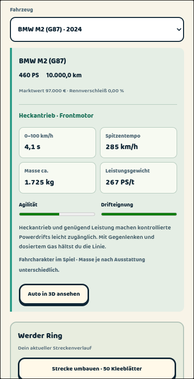
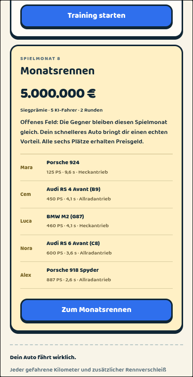

# Individuelle Autos und offenes Monatsrennen · v468

Das Monatsrennen passt die Gegner nicht mehr an den ausgewählten Garagenwagen an. Fünf Fahrer treten mit eigenen Autos an; das gemischte Feld steht für den jeweiligen Spielmonat fest und ist vor dem Start sichtbar. Ein anderes Spielerauto oder ein Umbau für 50 Kleeblätter verändert dieses Feld nicht. Ein leistungsfähigerer Garagenwagen bringt damit einen messbaren Vorteil. Ein hoher Sammlerpreis allein macht ein Auto nicht schneller.

## Fahrzeugtechnik und Recherche

`racehandling.js` enthält für alle 127 vorhandenen Katalogmodelle eigene Werte für Antrieb, Motorlage, Masse, Radstand, Reifenabstimmung und Aerodynamik. Die Marke fließt nicht in die Physik ein. Beispielsweise sind M2 G87 und AMG GT S heckgetrieben, BMW i8 und AMG G 63 dagegen allradgetrieben. Der katalogisierte Gallardo ist der frühe Allradwagen, der Diablo das ursprüngliche heckgetriebene Modell. LaFerrari hat Heckantrieb, SF90 Allrad. Der XJ220 erhält die Technik der Serienversion, nicht den Allradantrieb der Studie.

Die unten verlinkten technischen Modellreferenzen wurden am **23.11.2026** öffentlich abgerufen und hinsichtlich Antrieb, Motorlage, Radstand und verfügbarer Gewichtsdaten geprüft. Bei Baureihen mit mehreren Varianten wurde der zum vorhandenen Katalog passende Zeitraum/Typ verwendet. Ergänzend:

- [Porsche: Vorstellung des 2022er 911 GT3](https://newsroom.porsche.com/en_US/2021/products/porsche-911-gt3-motorsport-technology-world-premiere-23656.html): Leichtbau, aerodynamische Entwicklung, Doppelquerlenker-Vorderachse und PDK/Handschalter. Die dort genannte 0–60-mph-Zeit wird nicht als 0–100-km/h-Zeit übernommen.
- [Ferrari: SF90 Stradale](https://www.ferrari.com/en-EN/auto/sf90-stradale): 1.000 cv, 2,5 Sekunden auf 100 km/h und elektrifizierter Allradantrieb.

Die vorhandenen katalogisierten PS-, 0–100- und Höchstgeschwindigkeitswerte bleiben die Grundlage. Gewicht ist ausdrücklich ein **Näherungswert**, kein für jedes Einzelauto nach DIN/EU gleichartig gemessener Homologationswert. Quellen unterscheiden sich bei Ausstattung, Getriebe, Tankfüllung und teils Trocken-/Leergewicht. Wo nur Trockenmasse zugrunde liegt, werden pauschal 100 kg Betriebsstoffe angesetzt (288 GTO, SF90, Daytona SP3, 365 GTB/4, Veneno, Temerario, Zonda, Huayra, Utopia). Auch seltene historische Karosserievarianten und der Sián nutzen repräsentative Näherungen. Die Spielkarte kennzeichnet Massen mit „ca.“.

Fehlt im Katalog ein vergleichbarer 0–100-Wert, wird er aus Leistung und Masse angenähert und sichtbar mit **≈** gekennzeichnet. Das betrifft beispielsweise 550 Spyder, 917 K, Valkyrie, Evija und Utopia. Solche Näherungen sind keine recherchierten Herstellerangaben. Reifen-/Aero-Koeffizienten sowie die Anzeigen für Agilität/Drifteignung sind nachvollziehbare Spielabstimmung aus Bauart und Einsatzzweck; keine gemessenen Markenbewertungen.

## Spürbare Unterschiede

- Bekannte 0–100-Zeiten kalibrieren die Beschleunigung. Das bisherige gemeinsame Beschleunigungslimit für besonders schnelle Autos entfällt. Oberhalb 100 km/h wirkt das Leistungsgewicht zusätzlich auf den Durchzug; auch die bisherige gemeinsame Grenze von 378 km/h entfällt.
- Masse, Radstand und Karosserie bestimmen die Reaktionsgeschwindigkeit. Hohe, schwere SUVs wechseln langsamer die Richtung. Reifen und geschwindigkeitsabhängiger Aero-Effekt bestimmen Kurvengrip und mögliche Verzögerung. Lenken bei hohem Tempo ist durch die verfügbare Seitenführung begrenzt.
- Kräftige heckgetriebene Frontmotorwagen halten einen Drift leichter. Allrad fängt seitliches Rutschen früher ab. Heck-/Mittelmotorwagen besitzen eigene Reaktionen; ein Porsche bekommt keinen allgemeinen Beschleunigungs- oder Driftbonus.
- Gegner verwenden ihre eigenen Leistungs-/Grip-/Bremswerte sowie ihr eigenes vorhandenes Karosserie- und Radmodell. Es gibt keine Anpassung ihrer Leistung an das Spielerauto und keinen Aufholbonus durch den Abstand zum Spieler. Die KI fährt weiterhin mit vereinfachter Linienführung.

Die Garage zeigt Antrieb, Motorlage, 0–100, Spitzentempo, ungefähre Masse und PS pro Tonne. Agilität und Drifteignung erklären den Spielcharakter; ein kurzer Text gibt Hinweise zur Fahrweise. Die Gestaltung bleibt im bisherigen Logistika-Stil. Weitere detaillierte Einzelkarosserien werden dadurch nicht vorgetäuscht: das eigene Gallardo-Modell aus v467 bleibt erhalten, andere Modelle nutzen ihre bisherigen Formen.

## Wettbewerb und Spielstand

Die fünf Plätze werden deterministisch pro Spielmonat aus fünf festen Gruppen mit ansteigender Leistung besetzt. Die Fahrer beherrschen zwischen 87 und 96 Prozent ihrer vorgegebenen Liniengeschwindigkeit. Auswahl, Lack, Preis und Inhalt der Spielergarage sind keine Eingaben der Auslosung. Das Feld wechselt mit dem Spielmonat und wird beim Start als Modellkennungen/Fahrer/Fahrerwert im Monatseintrag gespeichert. Alte Monatseinträge ohne dieses Feld bleiben lesbar.

Preisgeld, eine Teilnahme je 30 Spieltage, Training, Kilometer, Verschleiß, Auktionswerte und die 50-Kleeblatt-Umbauten bleiben nach den bestehenden Regeln erhalten. Die zusätzlichen Profile werden nicht in jedes Garagenauto kopiert. Alte Bestzeiten und bestehende Garagenwerte werden nicht zurückgesetzt.

## Prüfung

`node fahrprofile-v468.test.js`: acht Gruppen, vollständige Abdeckung aller 127 Modelle, alle bekannten und angenäherten Antritte auf einer unendlich langen Geraden ohne Nitro innerhalb 0,045 s des Sollwerts, modellgerechter Antrieb, spürbarer Unterschied bei identischem Driftimpuls, Grip und Durchzug, kein Marken-/Preisbonus, konstantes Monatsfeld über Autowahl/Umbau, 381 vollständige KI-Läufe (jedes Modell auf allen drei Kursen).

| Gleiche Testbedingungen | 0–100 km/h ohne Nitro | Zwei Runden Werder, gleicher KI-Fahrer |
| --- | ---: | ---: |
| Porsche 924 | 9,6 s | 190,85 s |
| BMW M2 G87 | 4,1 s | 159,20 s |
| Porsche 911 GT3 992 | 3,4 s | 149,43 s |
| Bugatti Chiron | 2,4 s | 146,40 s |

Das sind automatisierte Spielmessungen. Kurvige Strecken begrenzen den Nutzen reiner Höchstgeschwindigkeit; Fahrweise und Kurvenstärken zählen weiterhin.

`fahrprofile-v468.browser.js`: reale Fahrzeugauswahl (M2/i8/GT3/Chiron), unveränderte Garage durch die Vorschau, sichtbares und bei Autowahl unverändertes Feld, eigener Motor-/Grip-/Modellweg jedes Gegners, gespeicherte Feldkennungen, Monatsstart trotz Fahrzeugwechsel/Training/Umbau verbraucht, Umbaukosten/Neuladen, keine Seitenfehler. Darstellung ohne horizontalen Überlauf bei 320, 390 und 980 Pixeln.

Weitere Prüfungen: `autorennbahn-v461.test.js`, `gallardo-umbau-v467.test.js`, bestehende Rennbahn-Browserprüfung (Kauf, begrenzte Rodung, Touch, Verschleiß, Preisgeld, Monatswechsel, Auktion) und Gallardo-Browserprüfung (Drehen, Modellgleichheit, Hofwächter, Umbau-Rollback, Rundkurs und Speicherzustand). `autorennbahn-v461.fahrt.browser.js` nutzt jetzt die eigenen Gegnerautos auch im beschleunigten Prüflauf.

Chromium/SwiftShader, kein echter iPhone-/Safari-Test und keine Aussage zur Bildrate auf einem physischen Handy.

## Modellübersicht mit Referenzen

Die Masse in dieser Tabelle entspricht der im Spiel benutzten Näherung. **≈** bei der Beschleunigung bezeichnet eine Modellschätzung. Quellen sind Baureihenreferenzen; sie garantieren keine identische Ausstattung jedes vorhandenen Garagenautos.

| Modell / Katalogjahr | Masse ca. | Antrieb / Motor | Radstand | 0–100 km/h | Referenz |
| --- | ---: | --- | ---: | ---: | --- |
| Porsche 356 B 1600 Super · 1961 | 935 kg | Heckantrieb / Heckmotor | 2,100 m | 14,5 s | [Modellquelle](https://en.wikipedia.org/wiki/Porsche_356) |
| Porsche 550 Spyder · 1955 | 550 kg | Heckantrieb / Mittelmotor | 2,100 m | ≈ 7,0 s | [Modellquelle](https://en.wikipedia.org/wiki/Porsche_550) |
| Porsche 911 Turbo 3.3 (930) · 1987 | 1.335 kg | Heckantrieb / Heckmotor | 2,272 m | 5,4 s | [Modellquelle](https://en.wikipedia.org/wiki/Porsche_930) |
| Porsche 959 · 1988 | 1.450 kg | Allradantrieb / Heckmotor | 2,272 m | 3,7 s | [Modellquelle](https://en.wikipedia.org/wiki/Porsche_959) |
| Porsche Carrera GT · 2005 | 1.380 kg | Heckantrieb / Mittelmotor | 2,730 m | 3,9 s | [Modellquelle](https://en.wikipedia.org/wiki/Porsche_Carrera_GT) |
| Porsche 918 Spyder · 2014 | 1.674 kg | Allradantrieb / Mittelmotor | 2,730 m | 2,6 s | [Modellquelle](https://en.wikipedia.org/wiki/Porsche_918_Spyder) |
| Porsche 911 GT3 (992) · 2022 | 1.435 kg | Heckantrieb / Heckmotor | 2,457 m | 3,4 s | [Modellquelle](https://en.wikipedia.org/wiki/Porsche_911_GT3) |
| Porsche 911 GT2 RS (991) · 2018 | 1.470 kg | Heckantrieb / Heckmotor | 2,453 m | 2,8 s | [Modellquelle](https://en.wikipedia.org/wiki/Porsche_911_GT2) |
| Porsche 924 · 1981 | 1.242 kg | Heckantrieb / Frontmotor | 2,400 m | 9,6 s | [Modellquelle](https://en.wikipedia.org/wiki/Porsche_924) |
| Porsche 944 · 1986 | 1.180 kg | Heckantrieb / Frontmotor | 2,400 m | 8,4 s | [Modellquelle](https://en.wikipedia.org/wiki/Porsche_944) |
| Porsche 928 S4 · 1988 | 1.580 kg | Heckantrieb / Frontmotor | 2,500 m | 5,9 s | [Modellquelle](https://en.wikipedia.org/wiki/Porsche_928) |
| Porsche Boxster 2.5 (986) · 1998 | 1.250 kg | Heckantrieb / Mittelmotor | 2,418 m | 6,9 s | [Modellquelle](https://en.wikipedia.org/wiki/Porsche_Boxster_(986)) |
| Porsche Taycan Turbo S · 2021 | 2.295 kg | Allradantrieb / Elektroantrieb | 2,900 m | 2,8 s | [Modellquelle](https://en.wikipedia.org/wiki/Porsche_Taycan) |
| Porsche Cayenne Turbo · 2020 | 2.175 kg | Allradantrieb / Frontmotor | 2,895 m | 3,9 s | [Modellquelle](https://en.wikipedia.org/wiki/Porsche_Cayenne) |
| Porsche 911 Carrera RS 2.7 · 1973 | 1.075 kg | Heckantrieb / Heckmotor | 2,268 m | 5,8 s | [Modellquelle](https://en.wikipedia.org/wiki/Porsche_911_(classic)) |
| Porsche 911 R (991) · 2016 | 1.370 kg | Heckantrieb / Heckmotor | 2,457 m | 3,8 s | [Modellquelle](https://en.wikipedia.org/wiki/Porsche_991) |
| Porsche 917 K · 1970 | 820 kg | Heckantrieb / Mittelmotor | 2,300 m | ≈ 3,2 s | [Modellquelle](https://en.wikipedia.org/wiki/Porsche_917) |
| Audi quattro („Ur-quattro“) · 1985 | 1.300 kg | Allradantrieb / Frontmotor | 2,524 m | 7,1 s | [Modellquelle](https://en.wikipedia.org/wiki/Audi_Quattro) |
| Audi Sport quattro · 1984 | 1.298 kg | Allradantrieb / Frontmotor | 2,204 m | 4,8 s | [Modellquelle](https://en.wikipedia.org/wiki/Audi_Quattro) |
| Audi RS 2 Avant · 1995 | 1.595 kg | Allradantrieb / Frontmotor | 2,611 m | 4,8 s | [Modellquelle](https://en.wikipedia.org/wiki/Audi_RS_2_Avant) |
| Audi R8 4.2 FSI (Typ 42) · 2008 | 1.565 kg | Allradantrieb / Mittelmotor | 2,650 m | 4,6 s | [Modellquelle](https://en.wikipedia.org/wiki/Audi_R8_(Type_42)) |
| Audi R8 V10 performance (Typ 4S) · 2020 | 1.645 kg | Allradantrieb / Mittelmotor | 2,650 m | 3,1 s | [Modellquelle](https://en.wikipedia.org/wiki/Audi_R8_(Type_4S)) |
| Audi RS 6 Avant (C8) · 2022 | 2.150 kg | Allradantrieb / Frontmotor | 2,929 m | 3,6 s | [Modellquelle](https://en.wikipedia.org/wiki/Audi_RS_6) |
| Audi RS e-tron GT · 2022 | 2.347 kg | Allradantrieb / Elektroantrieb | 2,900 m | 3,3 s | [Modellquelle](https://en.wikipedia.org/wiki/Audi_e-tron_GT) |
| Audi RS 4 Avant (B9) · 2019 | 1.790 kg | Allradantrieb / Frontmotor | 2,826 m | 4,1 s | [Modellquelle](https://en.wikipedia.org/wiki/Audi_RS_4) |
| Mercedes 300 SL Flügeltürer (W 198) · 1955 | 1.295 kg | Heckantrieb / Frontmotor | 2,400 m | 9,5 s | [Modellquelle](https://en.wikipedia.org/wiki/Mercedes-Benz_300_SL) |
| Mercedes 280 SL „Pagode“ (W 113) · 1969 | 1.300 kg | Heckantrieb / Frontmotor | 2,400 m | 9,3 s | [Modellquelle](https://en.wikipedia.org/wiki/Mercedes-Benz_W113) |
| Mercedes 500 SL (R 129) · 1991 | 1.880 kg | Heckantrieb / Frontmotor | 2,515 m | 6,2 s | [Modellquelle](https://en.wikipedia.org/wiki/Mercedes-Benz_SL-Class_(R129)) |
| Mercedes CLK GTR · 1998 | 1.440 kg | Heckantrieb / Mittelmotor | 2,670 m | 3,8 s | [Modellquelle](https://en.wikipedia.org/wiki/Mercedes-Benz_CLK_GTR) |
| Mercedes SLR McLaren · 2005 | 1.743 kg | Heckantrieb / Frontmotor | 2,700 m | 3,8 s | [Modellquelle](https://en.wikipedia.org/wiki/Mercedes-Benz_SLR_McLaren) |
| Mercedes SLS AMG · 2012 | 1.619 kg | Heckantrieb / Frontmotor | 2,680 m | 3,8 s | [Modellquelle](https://en.wikipedia.org/wiki/Mercedes-Benz_SLS_AMG) |
| Mercedes AMG GT S (C 190) · 2016 | 1.645 kg | Heckantrieb / Frontmotor | 2,630 m | 3,8 s | [Modellquelle](https://en.wikipedia.org/wiki/Mercedes-AMG_GT) |
| Mercedes AMG One · 2022 | 1.695 kg | Allradantrieb / Mittelmotor | 2,720 m | 2,9 s | [Modellquelle](https://en.wikipedia.org/wiki/Mercedes-AMG_One) |
| Mercedes AMG G 63 · 2021 | 2.485 kg | Allradantrieb / Frontmotor | 2,890 m | 4,5 s | [Modellquelle](https://en.wikipedia.org/wiki/Mercedes-Benz_G-Class) |
| Mercedes 540 K · 1937 | 2.300 kg | Heckantrieb / Frontmotor | 2,980 m | ≈ 14,8 s | [Modellquelle](https://en.wikipedia.org/wiki/Mercedes-Benz_540K) |
| BMW 507 · 1957 | 1.330 kg | Heckantrieb / Frontmotor | 2,480 m | 11,1 s | [Modellquelle](https://en.wikipedia.org/wiki/BMW_507) |
| BMW 3.0 CSi (E9) · 1972 | 1.380 kg | Heckantrieb / Frontmotor | 2,624 m | 7,5 s | [Modellquelle](https://en.wikipedia.org/wiki/BMW_E9) |
| BMW M1 · 1980 | 1.300 kg | Heckantrieb / Mittelmotor | 2,600 m | 5,6 s | [Modellquelle](https://en.wikipedia.org/wiki/BMW_M1) |
| BMW M3 (E30) · 1989 | 1.200 kg | Heckantrieb / Frontmotor | 2,562 m | 6,7 s | [Modellquelle](https://en.wikipedia.org/wiki/BMW_M3) |
| BMW M5 (E39) · 2001 | 1.795 kg | Heckantrieb / Frontmotor | 2,830 m | 5,3 s | [Modellquelle](https://en.wikipedia.org/wiki/BMW_M5) |
| BMW Z3 roadster 2.8 · 1998 | 1.285 kg | Heckantrieb / Frontmotor | 2,446 m | 7,1 s | [Modellquelle](https://en.wikipedia.org/wiki/BMW_Z3) |
| BMW Z8 · 2001 | 1.585 kg | Heckantrieb / Frontmotor | 2,504 m | 4,7 s | [Modellquelle](https://en.wikipedia.org/wiki/BMW_Z8) |
| BMW i8 · 2016 | 1.539 kg | Allradantrieb / Mittelmotor | 2,800 m | 4,4 s | [Modellquelle](https://en.wikipedia.org/wiki/BMW_i8) |
| BMW M2 (G87) · 2024 | 1.725 kg | Heckantrieb / Frontmotor | 2,747 m | 4,1 s | [Modellquelle](https://en.wikipedia.org/wiki/BMW_M2) |
| BMW 2002 turbo · 1973 | 1.080 kg | Heckantrieb / Frontmotor | 2,500 m | 6,9 s | [Modellquelle](https://en.wikipedia.org/wiki/BMW_02_Series) |
| Ferrari 250 GTO · 1962 | 950 kg | Heckantrieb / Frontmotor | 2,400 m | 6,1 s | [Modellquelle](https://en.wikipedia.org/wiki/Ferrari_250_GTO) |
| Ferrari 308 GTB · 1978 | 1.280 kg | Heckantrieb / Mittelmotor | 2,340 m | 6,5 s | [Modellquelle](https://en.wikipedia.org/wiki/Ferrari_308_GTB%2FGTS) |
| Ferrari 288 GTO · 1985 | 1.260 kg | Heckantrieb / Mittelmotor | 2,450 m | 4,9 s | [Modellquelle](https://en.wikipedia.org/wiki/Ferrari_288_GTO) |
| Ferrari Testarossa · 1987 | 1.708 kg | Heckantrieb / Mittelmotor | 2,550 m | 5,8 s | [Modellquelle](https://en.wikipedia.org/wiki/Ferrari_Testarossa) |
| Ferrari F40 · 1990 | 1.254 kg | Heckantrieb / Mittelmotor | 2,450 m | 4,1 s | [Modellquelle](https://en.wikipedia.org/wiki/Ferrari_F40) |
| Ferrari F50 · 1996 | 1.230 kg | Heckantrieb / Mittelmotor | 2,580 m | 3,7 s | [Modellquelle](https://en.wikipedia.org/wiki/Ferrari_F50) |
| Ferrari Enzo · 2003 | 1.480 kg | Heckantrieb / Mittelmotor | 2,650 m | 3,3 s | [Modellquelle](https://en.wikipedia.org/wiki/Ferrari_Enzo) |
| Ferrari LaFerrari · 2015 | 1.585 kg | Heckantrieb / Mittelmotor | 2,650 m | 2,6 s | [Modellquelle](https://en.wikipedia.org/wiki/LaFerrari) |
| Ferrari 458 Italia · 2012 | 1.565 kg | Heckantrieb / Mittelmotor | 2,650 m | 3,4 s | [Modellquelle](https://en.wikipedia.org/wiki/Ferrari_458) |
| Ferrari 812 Superfast · 2019 | 1.744 kg | Heckantrieb / Frontmotor | 2,720 m | 2,9 s | [Modellquelle](https://en.wikipedia.org/wiki/Ferrari_812_Superfast) |
| Ferrari SF90 Stradale · 2021 | 1.700 kg | Allradantrieb / Mittelmotor | 2,650 m | 2,5 s | [Modellquelle](https://en.wikipedia.org/wiki/Ferrari_SF90_Stradale) |
| Ferrari 296 GTB · 2023 | 1.540 kg | Heckantrieb / Mittelmotor | 2,600 m | 2,9 s | [Modellquelle](https://en.wikipedia.org/wiki/Ferrari_296) |
| Ferrari Daytona SP3 · 2022 | 1.585 kg | Heckantrieb / Mittelmotor | 2,651 m | 2,9 s | [Modellquelle](https://en.wikipedia.org/wiki/Ferrari_Daytona_SP3) |
| Ferrari Purosangue · 2023 | 2.170 kg | Allradantrieb / Frontmotor | 3,018 m | 3,3 s | [Modellquelle](https://en.wikipedia.org/wiki/Ferrari_Purosangue) |
| Ferrari 365 GTB/4 Daytona · 1970 | 1.300 kg | Heckantrieb / Frontmotor | 2,400 m | 5,4 s | [Modellquelle](https://en.wikipedia.org/wiki/Ferrari_365_GTB%2F4) |
| Ferrari Roma · 2021 | 1.570 kg | Heckantrieb / Frontmotor | 2,670 m | 3,4 s | [Modellquelle](https://en.wikipedia.org/wiki/Ferrari_Roma) |
| Bugatti Type 57 · 1937 | 1.800 kg | Heckantrieb / Frontmotor | 3,302 m | ≈ 15,4 s | [Modellquelle](https://en.wikipedia.org/wiki/Bugatti_Type_57) |
| Bugatti EB110 GT · 1993 | 1.620 kg | Allradantrieb / Mittelmotor | 2,550 m | 3,4 s | [Modellquelle](https://en.wikipedia.org/wiki/Bugatti_EB110) |
| Bugatti Veyron 16.4 · 2008 | 1.888 kg | Allradantrieb / Mittelmotor | 2,710 m | 2,5 s | [Modellquelle](https://en.wikipedia.org/wiki/Bugatti_Veyron) |
| Bugatti Chiron · 2019 | 1.995 kg | Allradantrieb / Mittelmotor | 2,711 m | 2,4 s | [Modellquelle](https://en.wikipedia.org/wiki/Bugatti_Chiron) |
| Bugatti Divo · 2020 | 1.961 kg | Allradantrieb / Mittelmotor | 2,711 m | 2,4 s | [Modellquelle](https://en.wikipedia.org/wiki/Bugatti_Divo) |
| Bugatti La Voiture Noire · 2021 | 1.995 kg | Allradantrieb / Mittelmotor | 2,711 m | 2,4 s | [Modellquelle](https://en.wikipedia.org/wiki/Bugatti_La_Voiture_Noire) |
| Bugatti Centodieci · 2022 | 1.976 kg | Allradantrieb / Mittelmotor | 2,711 m | 2,4 s | [Modellquelle](https://en.wikipedia.org/wiki/Bugatti_Centodieci) |
| Bugatti Bolide · 2024 | 1.450 kg | Allradantrieb / Mittelmotor | 2,750 m | 2,2 s | [Modellquelle](https://en.wikipedia.org/wiki/Bugatti_Bolide) |
| Bugatti W16 Mistral · 2024 | 1.977 kg | Allradantrieb / Mittelmotor | 2,711 m | 2,5 s | [Modellquelle](https://en.wikipedia.org/wiki/Bugatti_Mistral) |
| Bugatti Tourbillon · 2026 | 1.995 kg | Allradantrieb / Mittelmotor | 2,740 m | 2,0 s | [Modellquelle](https://en.wikipedia.org/wiki/Bugatti_Tourbillon) |
| Lamborghini Miura P400 · 1968 | 1.292 kg | Heckantrieb / Mittelmotor | 2,500 m | 6,7 s | [Modellquelle](https://en.wikipedia.org/wiki/Lamborghini_Miura) |
| Lamborghini Countach 5000 QV · 1985 | 1.488 kg | Heckantrieb / Mittelmotor | 2,450 m | 4,9 s | [Modellquelle](https://en.wikipedia.org/wiki/Lamborghini_Countach) |
| Lamborghini LM002 · 1988 | 2.700 kg | Allradantrieb / Frontmotor | 2,950 m | 7,7 s | [Modellquelle](https://en.wikipedia.org/wiki/Lamborghini_LM002) |
| Lamborghini Diablo · 1994 | 1.576 kg | Heckantrieb / Mittelmotor | 2,650 m | 4,5 s | [Modellquelle](https://en.wikipedia.org/wiki/Lamborghini_Diablo) |
| Lamborghini Murciélago · 2004 | 1.841 kg | Allradantrieb / Mittelmotor | 2,665 m | 3,8 s | [Modellquelle](https://en.wikipedia.org/wiki/Lamborghini_Murci%C3%A9lago) |
| Lamborghini Gallardo · 2006 | 1.597 kg | Allradantrieb / Mittelmotor | 2,560 m | 4,0 s | [Modellquelle](https://en.wikipedia.org/wiki/Lamborghini_Gallardo) |
| Lamborghini Veneno · 2013 | 1.550 kg | Allradantrieb / Mittelmotor | 2,700 m | 2,8 s | [Modellquelle](https://en.wikipedia.org/wiki/Lamborghini_Veneno) |
| Lamborghini Aventador LP 700-4 · 2014 | 1.731 kg | Allradantrieb / Mittelmotor | 2,700 m | 2,9 s | [Modellquelle](https://en.wikipedia.org/wiki/Lamborghini_Aventador) |
| Lamborghini Huracán LP 610-4 · 2016 | 1.553 kg | Allradantrieb / Mittelmotor | 2,620 m | 3,2 s | [Modellquelle](https://en.wikipedia.org/wiki/Lamborghini_Hurac%C3%A1n) |
| Lamborghini Centenario · 2016 | 1.675 kg | Allradantrieb / Mittelmotor | 2,700 m | 2,8 s | [Modellquelle](https://en.wikipedia.org/wiki/Lamborghini_Centenario) |
| Lamborghini Sián FKP 37 · 2020 | 1.785 kg | Allradantrieb / Mittelmotor | 2,700 m | 2,8 s | [Modellquelle](https://en.wikipedia.org/wiki/Lamborghini_Si%C3%A1n_FKP_37) |
| Lamborghini Urus · 2021 | 2.200 kg | Allradantrieb / Frontmotor | 3,002 m | 3,6 s | [Modellquelle](https://en.wikipedia.org/wiki/Lamborghini_Urus) |
| Lamborghini Revuelto · 2024 | 1.880 kg | Allradantrieb / Mittelmotor | 2,779 m | 2,5 s | [Modellquelle](https://en.wikipedia.org/wiki/Lamborghini_Revuelto) |
| Lamborghini Espada · 1972 | 1.630 kg | Heckantrieb / Frontmotor | 2,650 m | 6,8 s | [Modellquelle](https://en.wikipedia.org/wiki/Lamborghini_Espada) |
| Lamborghini Temerario · 2025 | 1.790 kg | Allradantrieb / Mittelmotor | 2,658 m | 2,7 s | [Modellquelle](https://en.wikipedia.org/wiki/Lamborghini_Temerario) |
| Aston Martin DB5 · 1964 | 1.502 kg | Heckantrieb / Frontmotor | 2,489 m | 8,1 s | [Modellquelle](https://en.wikipedia.org/wiki/Aston_Martin_DB5) |
| Aston Martin DB4 GT Zagato · 1961 | 1.225 kg | Heckantrieb / Frontmotor | 2,362 m | ≈ 5,3 s | [Modellquelle](https://en.wikipedia.org/wiki/Aston_Martin_DB4_GT_Zagato) |
| Aston Martin V12 Vanquish · 2003 | 1.835 kg | Heckantrieb / Frontmotor | 2,690 m | 4,8 s | [Modellquelle](https://en.wikipedia.org/wiki/Aston_Martin_V12_Vanquish) |
| Aston Martin One-77 · 2010 | 1.630 kg | Heckantrieb / Frontmotor | 2,791 m | 3,5 s | [Modellquelle](https://en.wikipedia.org/wiki/Aston_Martin_One-77) |
| Aston Martin Vantage (2018) · 2020 | 1.630 kg | Heckantrieb / Frontmotor | 2,705 m | 3,6 s | [Modellquelle](https://en.wikipedia.org/wiki/Aston_Martin_Vantage_(2018)) |
| Aston Martin Valkyrie · 2022 | 1.340 kg | Heckantrieb / Mittelmotor | 2,770 m | ≈ 3,0 s | [Modellquelle](https://en.wikipedia.org/wiki/Aston_Martin_Valkyrie) |
| McLaren F1 · 1996 | 1.260 kg | Heckantrieb / Mittelmotor | 2,718 m | 3,2 s | [Modellquelle](https://en.wikipedia.org/wiki/McLaren_F1) |
| McLaren P1 · 2014 | 1.490 kg | Heckantrieb / Mittelmotor | 2,670 m | 2,8 s | [Modellquelle](https://en.wikipedia.org/wiki/McLaren_P1) |
| McLaren Senna · 2018 | 1.374 kg | Heckantrieb / Mittelmotor | 2,670 m | 2,8 s | [Modellquelle](https://en.wikipedia.org/wiki/McLaren_Senna) |
| McLaren Speedtail · 2020 | 1.597 kg | Heckantrieb / Mittelmotor | 2,730 m | 2,9 s | [Modellquelle](https://en.wikipedia.org/wiki/McLaren_Speedtail) |
| McLaren 765LT · 2021 | 1.339 kg | Heckantrieb / Mittelmotor | 2,670 m | 2,8 s | [Modellquelle](https://en.wikipedia.org/wiki/McLaren_720S) |
| McLaren Artura · 2023 | 1.498 kg | Heckantrieb / Mittelmotor | 2,640 m | 3,0 s | [Modellquelle](https://en.wikipedia.org/wiki/McLaren_Artura) |
| Rolls-Royce Silver Shadow · 1970 | 2.108 kg | Heckantrieb / Frontmotor | 3,035 m | 10,9 s | [Modellquelle](https://en.wikipedia.org/wiki/Rolls-Royce_Silver_Shadow) |
| Rolls-Royce Phantom (VIII) · 2019 | 2.560 kg | Heckantrieb / Frontmotor | 3,552 m | 5,3 s | [Modellquelle](https://en.wikipedia.org/wiki/Rolls-Royce_Phantom_VIII) |
| Rolls-Royce Cullinan · 2020 | 2.660 kg | Allradantrieb / Frontmotor | 3,295 m | 5,2 s | [Modellquelle](https://en.wikipedia.org/wiki/Rolls-Royce_Cullinan) |
| Rolls-Royce Spectre · 2024 | 2.890 kg | Allradantrieb / Elektroantrieb | 3,210 m | 4,5 s | [Modellquelle](https://en.wikipedia.org/wiki/Rolls-Royce_Spectre) |
| Bentley 4½ Litre Blower · 1930 | 1.727 kg | Heckantrieb / Frontmotor | 3,300 m | ≈ 11,9 s | [Modellquelle](https://en.wikipedia.org/wiki/Bentley_4%C2%BD_Litre) |
| Bentley Continental R · 1996 | 2.422 kg | Heckantrieb / Frontmotor | 3,061 m | 6,6 s | [Modellquelle](https://en.wikipedia.org/wiki/Bentley_Continental_R) |
| Bentley Continental GT (2003) · 2005 | 2.350 kg | Allradantrieb / Frontmotor | 2,746 m | 4,8 s | [Modellquelle](https://en.wikipedia.org/wiki/Bentley_Continental_GT) |
| Bentley Continental GT Speed · 2024 | 2.459 kg | Allradantrieb / Frontmotor | 2,851 m | 3,2 s | [Modellquelle](https://en.wikipedia.org/wiki/Bentley_Continental_GT) |
| Maserati Bora · 1973 | 1.535 kg | Heckantrieb / Mittelmotor | 2,600 m | 6,5 s | [Modellquelle](https://en.wikipedia.org/wiki/Maserati_Bora) |
| Maserati MC12 · 2004 | 1.500 kg | Heckantrieb / Mittelmotor | 2,800 m | 3,8 s | [Modellquelle](https://en.wikipedia.org/wiki/Maserati_MC12) |
| Maserati MC20 · 2022 | 1.540 kg | Heckantrieb / Mittelmotor | 2,700 m | 2,9 s | [Modellquelle](https://en.wikipedia.org/wiki/Maserati_MC20) |
| Jaguar XK120 · 1951 | 1.295 kg | Heckantrieb / Frontmotor | 2,591 m | 10,0 s | [Modellquelle](https://en.wikipedia.org/wiki/Jaguar_XK120) |
| Jaguar E-Type Serie 1 · 1962 | 1.234 kg | Heckantrieb / Frontmotor | 2,438 m | 6,9 s | [Modellquelle](https://en.wikipedia.org/wiki/Jaguar_E-Type) |
| Jaguar XKSS · 1957 | 921 kg | Heckantrieb / Frontmotor | 2,300 m | ≈ 5,7 s | [Modellquelle](https://en.wikipedia.org/wiki/Jaguar_XKSS) |
| Jaguar XJ220 · 1993 | 1.470 kg | Heckantrieb / Mittelmotor | 2,640 m | 3,6 s | [Modellquelle](https://en.wikipedia.org/wiki/Jaguar_XJ220) |
| Pagani Zonda C12-S 7.3 · 2002 | 1.380 kg | Heckantrieb / Mittelmotor | 2,730 m | 3,7 s | [Modellquelle](https://en.wikipedia.org/wiki/Pagani_Zonda) |
| Pagani Huayra · 2013 | 1.450 kg | Heckantrieb / Mittelmotor | 2,795 m | 3,3 s | [Modellquelle](https://en.wikipedia.org/wiki/Pagani_Huayra) |
| Pagani Utopia · 2023 | 1.380 kg | Heckantrieb / Mittelmotor | 2,794 m | ≈ 3,4 s | [Modellquelle](https://en.wikipedia.org/wiki/Pagani_Utopia) |
| Koenigsegg CCR · 2005 | 1.230 kg | Heckantrieb / Mittelmotor | 2,659 m | 3,2 s | [Modellquelle](https://en.wikipedia.org/wiki/Koenigsegg_CCR) |
| Koenigsegg Regera · 2018 | 1.590 kg | Heckantrieb / Mittelmotor | 2,662 m | 2,8 s | [Modellquelle](https://en.wikipedia.org/wiki/Koenigsegg_Regera) |
| Koenigsegg Agera RS · 2017 | 1.395 kg | Heckantrieb / Mittelmotor | 2,662 m | 2,8 s | [Modellquelle](https://en.wikipedia.org/wiki/Koenigsegg_Agera) |
| Lotus Turbo Esprit HC · 1987 | 1.270 kg | Heckantrieb / Mittelmotor | 2,459 m | 5,4 s | [Modellquelle](https://en.wikipedia.org/wiki/Lotus_Esprit) |
| Lotus Elise (S1) · 1998 | 725 kg | Heckantrieb / Mittelmotor | 2,300 m | 5,9 s | [Modellquelle](https://en.wikipedia.org/wiki/Lotus_Elise) |
| Lotus Emira · 2023 | 1.487 kg | Heckantrieb / Mittelmotor | 2,573 m | 4,2 s | [Modellquelle](https://en.wikipedia.org/wiki/Lotus_Emira) |
| Lotus Evija · 2023 | 1.887 kg | Allradantrieb / Elektroantrieb | 2,800 m | ≈ 2,8 s | [Modellquelle](https://en.wikipedia.org/wiki/Lotus_Evija) |
| Ford GT40 Mk I · 1966 | 1.000 kg | Heckantrieb / Mittelmotor | 2,413 m | ≈ 4,5 s | [Modellquelle](https://en.wikipedia.org/wiki/Ford_GT40) |
| Ford Shelby GT350 · 1965 | 1.265 kg | Heckantrieb / Frontmotor | 2,743 m | 6,5 s | [Modellquelle](https://en.wikipedia.org/wiki/Shelby_Mustang) |
| Ford GT (2005) · 2005 | 1.581 kg | Heckantrieb / Mittelmotor | 2,710 m | 3,8 s | [Modellquelle](https://en.wikipedia.org/wiki/Ford_GT) |
| Ford GT (2017) · 2018 | 1.521 kg | Heckantrieb / Mittelmotor | 2,710 m | 3,0 s | [Modellquelle](https://en.wikipedia.org/wiki/Ford_GT) |
