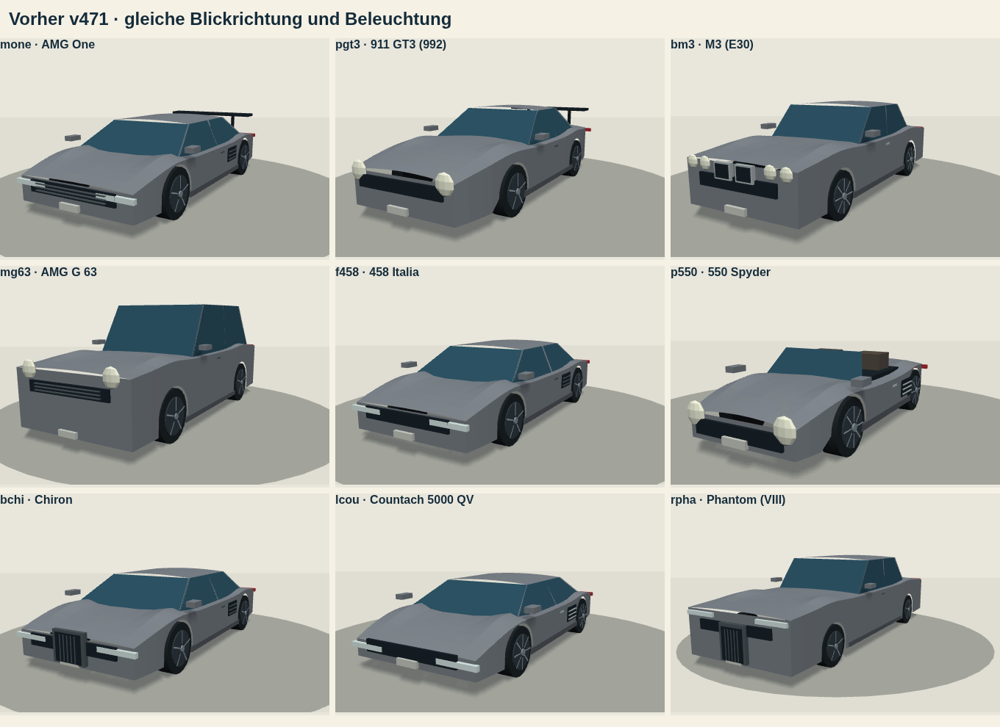
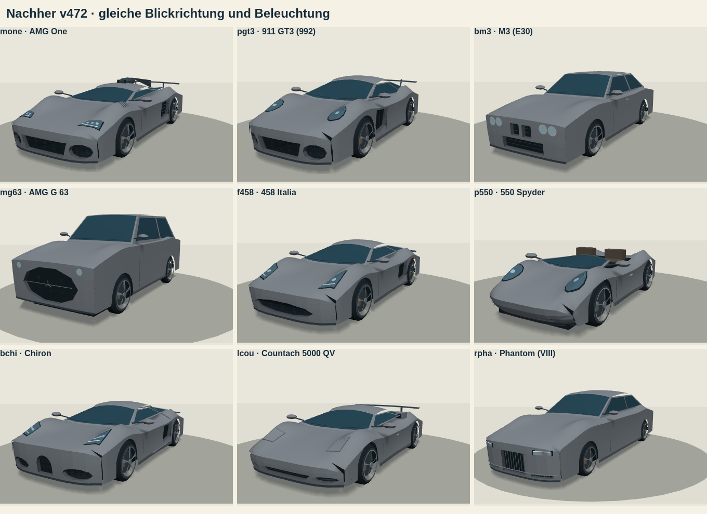
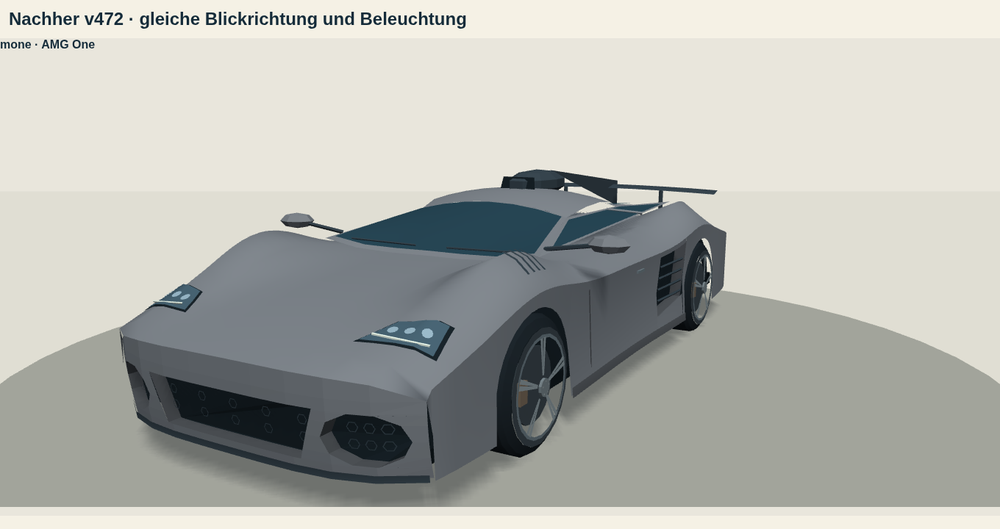
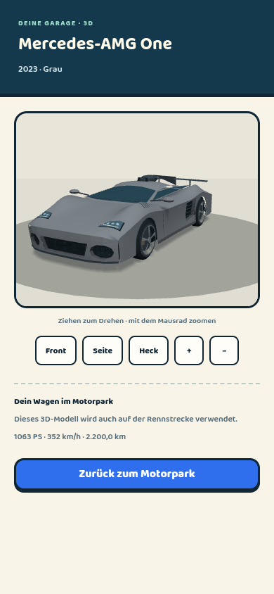

# Fahrzeugformen nach Bildvergleich · v472

Der AMG One im Screenshot hatte die Form eines kantigen Standardcoupés. Beim echten Auto sind die kleine gerundete Glaskanzel, stark gewölbte Vorderradkuppen, drei tiefe Frontöffnungen, die Dachansaugung samt Finne und die seitlichen Luftkanäle entscheidend. Bloß andere Leuchten auf derselben Kastenform reichten nicht.

## Bildreferenzen vor der Überarbeitung

Alle **127 fest zugeordneten Wikimedia-Modellbilder** aus `carphotos.js` wurden am **23.11.2026 erneut aus dem Internet heruntergeladen** und in elf beschrifteten Bildtafeln gesichtet. Es wurde weder nach einem beliebigen Titelbild gesucht noch ein fremdes Fahrzeug als Referenz zugeordnet. [Abrufprotokoll mit URL, Hash und Dateigröße](assets/fahrzeugformen-v472/referenzabrufe.json).

[Der Einzelvergleich für jedes der 127 Autos](FAHRZEUG-REFERENZEN-v472.md) nennt das Foto, Urheber/Lizenz und die sichtbaren Merkmale, die in die Formdaten eingeflossen sind. Die AMG-One-Referenz entspricht dem vom Nutzer gezeigten [Commons-Foto](https://commons.wikimedia.org/wiki/File:Mercedes-AMG_One_at_the_2022_Goodwood_Festival_of_Speed.jpg). Originalfotos und ihre Zuordnung im Auktionshaus bleiben unverändert.

Manche Fotos zeigen eine Heckansicht, eine offene/geschlossene Dachvariante oder optionales Aero-Zubehör. Nicht sichtbare Details sind dadurch nicht vollständig belegt. Die Modelle bleiben vereinfachte, prozedurale Low-Poly-Darstellungen, keine maßgenauen CAD-Rekonstruktionen. Gerundete Außenmaße dienen der Darstellung; technische Leistungswerte und Spielregeln wurden nicht neu recherchiert oder verändert.

## Was geändert wurde

| Bereich | Bisher | v472 |
| --- | --- | --- |
| Grundform | Breite flache Hauben und ähnliche kastenförmige Kabinen | Eigener Grundriss, Haubenverlauf, Radkuppen und Kabinenanteil für die jeweilige Bauform; getrennte lange GT-Hauben, Elfer-Dachbögen, schmale Mittelmotor-Kanzeln, Kombidächer und hohe SUV |
| Blech | Wenig ausgeprägte Übergänge | Gewölbte Schultern und weiche Oberflächennormalen; Radhausschalen schließen den Blick über den Reifen |
| Front | Aufgesetzte Streifen und pauschale Leuchten | Echte zurückliegende Öffnungen mit Innenwänden; Hufeisen, Nieren, hohe Kühler, schmale Altbaugrills und moderne Mehrfachöffnungen getrennt |
| Scheinwerfer | Gleiche helle Balken/Knöpfe | Explizite Wahl pro Modell: Rund-/Doppellinsen, alte Vieraugen-Fronten, Klappdeckel, schmale LED-Streifen und geformte Leuchtengehäuse; Gläser liegen auf der Karosseriefläche |
| Seiten | Aufgeklebte schwarze Rechtecke | Vertiefte Kanäle mit Laibung, zurückgesetzte Mittelmotor-Einlässe, Kiemen, Testarossa-Lamellen, R8-Seitenblades und Bugatti-C-Einfassungen |
| Kabine | Große flache Scheiben und Dachplatte | Gebogene Scheiben, gewölbtes Dach, schmale angeschlossene Rahmen; offene Sitzkabinen nach Formdaten |
| Aerodynamik | Ein hoher Querbalken für viele Autos | Kleine Hecklippen, Entenbürzel, Walflossen, integrierte Flügel und freistehende/aktive Flügel getrennt; Halter an der Karosserie |
| AMG One | Standardcoupé ohne typische Dachform | Kleinere Kanzel, Dachansaugung, Finne, Kotflügelentlüftungen, drei Frontkanäle, schmale Frontleuchten und angebundener Flügel |
| Räder / Spiegel | Einfache Zylinder und lose Blöcke | Runde Reifenschultern, offene Speichen/Felgenbetten, zurückliegende Bremsen und feststehende Sättel; Spiegel mit verbundenem Stiel |
| Klassiker | Normale Coupéform auch für Vorkriegswagen | Eigene schmale Haube, freistehende Leuchten, separate Kotflügel, Trittbretter und Drahtspeichenräder |

Die folgenden Übersichten verwenden dieselbe Blickrichtung, Beleuchtung und graue Lackfarbe. Der Ausschnitt wird jeweils am ganzen Modell eingepasst. Für „Vorher“ wird ausschließlich das vorherige `carmodels.js` aus Commit `e327a26` geladen; es ist kein nachgebautes Vergleichsbild.







## Alle Autos und alle bisherigen Systeme

`carforms.js` enthält für jede Katalog-ID ausdrücklich Bauform, Leuchten, Grill, Spoiler und Sondermerkmale. `carmodels.js` baut daraus die Geometrie. Das detaillierte Gallardo-Netz aus v470 bleibt erhalten und wurde erneut geprüft. Gemeinsam nutzen alle Autos die zurückhaltenderen Vorschau-Schatten, damit Blechübergänge nicht als schwarze Risse erscheinen.

Die Quelle für Auktionsvorschau, Garage und Rennen bleibt dieselbe. Die Prüfung vergleicht die tatsächlichen Vertexdaten von Garage und Rennszene. Es gibt keine neuen Spielstandfelder und keine Änderung von Kaufpreisen, Geboten, Leistung, Beschleunigung, Driftwerten, Nitro, Prämien oder Verschleiß. Die modellbezogenen Radstände kommen weiter aus den bestehenden Technikprofilen. Der automatische Bildausschnitt, Touchbedienung und das Freigeben der Vorschau-Ressourcen bleiben erhalten.

Alle vollständigen Modelle bleiben **unter 6.000 Dreiecken**, Maximum **5.657**. Das ist ein Geometriebudget, kein gemessener Handy-FPS-Wert. Der Modellaufbau findet beim Szenenaufbau statt, nicht in jedem Fahrbild; die Vorschau zeichnet weiter nur bei Eingabe/Größenänderung.



Weitere Ansichten: [Seite](assets/fahrzeugformen-v472/amg-one-side-390.png), [Heck](assets/fahrzeugformen-v472/amg-one-rear-390.png), [Auktionsdialog](assets/fahrzeugformen-v472/auktion-amg-one.png).

## Prüfung und Grenzen

- `node fahrzeugformen-v472.test.js`: 127 Referenzabrufe und 127 eindeutige Modellnetze; gültige Koordinaten/Normalen, Bodenkontakt, Radstand, Lack, Geometriebudget und unveränderte Katalogdaten. Zusätzlich echte Frontvertiefung, geschlossene Stoßfängeroberkante, kleinere AMG-One-Kabine/Dachansaugung und offene Felgenspeichen geometrisch geprüft.
- `node fahrzeugformen-v472.browser.js`: alle 127 Autos tatsächlich in Chromium/WebGL gezeichnet, elf Modelltafeln gesichtet; keine verlorenen Kontexte oder WebGL-Fehler. AMG One in zwölf Ansichten bei **320 × 568, 390 × 844 und 980 × 820 CSS-Pixeln**, vollständig im Bild und ohne horizontalen Überlauf. Echte Touchdrehung, Zoom, Auktionsdialog/Modellwechsel, Ressourcenfreigabe und identische Vertexdaten von Garage/Fahrt geprüft. Betrachten verändert Geld, Kleeblätter und Garage nicht. [Renderprotokoll](assets/fahrzeugformen-v472/all-webgl.json), [UI-Messwerte](assets/fahrzeugformen-v472/ui-pruefung.json).
- Bestehende Prüfungen: `auktionsautos-v471.test.js`, `gallardo-form-v470.test.js`, `gallardo-umbau-v467.test.js`, `autorennbahn-v461.test.js` und `gallardo-umbau-v467.browser.js` einschließlich vollständiger Fahrt, Umbau/Rückrollen bei Speicherfehler, Monatslimit und Neuladen.
- Syntax, Cacheversionen und Ladereihenfolge geprüft. **Chromium mit Software-WebGL/SwiftShader; kein echtes iPhone/Safari, keine Handy-Bildratenmessung.**

### Modelltafeln

| Katalogbereich | Nachher-Ansichten |
| --- | --- |
| 1–12 · frühe Porsche und Sportwagen | [Tafel 1](assets/fahrzeugformen-v472/models-0.png) |
| 13–24 · Porsche und Audi | [Tafel 2](assets/fahrzeugformen-v472/models-1.png) |
| 25–36 · Mercedes und Klassiker | [Tafel 3](assets/fahrzeugformen-v472/models-2.png) |
| 37–48 · BMW und frühe Ferrari | [Tafel 4](assets/fahrzeugformen-v472/models-3.png) |
| 49–60 · Ferrari | [Tafel 5](assets/fahrzeugformen-v472/models-4.png) |
| 61–72 · Bugatti und Miura | [Tafel 6](assets/fahrzeugformen-v472/models-5.png) |
| 73–84 · Lamborghini | [Tafel 7](assets/fahrzeugformen-v472/models-6.png) |
| 85–96 · Aston Martin und McLaren | [Tafel 8](assets/fahrzeugformen-v472/models-7.png) |
| 97–108 · McLaren, Luxuswagen, Maserati | [Tafel 9](assets/fahrzeugformen-v472/models-8.png) |
| 109–120 · Maserati, Jaguar, Pagani, Koenigsegg | [Tafel 10](assets/fahrzeugformen-v472/models-9.png) |
| 121–127 · Lotus und Ford | [Tafel 11](assets/fahrzeugformen-v472/models-10.png) |

Bilder erneut erzeugen, mit lokalem Server auf Port 8020:

```sh
node fahrzeugformen-v472.browser.js
node fahrzeugvergleich-v472.browser.js
git show e327a26:carmodels.js > /tmp/carmodels-v471.js
BASELINE_MODEL=/tmp/carmodels-v471.js node fahrzeugvergleich-v472.browser.js
CAR_IDS=mone OUT=amg-one-detail node fahrzeugvergleich-v472.browser.js
```

`LOGISTIKA_TEST_URL` und `LOGISTIKA_ARTIFACT_DIR` sind optional. Die Quellenliste in `FAHRZEUG-REFERENZEN-v472.md` und das Abrufprotokoll dokumentieren den Bildvergleich; die Originalfotos werden nicht neu in diesem PR ausgeliefert.
