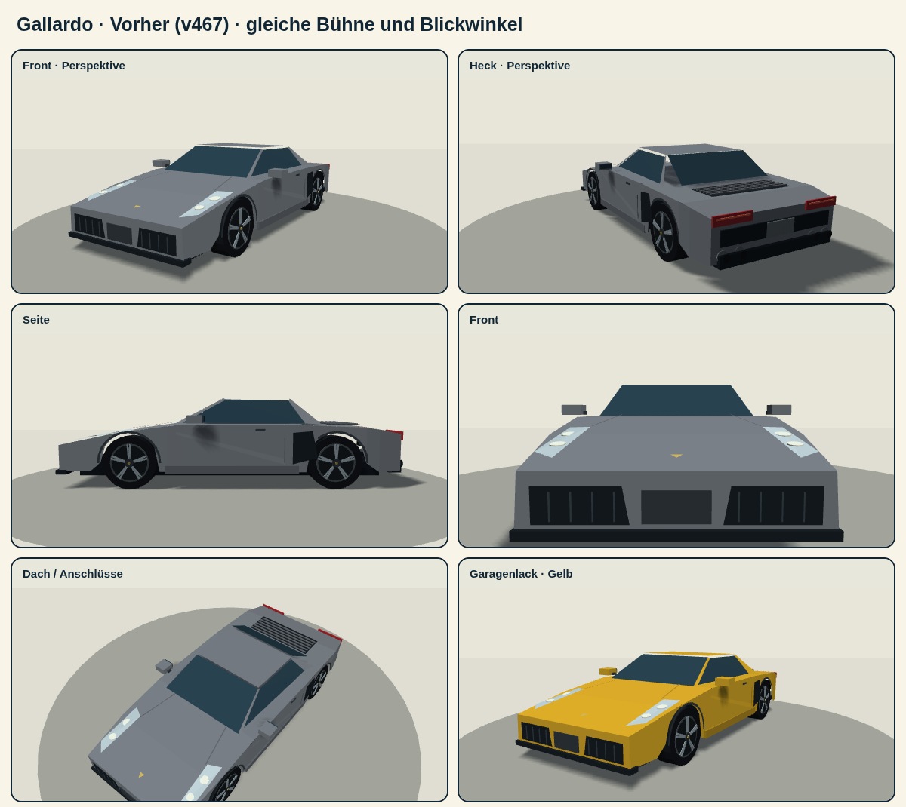
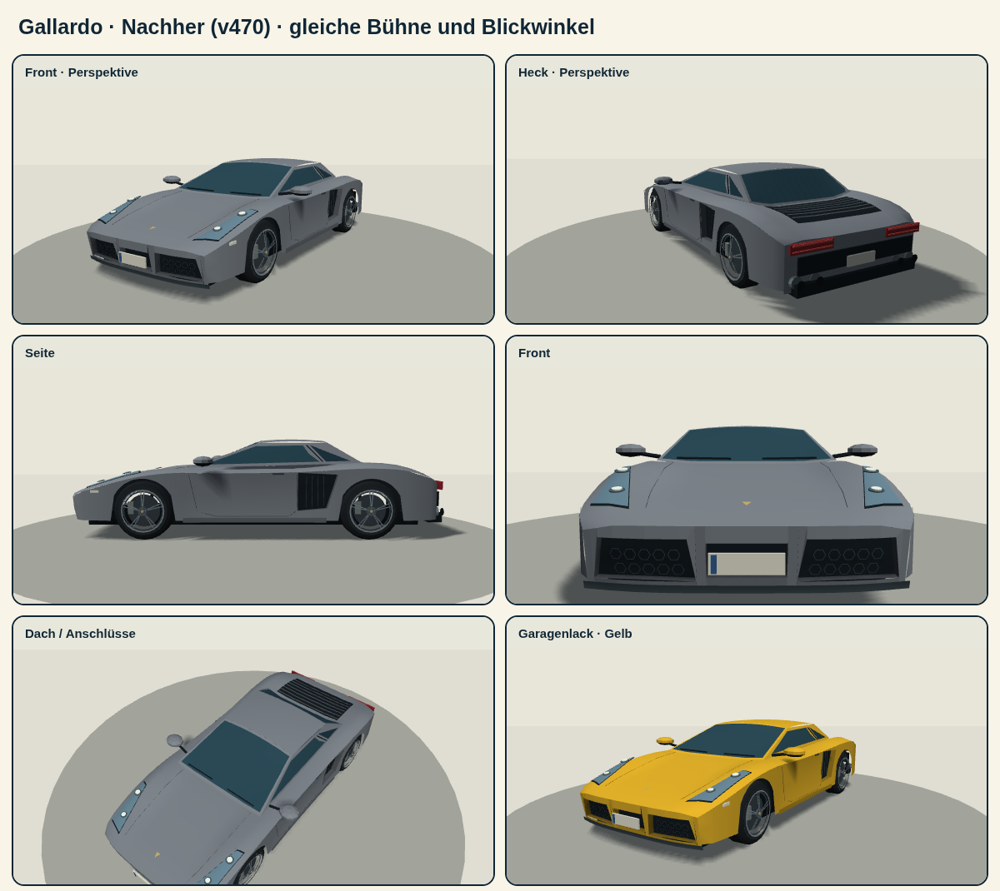
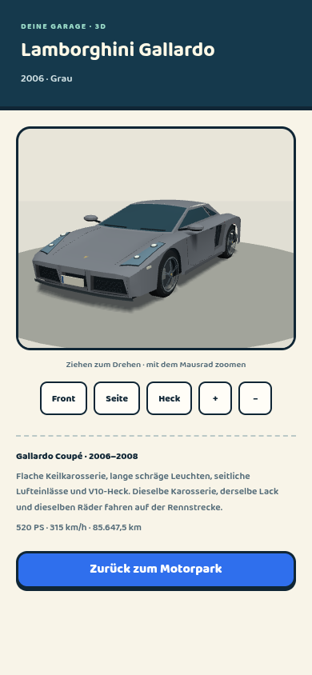

# Gallardo: Form und Details · v470

Der Vergleich betrifft das beigefügte Superleggera-Foto und den grauen Garagen-Gallardo. Das bisherige Modell traf die Grundform, wirkte durch die flachen Bleche, geraden Stoßfänger, blockigen Spiegel und einfachen Gitter aber zu kastenförmig. Als zweite Modellreferenz dient das vorhandene [Garagenfoto des 2006er Gallardo](https://commons.wikimedia.org/wiki/File:2006_Lamborghini_Gallardo.jpg), lokal `cars/photos/lgal.jpg`. Der Katalogeintrag beschreibt weiterhin das frühe **Gallardo-Coupé von 2006–2008 mit 520 PS**. Superleggera-Schriftzug, Sondermodellflügel oder geänderte Leistungsdaten werden nicht auf diesen Eintrag übertragen.

## Vergleich und Umsetzung

| Bereich | Bisherige Darstellung | Verfeinerung |
| --- | --- | --- |
| Silhouette / Bleche | Gerade Platten und harte Kastenübergänge | Interpolierte Längskontur, gewölbte Kotflügelschultern, eingezogene Türflächen und schmaler Seitenschweller; weiche Blech-Normalen nur am Gallardo |
| Front | Senkrechte Fläche und Gitterstäbe | Zurückgezogener unterer Stoßfänger, abgeschrägte Ecken, drei echte Vertiefungen mit geschlossenen Laibungen; seitliche Wabengitter |
| Leuchten | Helle flache Dreiecke | Dunklere eingefasste Gläser entlang der Kotflügelfläche, zwei Projektorlinsen und seitliche Positionsleuchten |
| Kabine | Eckiges Dach und einfach aufgesetzte Scheiben | Leicht gewölbtes geschlossenes Dach, gemeinsame Dach-/Scheibenkontur, klare A-/B-Säulen, hintere Dreiecksfenster und Scheibenwischer |
| Flanke | Aufgesetzter schwarzer Fleck | Freie Ansaugöffnung mit 7,5 cm zurückliegendem Grund und eingefasstem Kanal; feine Türfugen und Griffe |
| Spiegel / Radkästen | Klötze und heller Durchblick über den Reifen | Geformte Spiegel auf schmalem Stiel, Spiegelflächen und dunkle Radhausschalen |
| Räder | Einfache Reifen und Speichen | Abgerundete Reifenschulter, Felgenbett, zehn schmale Speichen in fünf Paaren, zurückliegende Bremsscheibe, Nabe/Schrauben; Bremssättel bleiben fest am Auto |
| Heck | Einfache Platte | An die hinteren Schultern angeschlossen, flache Rückleuchten, Motorraumlamellen und vier getrennte Endrohre erhalten/verfeinert |
| Vorschau | Hoher Blickwinkel, überhellte Bühne, fleckige Türschatten | Niedrigerer Blick, neutralere Beleuchtung, engerer Schattenbereich und Einpassung nach echten Modellpunkten statt festem Kameraabstand |

Die folgenden Übersichten verwenden **dieselben sechs Kameras, dieselbe Beleuchtung und dieselben Lackwerte**. Nur die Modellgeometrie wird für „Vorher“ aus dem Stand vor v470 geladen; der sechste Blickwinkel zeigt gelben Garagenlack.





## Gemeinsames Modell und Budget

`RACECARS.body/wheel/rig` bleiben die gemeinsame Quelle für Garage und Rennen. Es gibt kein zusätzliches detailliertes Modell nur für Screenshots. Die Vorschau zeichnet nur bei Eingabe, Größenänderung oder Wiederherstellung des WebGL-Kontexts; beim Schließen werden Listener und GPU-Ressourcen freigegeben. Die automatische Einpassung berechnet den Abstand aus den projizierten Modellpunkten einschließlich Rädern, mit Randreserve; sie verändert weder Modellmaßstab noch Fahrdaten. Der manuelle Zoom bleibt verfügbar.

| Netz | v467 | v470 |
| --- | ---: | ---: |
| Karosserie / Details | 1.339 | 3.465 |
| Ein Rad | 440 | 548 |
| Auto mit vier Rädern | 3.099 | 5.657 |

Das vollständige Auto bleibt unter 6.000 Dreiecken. Radstand **2,56 m**, Rig-Länge **4,30 m**, Dachhöhe **1,165 m**, Radmittelpunkte/-radius und Auspuff-Anschlusspunkte bleiben gleich. Die anderen 126 Autos nutzen weiterhin ihre vorhandenen Modellfamilien. Es gibt keine Änderungen an Fahrphysik, Garagenlack, Preisen, Renngewinnen, Strecken oder Spielständen. Gesamt-/SW470; ausschließlich `racecars.js` und `racecarview.js` erhalten Asset470. Die Zieleffekte und die Auslauf-Steuerung aus v469 bleiben enthalten.



Weitere Ansichten: [320 px](assets/gallardo-form-v470/gallardo-initial-320.png), [Seite](assets/gallardo-form-v470/gallardo-side-390.png), [Heck](assets/gallardo-form-v470/gallardo-rear-390.png), [dasselbe Auto während der Fahrt](assets/gallardo-form-v470/gallardo-fahrt-390.png).

## Geprüft

- `node gallardo-form-v470.test.js`: acht Gruppen; endliche, flächige Dreiecke und normierte Normalen, Budget, Maße/Bodenkontakt, durchgehendes gewölbtes Dach, erhöhte Kotflügel, tatsächliche Front-/Seitenvertiefungen, dunkle Radhausschalen, offene Speichen und zurückliegende Bremsscheibe, deterministische Lackvarianten einschließlich Schwarz, unveränderte andere Modellwege/Katalogdaten.
- `node gallardo-umbau-v467.test.js`: zehn Gruppen einschließlich aller drei Strecken, vollständiger KI-/freier Fahrten, Umbauzahlungen und Rückrollen bei Speicherfehler. Die bisherigen Budgetprüfungen berücksichtigen das neue begrenzte Detailnetz; die Limits anderer Modelle bleiben gleich.
- `node autorennbahn-v461.test.js`: zwölf Gruppen und alle 127 Automodelle.
- `node gallardo-form-v470.browser.js`: tatsächliche Garagenansicht bei **320 × 568, 390 × 844 und 980 × 820 CSS-Pixeln**. Zwölf Ansichten (Start, Front, Seite, Heck) ohne abgeschnittene Modellpunkte oder horizontalen Überlauf; echte Touchdrehung, Zoomknöpfe, keine Buchungen beim Betrachten, freigegebener Dialog, sechs zusätzliche Vergleichsansichten. [Messwerte](assets/gallardo-form-v470/pruefung-v470.json).
- `node gallardo-umbau-v467.browser.js`: Modellgleichheit zwischen Vorschau und Fahrt bis auf die Vertexdaten, grauer/schwarzer Garagenlack, Kontextfreigabe, tatsächliche Fahrt, Umbau-/Speicherfehler, Monatslimit und Neuladen bestanden. Keine JavaScript-Seitenfehler.
- Syntax der geänderten Laufzeitskripte, Cacheversionen/Ladereihenfolge und `git diff --check` geprüft.

Browser: Chromium mit Software-WebGL/SwiftShader auf dem lokalen Server. **Kein echtes iPhone/Safari und keine Handy-Bildratenmessung.** Die Darstellung bleibt ein stilisiertes Low-Poly-Modell.

Für reproduzierbare Vorher-/Nachher-Bilder optional vor dem Browserlauf:

```sh
git show e02d24d:racecars.js > /tmp/racecars-v467.js
LOGISTIKA_BASELINE_MODEL=/tmp/racecars-v467.js node gallardo-form-v470.browser.js
```

Standard-URL `http://127.0.0.1:8020`; mit `LOGISTIKA_TEST_URL` überschreibbar. Bilder und Messwerte landen standardmäßig unter `/tmp/logistika-v470`.
