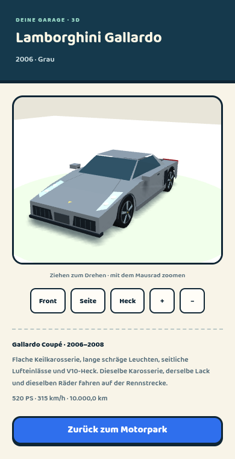
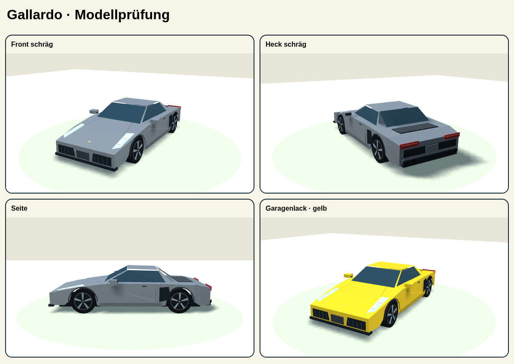
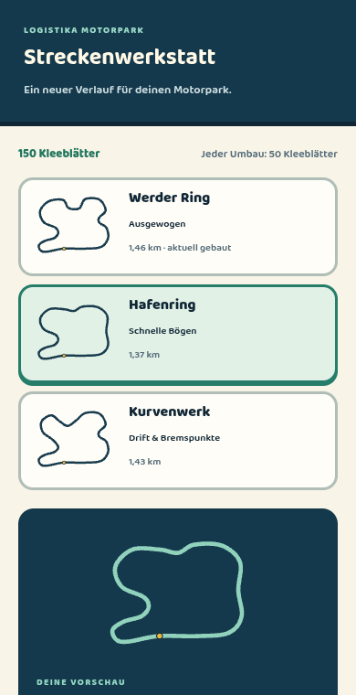
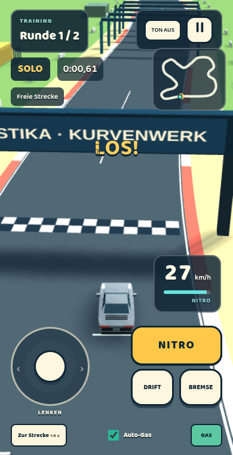

# Gallardo und Streckenwerkstatt · v467

Im Motorpark das eigene Garagenauto auswählen und **Auto in 3D ansehen** öffnen. Das Modell lässt sich mit Finger oder Maus drehen; Front, Seite, Heck und Zoom sind direkt erreichbar. Der Lamborghini Gallardo hat als erstes Fahrzeug eine eigene Karosserie und eigene Räder. Dasselbe Modell mit demselben Garagenlack wird anschließend gefahren.

## Modell

Der vorhandene Katalogeintrag `lgal` beschreibt den Gallardo von 2006–2008. Referenz war das bereits lizenzierte Garagenfoto `cars/photos/lgal.jpg`: [2006 Lamborghini Gallardo, Calreyn88, CC BY-SA 4.0](https://commons.wikimedia.org/wiki/File:2006_Lamborghini_Gallardo.jpg). Das Foto wird weder geändert noch neu ausgeliefert.

Die flache Keilkarosserie besitzt lange schräge Scheinwerfer, tief liegende Frontöffnungen, eine niedrige Kabine, seitliche Einlässe hinter den Türen, Motorraumlamellen, horizontale Heckleuchten und vier Endrohre. Radkästen sind echte Öffnungen; die fünf Doppelspeichen je Rad bilden keine gefüllten Scheiben. Fahrzeuglänge 4,30 m, Dachhöhe 1,165 m, Radstand 2,56 m. Die Karosserie hat 1.339 Dreiecke, das vollständige Auto mit vier Rädern 3.099. Leistung/Beschleunigung/Endgeschwindigkeit kommen weiter unverändert aus dem Katalog.

`racecars.js` liefert Karosserie, Räder und Einbaupunkte. `racecarview.js` zeichnet daraus die drehbare Ansicht und gibt beim Verlassen Listener, GPU-Netze und Kontext frei. Es gibt keine dauernde Animationsschleife für die Vorschau. Auch schwarzer Garagenlack bleibt schwarz. Die anderen 126 Katalogmodelle verwenden weiterhin ihre bisherigen vereinfachten Modellfamilien.





## Strecke umbauen

**Strecke umbauen · 50 Kleeblätter** öffnet die Werkstatt. Drei Verläufe stehen zur Auswahl:

| Kurs | Länge | Charakter |
| --- | ---: | --- |
| Werder Ring | 1.462 m | Bisherige Mischung aus Gerade, Bögen und S-Kurven |
| Hafenring | 1.368 m | Flüssigere Bögen und längere Vollgasabschnitte |
| Kurvenwerk | 1.435 m | Mehr Richtungswechsel und andere Bremspunkte |

Die Auswahl zeigt den tatsächlichen Verlauf kostenlos. Erst **Für 50 Kleeblätter umbauen** bezahlt und ändert den Kurs. Jeder Wechsel, auch zurück zum ursprünglichen Kurs, kostet genau 50. Der bereits gebaute Kurs lässt sich nicht erneut kaufen; während einer Fahrt und bei unzureichendem Guthaben ist der Umbau gesperrt. Die Inselminiatur wird am bestehenden Gebäude ausgetauscht. Das Grundstück bleibt 26 × 22 Kacheln groß; es werden keine weiteren Bäume entfernt.

Kurse besitzen eigene Geometrie, Längen, Projektionen und Kontrollpunkte. Startgerade und Boxenanlagen bleiben am gemeinsamen Platz. Vorschauen verändern den aktiven Fahrkurs nicht. Die vorhandenen Fahrregeln gelten weiter: zwei Runden, zwölf Kontrollpunkte je Runde, Drifts, Nitro und fünf Gegner im Monatsrennen.





## Spielstand und laufende Systeme

- `S.farm.race.layout`: gewählter Verlauf. Fehlt er im alten Stand, gilt Werder.
- `lastBuild`: letzter bestätigter Wechsel mit Herkunft, Ziel, Spielzeit und Kosten.
- `bests`: Bestzeiten pro Kurs. Das alte `best` bleibt die Werder-Bestzeit, andere Strecken überschreiben sie nicht.
- Monatsreservierung und aktive Fahrt speichern den Kurs. Ein Umbau setzt den Monatsstart nicht zurück.

Kleeblätter und Verlauf werden zusammen gespeichert und bei einem Speicherfehler vollständig zurückgerollt. Die Kilometer-, Verschleiß- und Preisgeldtransaktionen aus v461 bleiben bestehen. Der Hof ist während des Motorparkbesuchs absichtlich pausiert; sein Hängerwächter darf diese Pause nicht als Absturz behandeln. Das wurde auch mit einem veralteten Hof-Zeitstempel über mehr als zehn Sekunden geprüft.

## Prüfung

Aus dem Repository:

```sh
node gallardo-umbau-v467.test.js
node autorennbahn-v461.test.js
node placement-v347.test.js
node worker-motion-v351.test.js
node gebirge-v429.test.js
```

Browser: lokalen Server starten, dann:

```sh
LOGISTIKA_TEST_URL=http://127.0.0.1:8020 node gallardo-umbau-v467.browser.js
LOGISTIKA_TEST_URL=http://127.0.0.1:8020 node autorennbahn-v461.browser.js
```

Neue Unit-Prüfung: zehn Gruppen, Modellmaße/Bodenkontakt/Lack, feste Grundstücksgrenzen, Geometriebudget, Streckenprojektion, keine sich überlagernden Fahrbahnen, keine umgedrehten Randstreifen. Jede Strecke mit Gallardo und 75-PS-Klassiker per KI vollständig gefahren; zusätzlich je ein kompletter Zwei-Runden-Lauf mit freier Fahrphysik (Werder 167,39 s, Hafen 134,78 s, Kurvenwerk 159,53 s im automatisierten Prüfablauf). Zahlungsprüfungen für fehlende Kleeblätter, Speicherfehler, Doppelkauf, laufenden Start und kostenpflichtigen Rückbau.

Neue Browserprüfung: echte Touchdrehung, Modellgleichheit zwischen Vorschau und Rennen bis auf Vertexdaten, Freigabe des Vorschaukontexts, Vorschau ohne Buchung, bestehende Miniatur nach Umbau geändert, Speicherfehler ohne Abbuchung, Fahrt auf dem neuen Kurs einschließlich aller 25 Ziel-/Rundenmarkierungen, getrennte Bestzeit, Monatslimit trotz Umbau und Erhalt nach Neuladen. Werkstatt ohne horizontalen Überlauf bei 320, 390 und 980 Pixeln. Keine JavaScript-Seitenfehler. Bestehende Rennprüfungen mit zwölf Unit- und acht Browsergruppen ebenfalls bestanden.

Weitere bestandene Regressionen: Platzierung347 (7 Gruppen), Arbeiterbewegung351 (17 Gruppen) sowie Gebirge429 einschließlich Tierbewegung446. Syntax, Cacheversionen und Ladereihenfolge kontrolliert.

Chromium mit Software-WebGL/SwiftShader; keine Messung der Bildrate auf einem echten Handy. **Echtes iPhone/Safari nicht geprüft.**
