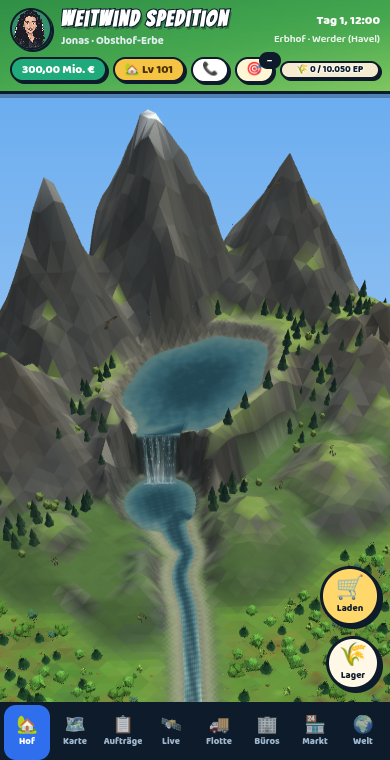
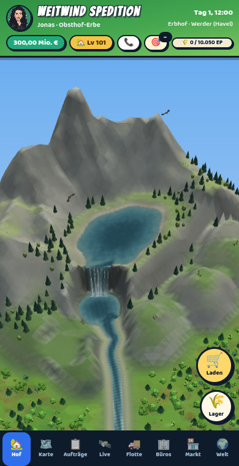
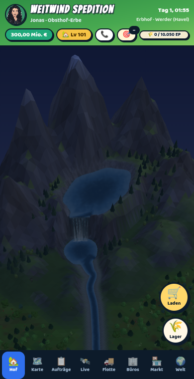
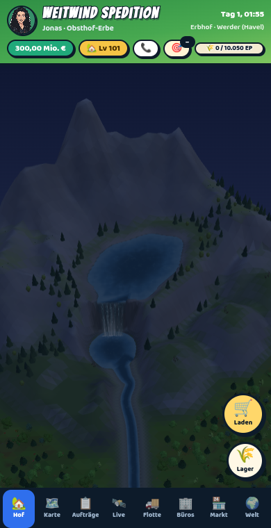
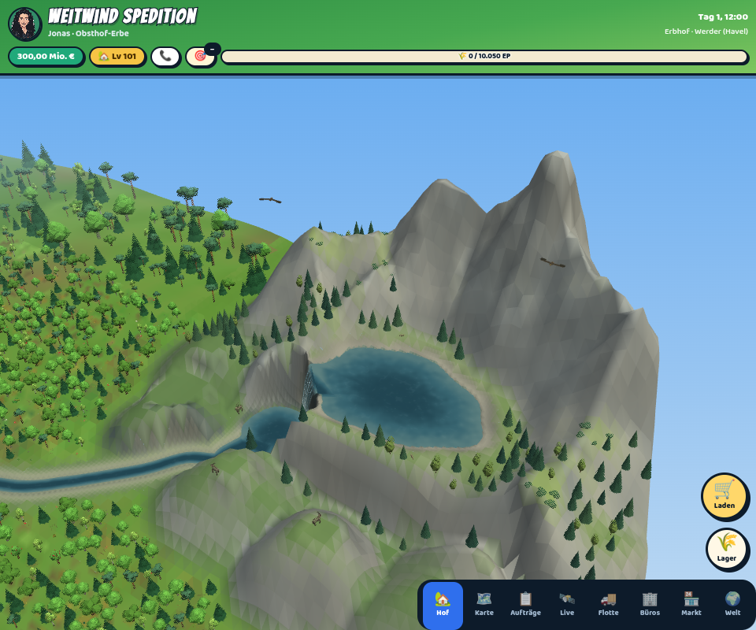
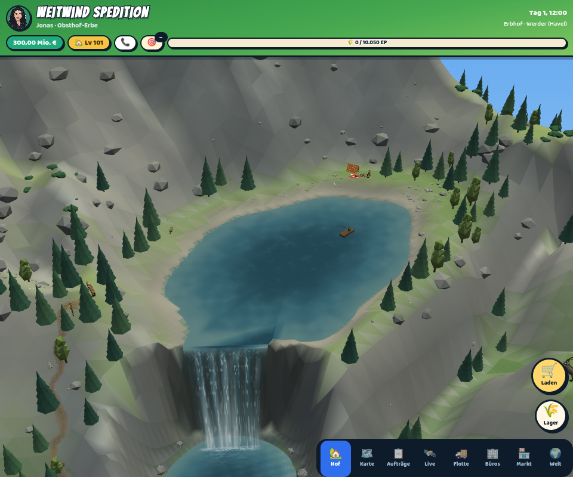
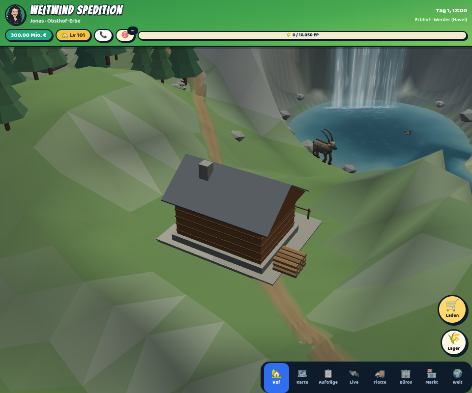

# Gebirgsüberarbeitung v413

Basis: main `21c3bf8` mit der bereits gemergten Almhütte und dem Trampelpfad aus PR125/v411. Stand: 18.11.2026.

[Interaktiver Vorher-Nachher-Vergleich: Tag, Nacht, Seitenansicht](GEBIRGE-v413-VORSCHAU.html) – eine eigenständige HTML-Datei ohne externe Ressourcen.

Die bisherige Landschaft bestand optisch aus hohen Einzelkegeln mit einem fast umlaufenden steilen Seerand. Starke Farbwechsel je Dreieck betonten das regelmäßige Raster. Das wirkte besonders nachts wie eine Gruppe dunkler Nadeln.

Der neue Hauptkamm liegt weiter hinter dem See. Verbundene Grate, kleinere Schultern und zum Kar auslaufende Felsrippen gliedern ihn; der höchste Gipfel bleibt deutlich erkennbar. Das Gipfelkreuz sitzt auf dem verlegten Hauptgipfel. Die Vorberge tragen weiterhin die Steinböcke. Die Form bleibt im vorhandenen Low-Poly-Stil modelliert.

Ein breiterer Moränenrücken trägt den See. Das Kiesufer steigt nur niedrig an und geht in die Hänge über, statt einen hohen Ringwall zu bilden. Die Wasserfläche überlappt weiterhin das Ufer; der vorhandene freie Wasserfall und der Fluss behalten ihre Geometrie, Farbe und Animation. Die Übergänge wurden an den tatsächlich gezeichneten Dreiecken geprüft.

Kühlgrauer und leicht warmer Kalkstein, zurückhaltende Schichtbänder und wenige Firnfelder unterscheiden die Hochlagen. Kontrast und Farbwechsel je Dreieck sind reduziert. Waldgruppen und Lichtungen sitzen unter einer unregelmäßigen Baumgrenze; die hohen Felslagen bleiben kahl. Es gibt keine zusätzliche Emission für die Nacht: die normale Spielbeleuchtung bleibt maßgeblich.

| Bisher | Überarbeitet |
| --- | --- |
|  |  |
|  |  |

## Leistung und Prüfung

Das Geländenetz bleibt fest und wird beim Zoomen wiederverwendet. Der Höhenaufbau sucht das Flussprofil nur einmal je Probe; im Kerngebirge entfällt die unnötige Flusssuche für die Sperrflächenprüfung. Die Grundform wird unter dem See nicht berechnet, da sie dort ohnehin vom Seegrund ersetzt wird. Das sind rechnerisch identische Vereinfachungen der Abfragen.

| Messgröße | main411 | v413 |
| --- | ---: | ---: |
| Gelände | 9.918 Dreiecke | 9.918 Dreiecke |
| Gesamte zusätzliche Gebirgs-Fernlast | 15.311 Dreiecke | 15.431 Dreiecke |
| Gebirgs-Drawcalls in der Ferne | 12 | 12 |
| Bäume/Sträucher | 143 | 140 |
| Erster Gebirgsaufbau im Vergleichslauf | 993 ms | 759 ms |

Der Aufbauwert stammt aus einzelnen lokalen Chromium-/SwiftShader-Läufen und schwankt mit der Umgebung. Er ist keine Aussage über Geräte-FPS. Die Fernlast steigt um 120 Dreiecke, also rund 0,8 Prozent; sie bleibt unter der bisherigen Grenze von 16.000. Es gibt keine neuen Texturen, externen Modelle oder Meshes im Renderloop. Messwerte: [JSON](assets/v413/messwerte.json).

- `node gebirge-v413.test.js`: zwölf zusammenhängende Kammabschnitte, Gipfelkreuz am höchsten Rücken, trockener Wanderweg, ebene Hüttenterrasse (Höhenstreuung etwa 0,0022), äußerer Wasserrand mit Rastertoleranz, kahle Hochlagen und feste Grafikbudgets. 240 Zoomwechsel ohne neue Meshes oder Spielstandänderung.
- `node wasseroptik-v386.test.js`: durchgehender Fluss an 45 Querschnitten, See/Kolk über dem Grund, genaue Wasseranschlüsse und Inselkante, Fallkurve, Gischt im Becken. 1.800 Tierschritte mit verbundenen Beinen und Hufkontakt; 200 Zoomwechsel ohne Ressourcenwachstum. Die vorhandene erhaltende Baummigration besteht weiterhin; keine neue Migration.
- `node gebirge-v413.browser.js`: vollständiger Hof in Chromium mit Touch-Viewport 390×760 und 960×800. Tag, Nacht, Seite, Seeufer, Hütte und Insel; 24 Wechsel zwischen Nahsicht und maximalem Abstand. Keine neuen GPU-Meshes/Knoten, kein Kontextverlust oder JavaScriptfehler; Fernschatten aus, Tiere bewegen sich. Bäume, Gebäude und Geld bleiben erhalten. Für den Vorher-Lauf wurde ausschließlich `alpine.js` aus main411 in die identische Szene eingesetzt.
- Syntax und `git diff --check` bestanden.

Nicht auf einem echten iPhone/Safari oder einer schwachen Handy-GPU getestet. Der Vergleich und feste Ressourcenrahmen ersetzen keine Bildratenmessung auf realen Geräten.

