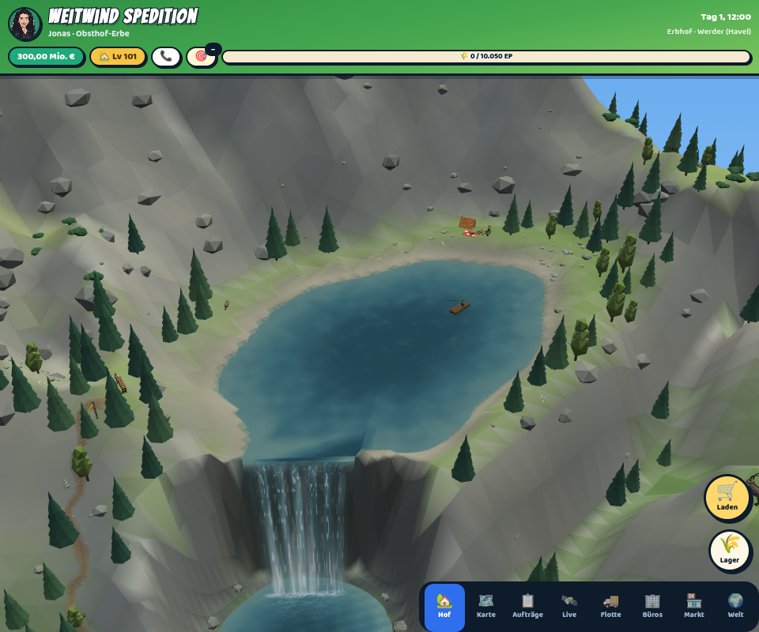
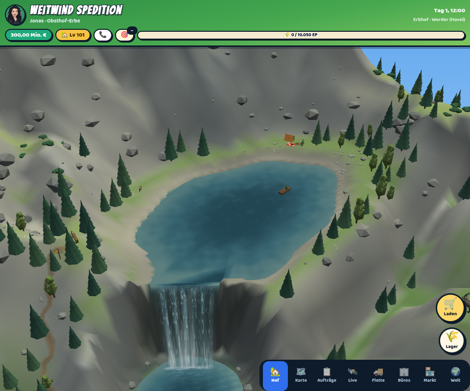
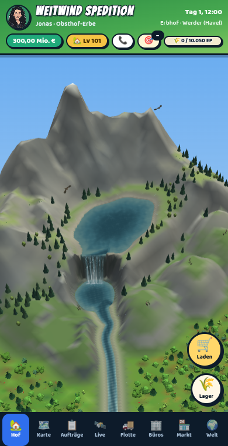

# v428 – Ruhige Bergoberfläche und feste Kamerahöhe

Die automatische Höhenanpassung in `ALPINE.step` ist entfernt. Das Gebirge setzt weder die Blickpunkthöhe noch eine zusätzliche Mindesthöhe beim Schwenken. Die vom Benutzer beziehungsweise der übrigen Kamerasteuerung gesetzte Höhe bleibt erhalten.

Das sichtbare Rauten-/Dreiecksmuster entstand durch pro Dreieck gemittelte Farben, zusätzliche Farbvariation je Facette und die Beimischung unterschiedlicher Flächennormalen. Das Gelände nutzt jetzt durchgehend die gemeinsamen Farben und Normalen seiner Eckpunkte. Großflächigere Farbvariation ersetzt die kleinteilige Schuttfarbe. Höhenfeld, Raster, Geländeform, Ufer, Wanderwege, Ausstattung und Wassergeometrie bleiben erhalten. Keine zusätzlichen Dreiecke oder Bibliotheken.

| Vorher | Verfeinert |
| --- | --- |
|  |  |

Prüfungen:
- `node gebirge-v428.test.js`: 270 Kameraschwenks bei drei vorgegebenen Blickpunkthöhen ohne Höhenänderung; gemeinsame Eckpunkte ohne Farb-/Normalensprünge, interpolierte Farben, exakt 9.918 Geländedreiecke.
- `node gebirge-v413.test.js` und `node wasseroptik-v386.test.js`: Kämme, Hüttenstand, trockener Wanderweg, Ufer/Wasseranschlüsse, 1.800 Tierschritte und insgesamt 440 rechnerische Zoomwechsel bestanden.
- Vollständiger Hof in Chromium/SwiftShader: Tag/Nacht, Kamm, Seeufer, Hütte, Mobilformat und Inselübersicht; 24 WebGL-Zoomwechsel ohne neue Meshes/Knoten oder Kontextverlust, bewegte Tiere, unveränderte Spielstanddaten, keine JavaScriptfehler. Fernlast weiterhin 15.431 Dreiecke. [Messwerte](assets/v428/messwerte.json).
- Kein Test auf einem echten Handy/iPhone/Safari und keine Geräte-FPS-Messung.

Gesamt-/SW428, alpine428. Übrige Assetstände aus main9cd4575 erhalten. Kein automatisches Merge/Deployment.
