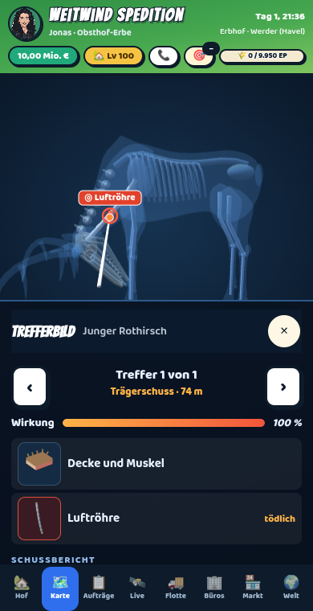
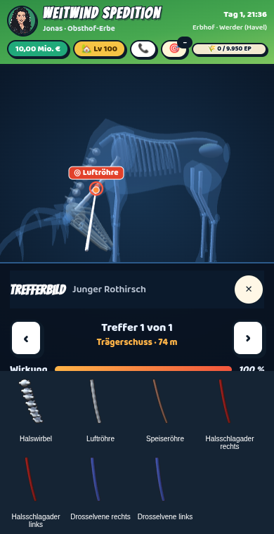
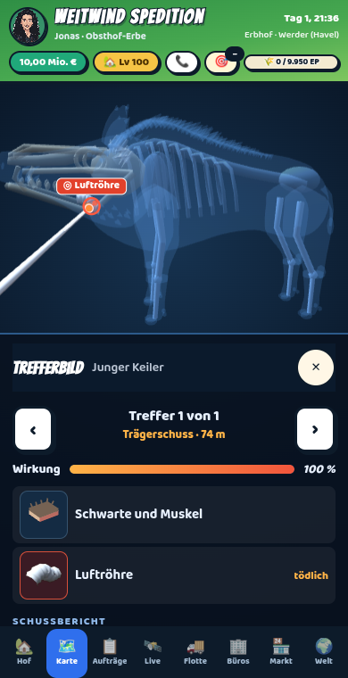

# v442 – Halsorgane und ihre Vorschauen

Die auf dem Screenshot sichtbaren Überlagerungen hatten zwei Ursachen: Die Halsorgane wurden nach Trefferhäufigkeit stark aufgeweitet; beim Keiler wurde der Halsweg sogar über einen negativen Parameter in den Rumpf verlängert. Dazu kam eine separate schematische Verbindung zu einem Lungenlappen. Beim Drehen/Äsen rotierte dadurch Halsgewebe in die Brustorgane.

## Korrektur

- Die mitrotierenden Halsabschnitte beginnen am Brusteingang entlang der bestehenden Hautachse. Haut, Gelenke und gesamte Hals-Trefferzone bleiben erhalten.
- Speiseröhre dorsal zur Luftröhre und am Ansatz mittig zwischen den Lungenflügeln, geringere Radien; seitliche Halsschlagadern/Drosselvenen wieder proportional. Der falsche zusätzliche Trachea-Lungensteg entfällt. Der bereits vorhandene mediale Bronchialbaum bleibt erhalten.
- Halswirbel als gegliederte Körper mit Quer- und Dornfortsätzen statt Wellenröhre. Weiterhin vereinfachte Spielmodelle: sieben Halswirbelglieder beim Schalenwild, stilisierte Gliederung beim Fasan.
- Alle Halsorgan-Bildchen verwenden die Körpernetze, nur zentriert/skaliert. Keine abweichenden Y-Arterien oder abstrakten Wirbel-SVGs mehr. Ein zusätzlich gefundener Fehler im Maßstab der bisherigen Körperorgan-Bildchen ist korrigiert: `MB.merge` berücksichtigt den `at`-Transformationsstapel nicht und benötigt die Skalierung direkt.
- Zeichnung und Strahlprüfung verwenden dieselben gecachten Halsnetze. Neue Kontakte können durch die korrigierten Proportionen anders ausfallen; keine unsichtbaren alten Ersatzradien. Historische Wirkung/Medaille/Trophäe und Spielstand bleiben erhalten; eine abweichende alte Organliste wird als ältere Aufnahme gekennzeichnet. Neue Aufnahmen tragen `anatomy442`.

## Prüfung

`node halsorgane-v442.test.js`: 34.008 Prüfungen aller eindeutigen Röhren-Eckpunkte gegen beide Lungenflügel, in mehreren lebenden Haltungen einschließlich äsendem Hirsch, wühlendem Keiler und pickendem Fasan sowie seitlich gedrehtem Hals. Keine Überschneidung in diesen Fällen. Zusätzlich exakter Punktvergleich von Vorschau und Körpernetz, endliche Geometrie, Cache-/Dreiecksbudgets und unveränderte historische Datensätze.

`node halsorgane-v442.browser.js`: Chromium, Touch-Viewport 390×760, drei Arten, beide Ansichtsseiten, echte Querschüsse, sämtliche Halsorgan-Bildchen geladen; keine JavaScriptfehler. Über URL `LOGISTIKA_TEST_URL` bzw. Standardport8014 reproduzierbar. Die Modellgalerie ist ausschließlich Prüfstand, keine zusätzliche Spieloberfläche.

Regressionen: anatomie-v367, trefferbild-v357, trefferklarheit-v388, kopftreffer-v412, traeger-weich-v418, wundoptik-v400, hunt-v307 und freigabe-v437 bestanden. Neue Halsnetze sind gecacht: je Röhren-/Gefäßnetz432 Dreiecke, Halswirbel784 (Schalenwild) bzw.1008 (Fasan), kein Modellaufbau beim Drehen. Kein tatsächlicher iPhone-/Safari-Test und keine FPS-Messung auf echter Handyhardware.

## Vorschauen

