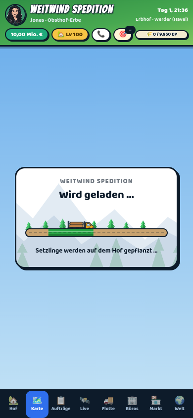

# Hof-Ladeanzeige v405

Der gemeldete Screenshot enthält 13 % bei weit gefülltem Balken. Bisher war die Zahl eine Schätzung aus der letzten Ladezeit; mehrere unabhängige Web-Animationen stellten Ziffern, Balken, Lkw und Meldungen dar. Die Zahl sagte nichts darüber aus, welcher Teil der Landschaft bereits aufgebaut war.

Die Anzeige verwendet jetzt „Wird geladen …“ mit einer laufenden Markierung und dem Lkw. Es gibt keine geschätzte Prozentzahl. „Fertig“ erscheint beim Hof nach dem Szenenaufbau und einer Zeichnung; im Büro erst nach allen gestaffelten Aufbauaufgaben. Bei reduzierter Bewegung bleiben die Markierungen statisch. Ein abgefangener Hof-Aufbaufehler beendet die Animationen und bietet „Neu laden“ an. Der Spielstand wird nicht gelöscht oder migriert.

## Prüfung und Grenzen

`node hofladen-v405.browser.js` gegen `python3 -m http.server 8002 --bind 127.0.0.1` prüft Chromium/SwiftShader bei 390 × 844. URL über `LOGISTIKA_TEST_URL`, Bildordner über `LOGISTIKA_ARTIFACT_DIR` einstellbar.

- Nach mehr als einem Animationszyklus und nach einem 400-ms-Threadblock steht weiter „Wird geladen …“, kein vorgetäuschter Fertigstand.
- `finish()` setzt den abgeschlossenen Zustand; die statische Alternative berücksichtigt reduzierte Bewegung.
- Echter Hofstart einschließlich Gebirge und anschließend entfernte Ladefläche, kein Ersatz für den Szenenaufbau im Test. Gemessene Gesamtzeit im Softwarebrowser ungefähr sieben Sekunden einschließlich Anzeigeabschluss; keine Mobilgeräte-Messung.
- Echtes Büro mit absichtlich angehaltener Aufbauwarteschlange: solange Aufgaben ausstehen, kein „Fertig“; nach Freigabe schließt die Anzeige.
- Absichtlich ausgelöste Ausnahme aus `farmBuildScene`: Rückmeldung, gestoppte Ladeanimationen und Neuladen-Knopf, kein unbehandelter Seitenfehler.
- Verlassen vor dem Aufbau: keine verwaiste Ladefläche oder gesetzte Startsperre.
- Syntax `farmview.js`, `officefp.js`, `sw.js` und `git diff --check`.

Der normale Hofstart lief im Testbrowser schon vor der Änderung durch. Ein dauerhaftes Hängen auf dem tatsächlichen iPhone und der konkrete Spielstand aus dem Screenshot wurden nicht reproduziert. Diese Änderung verbessert die Anzeige und den abgefangenen Fehlerfall, sie behauptet keine Beschleunigung des synchronen Landschaftsaufbaus oder eine bestätigte Behebung eines gerätespezifischen Absturzes.
