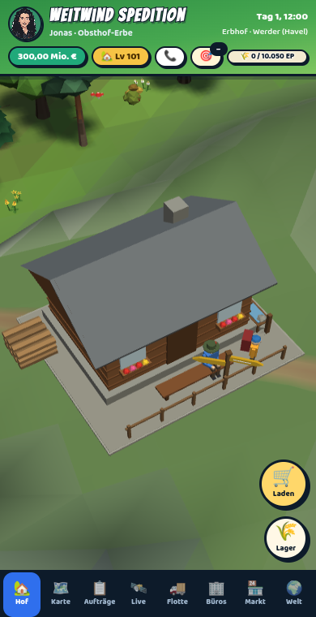
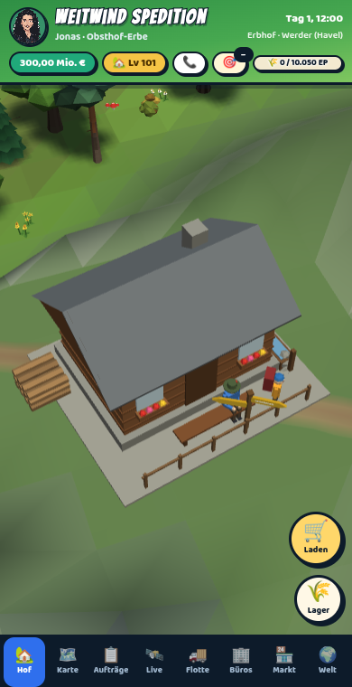
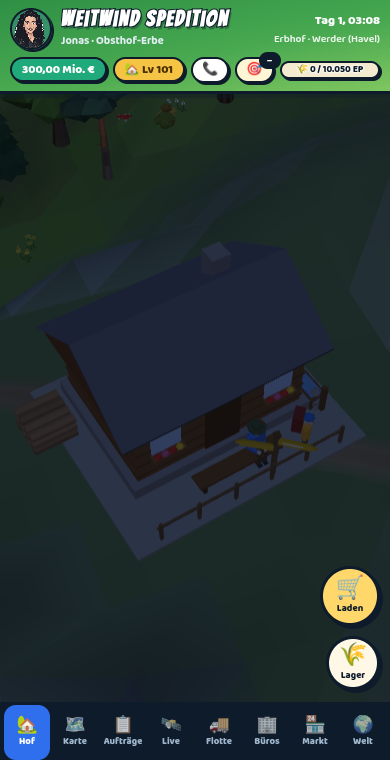

# v414 – Bodenplatte des Berghauses

Fundament und Deckplatte hatten beide ihre obere Fläche bei lokal `y=+0,04`. Zwei unterschiedlich gefärbte, sichtbare Flächen lagen damit übereinander. Je nach Blickwinkel und Tiefenpuffer konnte die Darstellung zwischen beiden Flächen wechseln.

Das Fundament endet jetzt an der Unterseite der Deckplatte (`y=-0,04`). Die Deckplatte behält ihre Dicke von0,08 Spieleinheiten und ihre bisherige Oberkante. Beide Teile schließen ohne Spalt aneinander an; der Sockel reicht weiterhin unter die Geländeoberfläche. Die Hütte selbst, ihr Bauplatz, Bank, Geländer und Wanderweg bleiben erhalten. Keine zusätzlichen Modelle, Rendertricks oder Änderungen an der allgemeinen Tiefenprüfung.

| Vorher im Prüfstand | Korrigiert |
| --- | --- |
|  |  |

`node huettenplatte-v414.test.js` prüft die tatsächlichen Dreiecke des Hüttenmodells: getrennte sichtbare Oberseiten, Fundament an der Plattenunterseite, Sockel unter dem angrenzenden Gelände. Der unveränderte Vorgänger löst den Überlagerungsfehler im Test aus; die neue Fassung besteht. 100 Zoomwechsel erzeugen keine neuen Meshes, der Modellspielstand bleibt unverändert.

`node huettenplatte-v414.browser.js` prüft den vollständigen Hof in Chromium/SwiftShader: vier Richtungen, Tag/Nacht,960×800 und390×760 – insgesamt16 Ansichten. Keine zusätzlichen GPU-Meshes/Knoten, kein Kontextverlust oder JavaScriptfehler; Gebäude, Bäume und Geld bleiben erhalten. Messwerte: [JSON](assets/v414/messwerte.json). Kein Test auf einem echten iPhone/Safari.

Der lokale Lieferstand414 enthält die vorherigen Gebirgsänderungen413 und Kopf-/Menüfixes412. Nur alpine414 und Gesamt-/SW/LOGI_V414 neu erhöht; hunt/style bleiben412. Basis main21c3bf8. Kein GitHub-Upload, GitHub-Merge oder Deployment.
