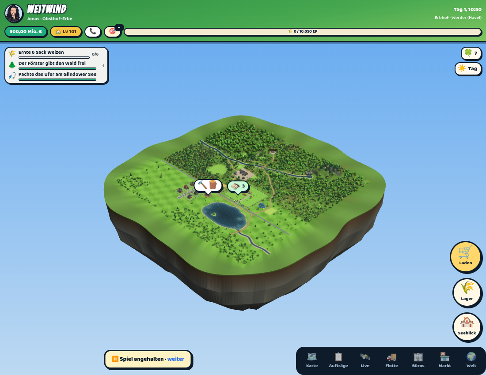
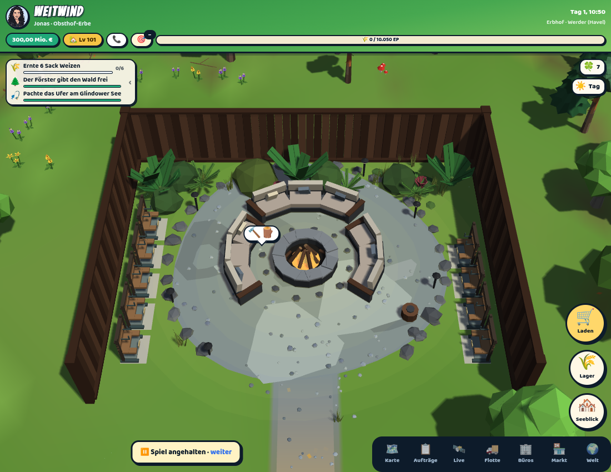
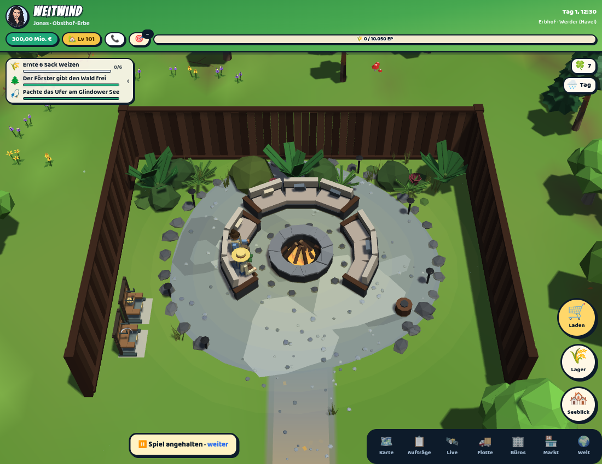
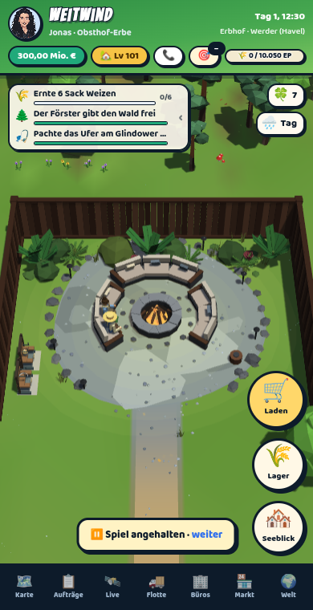

# Abnahme v358

Basis: main `2a02935`, einschließlich PR #74/v356. Während der Schlussabnahme wurde Jagd-PR #75 (`e475d44`, v357) eröffnet. Er ist in diesen Arbeitsbranch integriert; die gemeinsame Lieferung trägt Version 358. Eigener Branch `codex/floating-island-v358`.

## Darstellung und Verhalten

Die frühere Kulisse zog die Landschaft radial bis 1.500 Einheiten nach außen. An ihrer Stelle steht ein begrenzter Inselkörper: Grasdecke, schmale Erdschicht, gebrochene Felsflanken und ein geschlossener, nach unten zulaufender Körper im Himmel. Die vorhandene Welt bleibt unverändert bei x/z −160 … 104; keine Verschiebung von Gebäuden, Pfaden, Bewohnern, Bauflächen oder Freischaltungen. Die zusätzliche Geometrie ist ein statisches Netz mit 3.960 Dreiecken. In der Ich-Perspektive bleibt wie bisher die eigene Aussicht aktiv.

Werkzeugfächer stehen längs der Seitenwände. Pro vorhandener Kraft mit Gerät wird genau ein Fach angezeigt; nicht benötigte Module sind unsichtbar. Höchstens neun Knoten teilen ein Modell. Persönliche Plätze bleiben stabil, wenn andere Kräfte hinzukommen oder ausscheiden. Die Mitte vor dem Feuer bleibt frei. Arbeiter gehen im Quergang zur seitlichen Gasse, räumen dort ihr Gerät ein und folgen anschließend dem inneren Ring zu ihrem Sitz. Zurück verläuft es umgekehrt. Ablagepose, Blickrichtung und Haltepunkte sind auf die neue Fachausrichtung abgestimmt.

Gespeicherte Wege zu den alten Frontregalen werden ab der tatsächlichen Position umgestellt. Erledigte Übergaben werden nicht neu abgespielt; nach beendeter Laufphase bleiben Arbeits-/Pausenzeitleisten unverändert. Insbesondere bleibt das Pausenende um 13 Uhr erhalten. Keine neue Buchung von Lohn, Material oder Aufgabenerträgen.

## iOS-Browserfenster

Die Domain-Pille im markierten Screenshot gehört zur nativen Browseroberfläche. Eine Website kann weder deren Position festlegen noch das Einblenden beim Neuladen verbieten. Dieser native Effekt wurde hier nicht auf einem iPhone reproduziert und wird nicht als direkt behoben ausgegeben.

Der App-Teil wird stabilisiert: `viewport.js` läuft früh im Dokumentkopf und übernimmt die sichtbare Höhe/den oberen Versatz bei Start, Reload/Pageshow, Drehen und Viewport-Ereignissen. Alle festen Spielbereiche haben einen gemeinsamen Body-Bezugsrahmen. Innere Scrollbereiche und native Dialoge bleiben bedienbar. Luckybox-Offsets werden nicht doppelt auf den neuen Rahmen angewendet; Fensterhöhen berücksichtigen denselben Rahmen. Kein automatischer Vollbildmodus, kein Scroll-Trick und keine neue Suchleiste im Spiel.

Für eine Anzeige ohne Safari-Browserleiste ist die vorhandene PWA vorgesehen: Safari → Teilen → „Zum Home-Bildschirm“. Ob der markierte native Effekt im normalen Safari nach dem Update weiterhin auftritt, muss am echten Gerät geprüft werden.

## Durchgeführte Prüfungen

- `node floating-island-v358.test.js`: 264 offene Anschlusskanten exakt auf dem bestehenden Weltraster; alle übrigen Kanten geschlossen, keine degenerierten Dreiecke, korrekte Ausrichtung von Gras und Unterseite, Geometriebudget.
- `node fixes-v354.test.js`: neun Prüfgruppen, einschließlich aktualisierter Randprüfung, Bewohnerabläufe, Speicherung und Jagddarstellung.
- `node worker-motion-v351.test.js`: 13 Szenarien; Modulzahl bei 9/2/0/3 Kräften, eigene Fächer, angepasste alte Route, Laden während der Pause, alle neun Rückwege ohne Zaunquerung/Positionssprünge und ohne Wirtschaftsbuchung, sichtbare Übergabe, bestehende Fahrradprüfungen.
- `camp.test.js` über temporären Unterordner ausgeführt (historischer ROOT-Pfad): zehn Prüfungen, insbesondere jeder Hin-/Rückweg abseits von Feuer, Sofas und Wänden, maximal 180° innerer Bogen, korrekte Haltepunkte.
- `node farmteam-v349.test.js`: zehn Prüfungen zu Bekanntschaften, Bestandsschutz und Sitz-/Aufstehgelenken.
- `node floating-island-v358.browser.js`: echter WebGL-Render in Chromium/SwiftShader, Ladebildschirm vollständig beendet; Insel, neun Fächer, zwei sitzende Kräfte mit zwei sichtbaren Geräten/Fächern, Canvas und Navigation im Hochformat ohne Überlappung. Nur generierte Testdaten.
- `node viewport-v358.browser.js`: Reload mit erhaltenem Testspielstand, 390×760, 390×600, 844×390; zusätzliche simulierte Viewport-Höhen 620/480 und Offset 34, Pageshow, ignorierter Pinch-Maßstab, Fallback ohne VisualViewport. Luckybox erhält keinen doppelten Offset und scrollt innen, ohne das Dokument zu verschieben.
- `node company-ui-v356.browser.js`: bestehende fünf Bildschirmgrößen, große Schrift, unabhängige Klappbereiche, suchbare Standortauswahl, Tastatur/Refresh und echter Testkauf mit 17 Fahrzeugen an ihrer Betriebshofadresse.
- Integration PR #75 zusätzlich geprüft: `node trefferbild-v357.test.js` (vier Gruppen), `hunt.test.js` (23). Im 3D-Browser echter Schuss auf einen Hirsch, Erlegen und Öffnen des Trefferbilds mit sichtbarer Treffermarkierung ohne JavaScript-Fehler. Die weitergehende mobile Jagd-Abnahme aus PR #75 bleibt separat dokumentiert.
- `node release-v358.test.js`: vollständiger Service Worker mit Install/Activate/Fetch, alle Skripte in der App-Shell, neue Asset-Versionen konsistent, Jagd-Asset aus PR #75 und Vorschauen erhalten.
- Syntaxprüfungen und `git diff --check` bestanden.

Browserbefehle benötigen einen lokalen HTTP-Server auf Port 8000, installiertes Playwright und Chromium unter `/usr/bin/chromium`. Bilder sind Testbrowser-Vorschauen, keine Aufnahmen vom iPhone. Kein Safari-/Mobilhardware-Leistungsnachweis. Native Browserleisten wurden nicht künstlich ausgeblendet.
