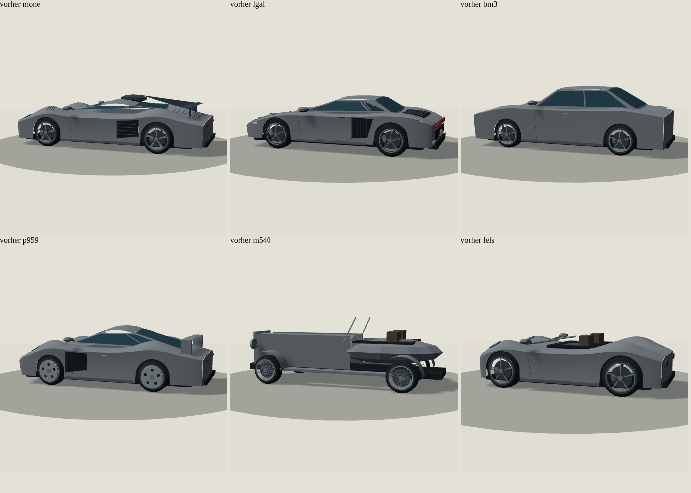
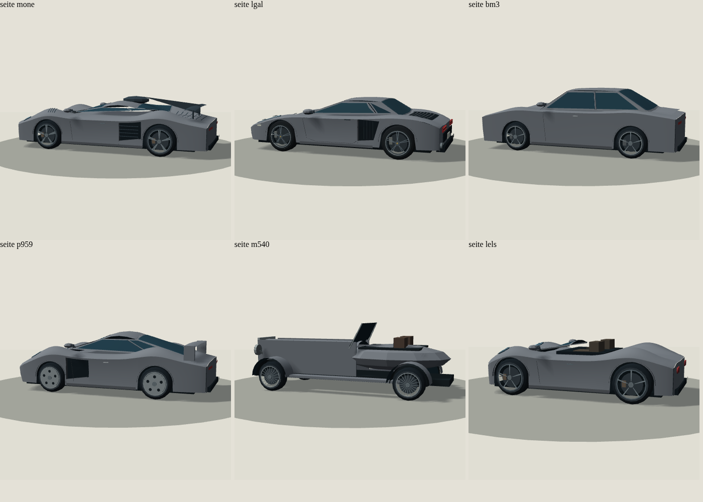
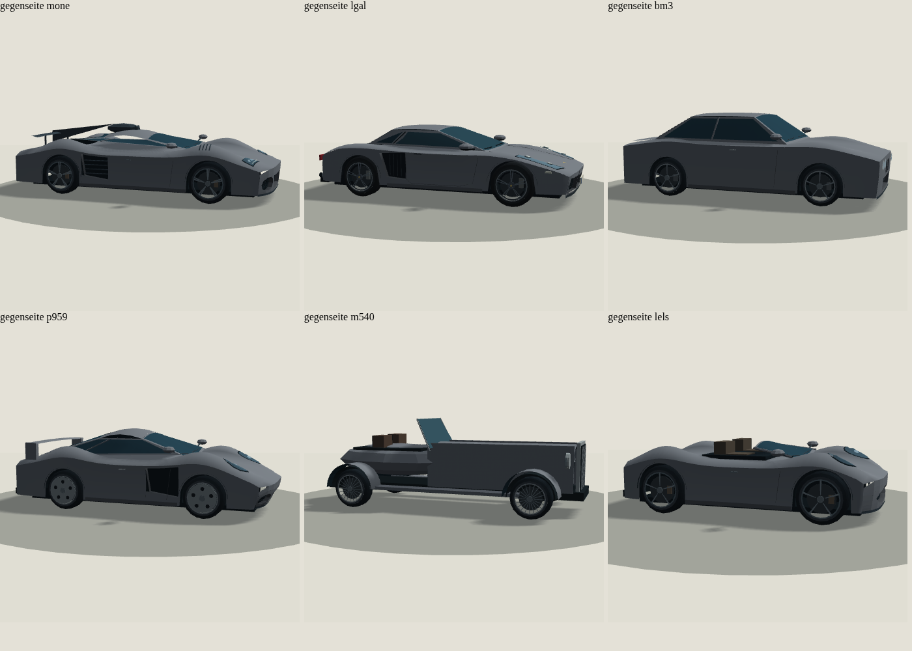
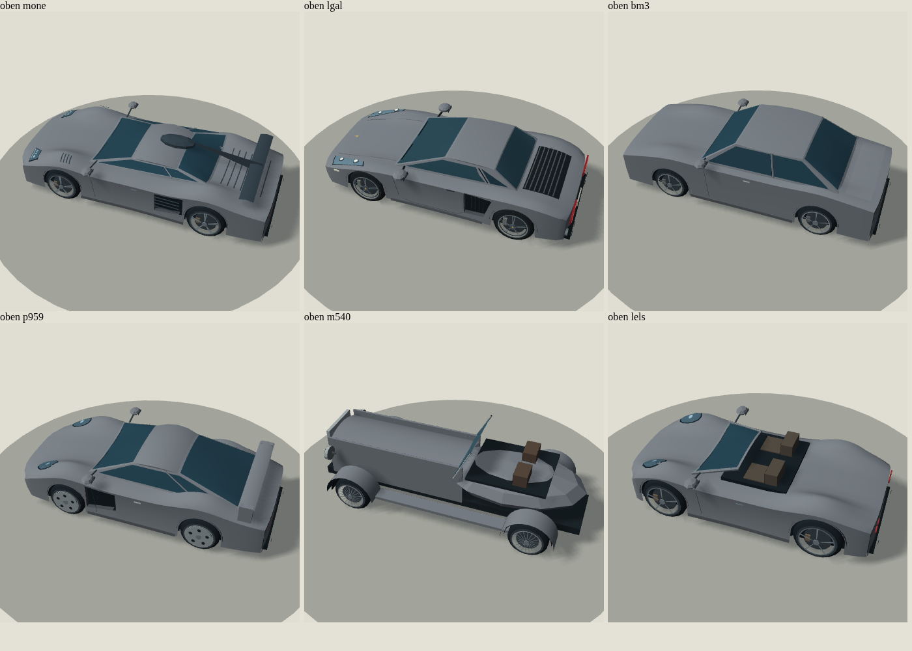

# Karosserie-Innenflächen · v475

Das Nutzervideo vom 23.11. zeigt am AMG One hellen Hintergrund hinter den Speichen und schmale Spalten neben dem seitlichen Einlass. Beim Drehen fehlen außerdem die Rückseiten der Scheiben-/Dachflächen. Ursache: flache Radhausringe statt Wannen mit Tiefe und Rückwand, einseitige Kabinenflächen bei aktivem Backface-Culling, nicht durchgehend hinterlegte Einlassränder.

## Änderung

- Gemeinsame Radhauswannen mit Mantel und innerer Rückwand für alle Katalogmodelle, einschließlich eigenständigem Gallardo und klassischen offenen Kotflügeln. Die Räder, Speichen, Bremsen und äußeren Blechformen bleiben erhalten.
- Dunkle Innenhaut an Dach, Scheiben und Kabinenrahmen. Getönte Scheiben sind von innen sichtbar; der Welt-Renderer behält sein Backface-Culling. Offene Cockpits bleiben offen.
- Innere Seitenwand hinter Einlässen/Fugen und Unterboden bis zum Schweller mit Aussparungen an den Achsen.
- Nur `carmodels.js`/`racecars.js` auf Asset475, Gesamt-/SW475; übrige Assetstände einschließlich alpine474 und Training473 erhalten. Keine Spielstandänderung, keine Preis-/Leistungsänderung.

## Prüfung

- `karosserie-v475.test.js`: 127 Modelle, 10.668 Radhaus- und 1.002 Scheibenblickstrahlen mit aktivem Backface-Culling. Alte Fassung main0930c00: 7.568 Fehlstellen; neue Fassung: keine an den geprüften Stellen. Katalogdaten bleiben unverändert.
- Katalog-/Formprüfungen v471/v472: 127 unterschiedliche Modelle, endliche Punkte, normierte Normalen, Radstand, Bodenkontakt und echte Einlassvertiefungen. Maximum jetzt 6.455 statt 5.657 Dreiecke pro komplettem Auto (knapp 14 % zusätzlich); begrenztes Budget 6.500. Keine neuen Netze pro Animationsbild.
- Gallardo v470: acht Prüfgruppen; 4.263 Karosserie- und 548 Raddreiecke. Der alte zweiseitige Teststrahl wurde auf das tatsächliche Backface-Culling umgestellt, damit deckungsgleiche Innenhaut nicht fälschlich als außen sichtbare Normale gewertet wird.
- `fahrzeugformen-v472.browser.js`: alle 127 Modelle im WebGL-Renderer, zwölf AMG-One-Ansichten in drei Bildschirmgrößen, Touch/Zoom, Auktionswechsel, Rendererfreigabe, identische Garage-/Rennnetze, keine JavaScript-Seitenfehler.
- `karosserie-v475.browser.js`: sechs Bauformen jeweils von beiden Seiten in flachem Winkel und von oben, keine WebGL-Fehler. Sichtvergleich mit alter Fassung.
- Trainingsziel v473: 18 Prüfgruppen bestanden. Syntax und Asset-/SW-Verweise geprüft.

Chromium/SwiftShader; kein Test auf echtem iPhone/Safari und keine Messung der Bildrate auf einem Mobilgerät. Die Innenflächen erhöhen den Geometrieaufwand; die bestehenden Modellcaches und bedarfsabhängige Vorschau bleiben erhalten.

## Bildvergleich

