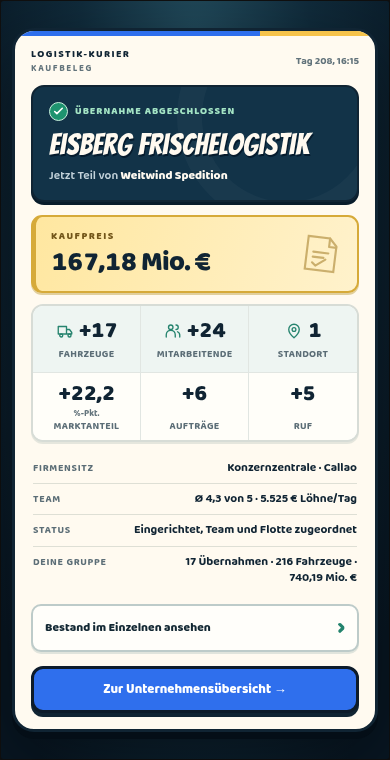
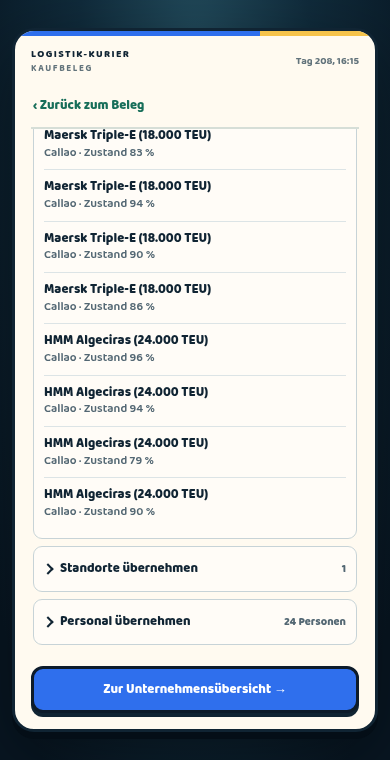
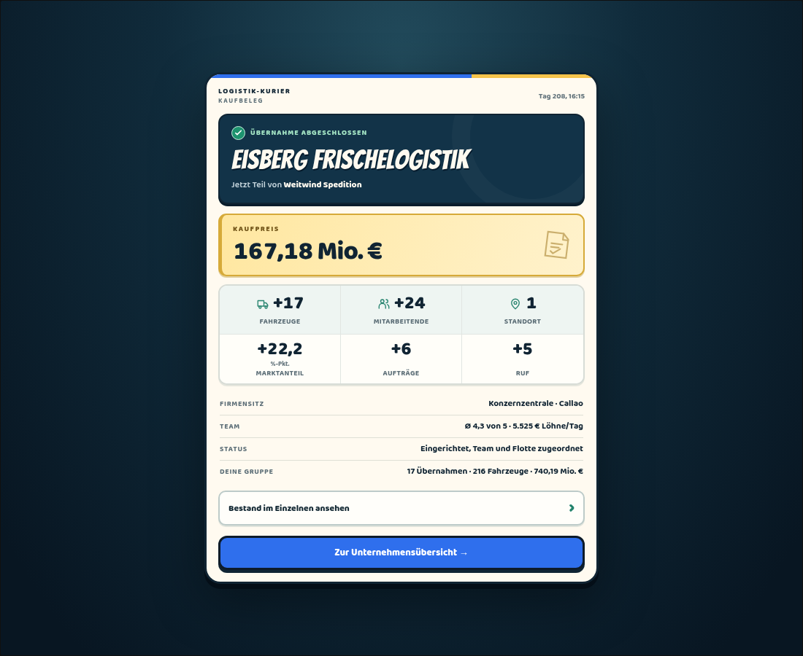

# v448 – Markanter Kaufbeleg, klare Übersicht

Der Firmenname steht jetzt in einem kräftigen dunkelblauen Kopfbereich, der Kaufpreis in einem goldenen Block. Die sechs Kennzahlen bleiben als ruhiges Raster erhalten: Fahrzeuge, Team und Standorte sind mit eigenen SVG-Symbolen hervorgehoben, die weiteren Kennzahlen stehen darunter auf gemeinsamen Zahlenlinien. Der Papier-/Buttonrahmen und der blaue Abschlussknopf greifen den Logistika-Stil auf.

Die Bestandsliste öffnet weiterhin als eigene Ansicht innerhalb des Belegs. Ihr Zurück-Knopf und der Abschlussknopf liegen außerhalb der scrollenden Liste. Kurzes Einblenden statt laufender Effekte; `prefers-reduced-motion` schaltet die Bewegung aus. Keine neuen Texturen oder WebGL-/Partikeleffekte.

## Daten und Bedienung

Nur `corpreport.js` und zusätzliche CSS-Regeln sind für die Gestaltung geändert. Kaufpreis, übernommene Objekte, Gruppendaten und historische Quittungen werden weiterhin aus dem gespeicherten Ergebnis gelesen. Die Zahlen haben deutsche Dezimalzeichen; die Einheit „%-Pkt.“ ist von der Zahl getrennt, damit sie im Kennzahlenfeld lesbar bleibt. Geldbeträge in der Gruppenzeile werden nicht vor dem Eurozeichen umgebrochen.

Dialogrollen, Fokusführung, Zurück/Schließen/Escape und die Bestandsansicht bleiben erhalten. Auf üblichen Handygrößen passt der normale Beleg ohne Scrollen. Bei 320×568 oder besonders langen Firmennamen scrollt nur der Inhalt; der Abschlussknopf bleibt erreichbar. Altbelege ohne vollständige Inventarliste haben weiterhin keinen leeren Bestandsknopf.

## Prüfung

`node kaufbeleg-v448.browser.js` nutzt ein echtes, in der vorhandenen Übernahme-Fixture erzeugtes Kaufpaket. Die Bildbeispiele übernehmen Name/Flotte/Team aus diesem Paket; Preis, Tag und Gruppenstand sind feste Darstellungsbeispiele passend zur Vorlage.

- Chromium mit Touch in 320×568, 360×640, 390×760 und430×820; Desktop 1100×900 und 844×390.
- Alle sechs Kennzahlen vorhanden; keine horizontal überlaufenden Titel, Werte oder Zeilen. Üblicher Beleg in 360/390/430 vollständig sichtbar. Abschlussknopf auch auf kleinster Größe sichtbar.
- Bestandsliste auf-/zuklappen, Flotte aufklappen, nativ scrollen, Zurück-Fokus und Schließen geprüft. Keyboard-Tab bleibt im Dialog, Escape schließt ihn.
- Lange Namen/Zahlen, mehrere reservierte Standorte, historischer Beleg ohne Assets sowie reduzierte Bewegung geprüft.
- Gespeicherter Spielstand und Eingabebeleg werden durch die Darstellung nicht verändert. Keine JavaScriptfehler.

`node company-acquisition-v355.test.js`: alle 18 Szenarien der tatsächlichen Kauf-/Übertragungslogik bestanden, einschließlich Datenhistorie, Doppeltippen, Speicherfehler, Personal-/Standortzuordnung und Altbeständen. `node gebirge-v429.test.js`: Gebirgs-/Murmeltierprüfung der parallel enthaltenen Uferkorrektur447 bestanden.

Kein tatsächlicher iPhone-/Safari-Test. Grundlage main eeb200a plus unverändertem Gebirgsübergang aus PR149/c9bbe4f. Gesamt-/SW448, nur style/corpreport448; alle vorherigen Tier-, Waffen-, Trophäen- und Arbeiteränderungen erhalten.

## Vorschauen

