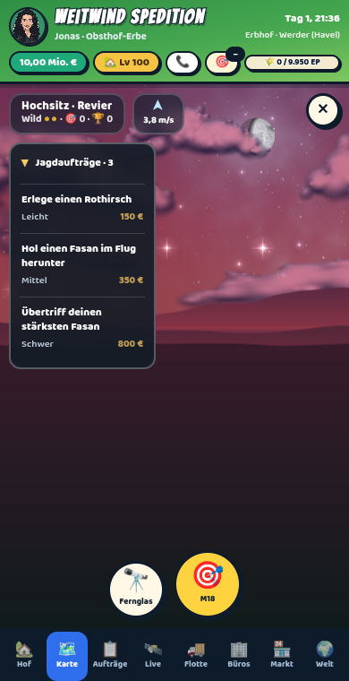
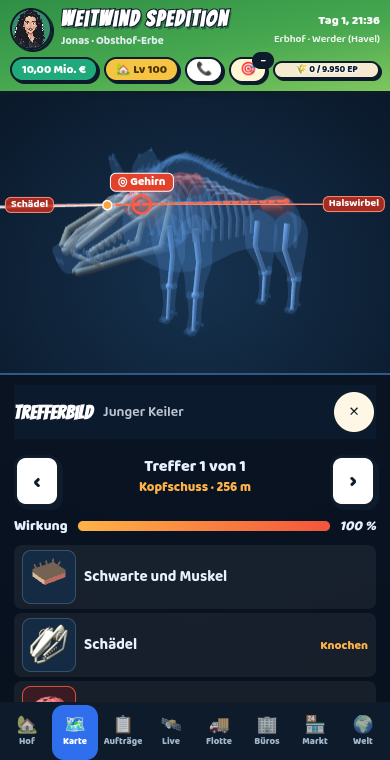
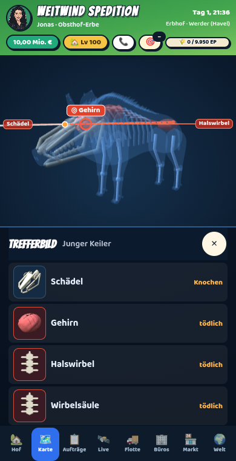

# v412 – Kopf-Trefferbild und schmales Hochsitz-Menü

Stand: 18.11.2026. Basis: main b82ff69, einschließlich Gebirge410 und Waldplatz409.

## Ursache und Änderung

Bei Kopfaufnahmen endete der Kanal unabhängig von der Kopfform nach pauschal 20 cm hinter dem groben Trefferpunkt. Im Kopf waren zwei Ersatzellipsoide rot eingefärbt, einschließlich Schnauze/Kiefer. Im Bericht stand dafür eine flache Schädelzeichnung.

- Artspezifische 3D-Schädel mit Augenhöhlen, Nasenbein, Kiefer und Zähnen; beim Keiler kleine Waffen, beim Fasan ein Vogelschädel. Die transparente Schädelkalotte gibt den Blick auf das separat modellierte Gehirn frei. Keine rot eingefärbte Ersatzschnauze.
- Schädel und Gehirn werden im Bericht getrennt benannt und als 3D-Bildchen gezeigt. Das Hauptschild nennt das tatsächlich geschnittene Gehirn; der Schädel erhält einen eigenen Zeiger, keine doppelte Gehirnbeschriftung.
- Ein gemeinsamer Kopfrahmen berücksichtigt Hals-/Kopfhaltung und die im Keilermodell enthaltene Neigung. Die Kopfhautgrenzen folgen demselben Profil wie das Tiermodell. Gehirnzeichnung und Gehirnkontakt verwenden dasselbe Netz. Auch der Fasan besitzt eine eigene Hirnregion.
- Der Kanal beginnt an der Kopfoberfläche und folgt dem Strahl bis zum letzten Körperaustritt oder zur gespeicherten Eindringtiefe. Ein anschließender Hals/Rumpf bleibt enthalten. Kein Verlängern eines Steckschusses hinter dessen Stopp.
- Neue Schüsse gelten ohne tatsächlich erreichtes Gehirn nicht als Gehirntreffer. Ältere Aufnahmen werden als Ansichtskopie nachgeprüft; gespeicherte Wirkung, Medaille, Trophäe und Erlös werden nicht geändert. Eine historisch abweichende Kopfwertung wird entsprechend als ältere Aufnahme gekennzeichnet.
- Geöffnetes Auftragsmenü an der Breite des Revierkastens ausgerichtet, mindestens 164 CSS-Pixel für lesbare Überschrift. Titel über voller Zeilenbreite; Schwierigkeit und Bezahlung darunter. Touch-Scrollen und Ein-/Ausklappen erhalten. Der ResizeObserver berücksichtigt auch Größenänderungen des Revierkastens.

## Mobile Aufwandgrenzen

Geometrien und Kopfgrenzen werden pro Art wiederverwendet. Außerhalb der Kopfgrenzen werden die Dreiecke beim Strahltest übersprungen. Kein Modellaufbau im Dreh-/Renderloop, keine zusätzlichen Szenen in der Hofansicht.

| Art | Schädel | Gehirn | Kopfhaut für Strahltest |
| --- | ---: | ---: | ---: |
| Hirsch | 1609 | 1860 | 672 |
| Keiler | 1681 | 1860 | 1000 |
| Fasan | 456 | 780 | 520 |

Angaben in Dreiecken; die Kopfhaut ist ein CPU-Prüfnetz, kein zusätzlicher sichtbarer Knoten.

## Prüfung

- `node kopftreffer-v412.test.js`: 18 Kanäle aus drei Richtungen und zwei Kopfhaltungen, alle drei Arten. Vollständiger Kanal, echtes Gehirn, Organreihenfolge, Steckschuss im/vor dem Gehirn, Stopp vor Kopfoberfläche, Kiefer/Schnabel ohne Gehirntreffer, gespeicherte Werte, endliche und wiederverwendete Modelle.
- `node kopftreffer-v412.browser.js`: Chromium mit Touch-Viewport 390×760, 320×640 und 760×390. Auf-/Zuklappen, Menübreite, kein horizontaler Überlauf, alle Belohnungen erreichbar; Schädel-/Gehirnbildchen geladen, Kopfkanal vollständig, keine JavaScriptfehler. Vorschau per `python3 -m http.server 8004`; alternativ `LOGISTIKA_TEST_URL` setzen.
- `trefferbild-v357.test.js`, `anatomie-v367.test.js`, `trefferklarheit-v388.test.js`, `wundoptik-v400.test.js`: bestanden.
- `hunt.test.js`: alle 23 Gruppen bestanden (wie im Dateiheader vorgesehen aus einem Unterverzeichnis bzw. mit auf das Repository gesetztem ROOT). Der Hals-Silhouettentest schließt jetzt Kopf/Hals-Überdeckungen aus: Ein Strahl durch das Haupt gehört in den Kopfprüfstand, nicht in die Erwartung „jeder sichtbare Hals-Rasterpunkt ist tödlich“. Die bestehende Mindestquote für den unverdeckten Hals bleibt erhalten. Gegenprüfung des ursprünglichen Tests auf main durchgeführt.
- Syntax und `git diff --check` bestanden. Gesamt-/SW-Version411, nur hunt/style auf Asset412 erhöht.

Nicht auf einem echten iPhone/Safari gemessen. Die Browserprüfung und Dreiecksgrenzen sind keine FPS-Garantie für reale Geräte. Keine Spielstandmigration, kein automatisches Merge oder Deployment.

## Vorschau

