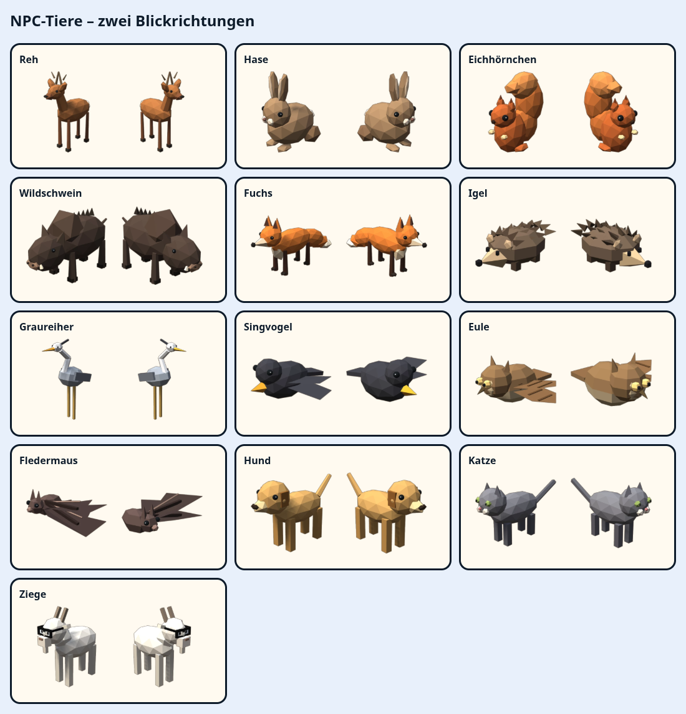
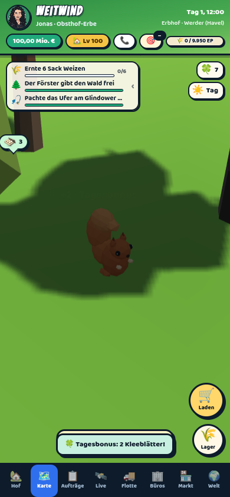
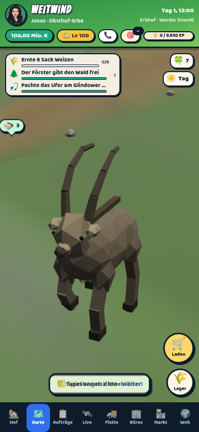
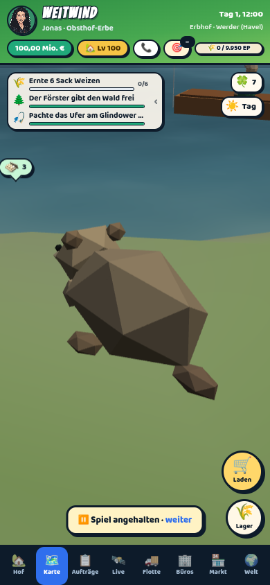

# v440 – NPC-Tiere klarer erkennbar

Das markierte Tier im Nutzerscreenshot ist ein Eichhörnchen. Das bisherige Modell hatte einen fast geraden Zylinderschwanz und kaum Gesichtsmerkmale. Es erhält jetzt einen buschigen, gebogenen Schwanz, Pinselohren, helle Bauchpartie, Augen, Nase und Pfoten.

Die frei lebenden Hof-/Waldtiere und Haustier-NPCs sind in derselben Formensprache verfeinert: Reh mit schlanken Läufen, Ohren und hellem Spiegel; Hase mit langen Ohren und Hinterpfoten; Wildschwein mit Schulterhügel, Rüssel, Hauern und Rückenborsten; Fuchs mit spitzer Schnauze, dunklen Läufen und weißer Schwanzspitze. Igel, Graureiher, Singvogel, Eule und Fledermaus haben klarere Artmerkmale. Hund und Katze erhalten gerundete Körper sowie erkennbare Gesichter. Ziege Tim behält ihre charakteristische Brille und ihren Bart.

Bei den Bergtieren sind Bart/Schnauze des Steinbocks, Pfoten/Wangen und der rundere Schwanz des Murmeltiers sowie Schnabel-/Augenmerkmale von Adler und Ente verfeinert. Tierarten, Größenfaktoren, NPC-Anzahl, Sichtungszeiten, Lauf-/Flugwege und Verhalten bleiben erhalten. Jagd- und Nutztiermechaniken sind unverändert.

| Steinbock | Murmeltier |
| --- | --- |
|  |  |

## Prüfung und Leistung

- `node npc-tiere-v440.test.js`: 13 stabile, endliche Körpermodelle und drei Flügelmodelle geprüft. 260–796 Dreiecke je Körper, höchstens 100 je Flügel; feste Grenzwerte statt zusätzlicher Geometrie pro Bild. Ausgeprägte Eichhörnchen-Schwanzsilhouette geprüft.
- Chromium/SwiftShader: 13 Arten aus zwei Blickrichtungen gerendert; zusätzlicher vollständiger Hof bei 390×844 mit Eichhörnchen und Nahansichten der vier Bergtierarten. Nach 240 NPC-Simulationsschritten gleich viele Meshes und Szenenknoten, kein Kontextverlust, Spielstand unverändert, keine JavaScriptfehler. [Messwerte](assets/v440/messwerte.json).
- `node gebirge-v429.test.js` und `node wasseroptik-v386.test.js`: Kamerahöhe, Gelände, Wasseranschlüsse, 1.800 Tierschritte mit Bodenkontakt und 200 Zoomwechsel bestanden. Geländebudget bleibt unverändert, Gebirgs-Fernlast unter 16.000 Dreiecken.
- Kein Test auf einem echten Handy/iPhone/Safari, keine Geräte-FPS-Messung.

Die Modelle werden weiterhin einmal aufgebaut und über vorhandene Modellschlüssel wiederverwendet. Keine neuen Bibliotheken, zusätzlichen Tierinstanzen oder laufenden Mesh-Neubauten. Aktuelles main976942e einschließlich geglätteter Arbeiterwege438 integriert. Gesamt-/SW440, woodmodels/alpine440; übrige Assetstände erhalten. Kein automatisches Merge/Deployment.
