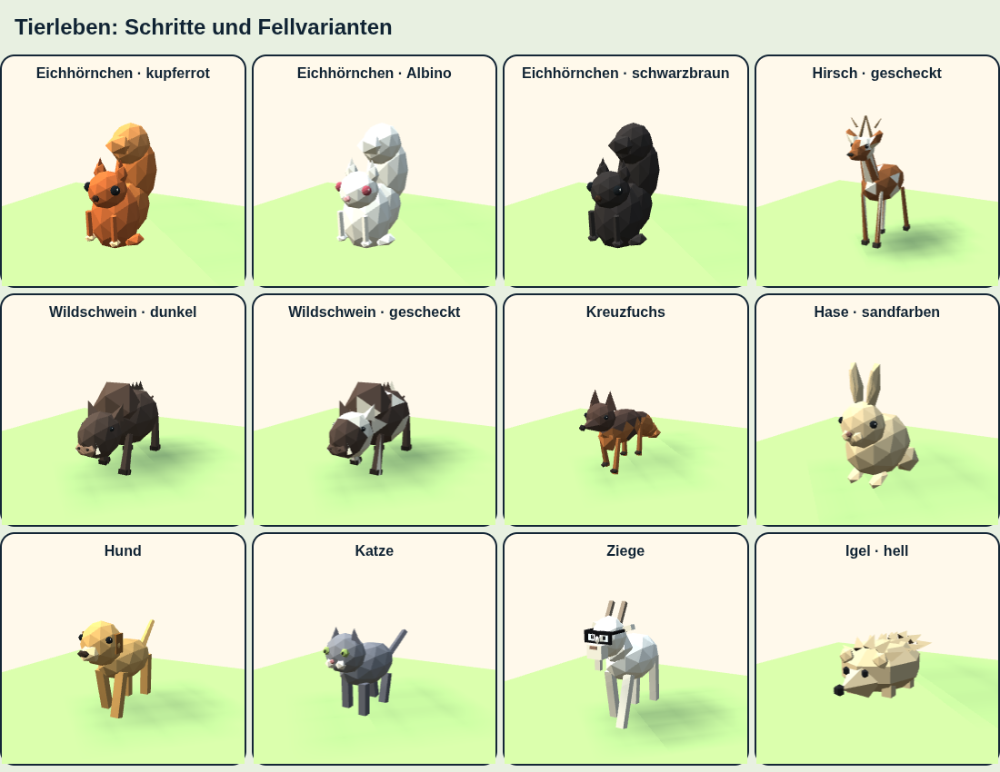

# v446 – Tierbewegung und Waldvielfalt

## Bewegungen

Die bisher starren Beine werden beim Modellbau als eigene Gelenkteile angelegt. Dieselben Modellfunktionen liefern weiterhin vollständige Standmodelle für Warenbildchen. Die Schrittphase folgt der tatsächlich zurückgelegten Strecke; beim Warten oder blockierter Bewegung läuft die Animation nicht einfach weiter. Die Beinstellung blendet in eine neutrale Haltung aus. Höheres Tempo ergibt längere Schritte und Trab statt immer schnellerem Trippeln. Hasen/Eichhörnchen verwenden paarige Vorder-/Hinterpfotenphasen.

Neu angebunden sind Hirsch, Hase, Eichhörnchen, Wildschwein, Fuchs, Igel, Reiher; Bello, Minka und Tim; Huhn, Kuh, Schwein, Schaf und Rind; beide Murmeltiere. Die bereits gegliederten Steinböcke und Jagdtiere sowie Flug-/Schwimmanimationen bleiben erhalten. Kaufen/Verkaufen-Übergänge und die ruhenden Trophäen sind keine Laufanimationen und bleiben erhalten.

Waldtiere/Haustiere bewegen beim Laufen keine starren Gesamtmodelle mehr auf und ab. Bei Stalltieren entfällt das Laufwippen ebenfalls. Schafschur/Fellwechsel tauschen das Körpermodell samt passenden Beinteilen aus, ohne Gelenke anzusammeln.

## Fellvarianten im normalen Wald

Pro Wiederauftauchen wird einmal gewichtet gewählt; während derselben Sichtung ändert sich das Fell nicht. Keine zusätzlichen Tiere, Rendertexturen, Jagdprämien oder neuen Spielstandfelder. Die Naturfarben der vorhandenen Haustiere/Stalltiere und das besondere weiße Hirsch-Ereignis bleiben erhalten.

| Art | Varianten und Wahrscheinlichkeit pro Sichtung |
| --- | --- |
| Eichhörnchen | Kupferrot 65 %, Schokolade 20 %, Schwarzbraun 13 %, Albino 2 % |
| Hirsch | Rotbraun 70 %, Dunkelbraun 18 %, Sommergold 8 %, weiß gescheckt 4 % |
| Wildschwein | Dunkel 73 %, Rostbraun 19 %, gescheckt 8 % |
| Hase | Feldbraun 72 %, Dunkel 18 %, Sand 8 %, Albino 2 % |
| Fuchs | Rot 75 %, Kreuzfuchs 15 %, hell 10 % |
| Igel | Braun 78 %, dunkel 18 %, helle Stacheln 4 % |
| Reiher | Graublau 75 %, Silbergrau 25 % |

23 Varianten einschließlich der normalen Farben. Albino-Eichhörnchen haben weißes/cremefarbenes Fell und rosige Augen/Nase; dunkle Augen bleiben bei den normalen dunklen Varianten erhalten. Scheckungen werden einmal in den vorhandenen Modellflächen eingefärbt.

## Aufwand und Prüfung

Körper-/Beinnetze werden pro Renderer, Modellzustand und Fell wiederverwendet. Beim Simulieren werden nur Winkel und Positionen bestehender Gelenke gesetzt. Zwei oder vier zusätzliche Beinknoten pro Tier; weder neue Tiere noch Netze im Schrittloop. Vorhandene Sichtbarkeits-/Entfernungsregeln bleiben erhalten. Die normalen FWM-Körper einschließlich Beine bleiben unter 1000 Dreiecken (260–836), Eichhörnchen bekommen dafür zwei kurze tatsächliche Vorderläufe. Keine externe Bibliothek, kein Shaderumbau.

- `node tierleben-v446.test.js`: 15 Tiermodelle mit vollständiger, endlicher Gelenkgeometrie, Bodenkontakt, tatsächlichen Schrittphasen, längeren Fluchtschritten, Stillstand, wiederverwendeten Netzen und ohne angesammelte Gelenke. Alle Stallfarben und bewollte/geschorene Schafe. Exakte Gewichte aller 23 Fellvarianten über je 10000 Ziehungen, stabile Farben während der Bewegung, Albino-Augen.
- `node tierleben-v446.browser.js`: zwölf Modell-/Fellansichten in Chromium. Tatsächliche mobile Spielschleifen mit 16 Waldtieren/62 Gelenken, allen drei Haustieren, allen fünf Stalltierarten; seltene Felle beim `wildHome`-Neuauftauchen, ruhende Beine, Schafschur und unveränderte Spielstände. Keine JavaScriptfehler. Während 180 Simulationsschritten werden keine neuen Netze angelegt. Die Navigationsrichtung wird nur in diesem Prüfstand für einen kontrollierten Bewegungstest vorgegeben; die Produktionsnavigation wurde nicht ersetzt.
- `gebirge-v429.test.js`: beide Murmeltiere tatsächlich sichtbar und beweglich, unverändert 9918 Geländedreiecke und konstante Kamerahöhe. `wasseroptik-v386.test.js`: Wasseranschlüsse, Hufkontakt der Steinböcke, unveränderte Spielstände und Zoom-Budgets bestanden.
- `npc-tiere-v440.test.js`, `hunt-v307.test.js`, `trophy-layout-v310.test.js`, `trophy-exhibits-v328.test.js`, `hunt-presentation-v315.test.js` und `weapons-v419.test.js` bestanden.

Nicht auf einem echten iPhone/Safari vermessen; kein Hardware-FPS-Versprechen. Die zusätzliche Zahl von Beinknoten ist trotz gemeinsam genutzter Geometrien zusätzlicher Renderaufwand. Die Browser-/Modellprüfungen sichern konstante Ressourcen im getesteten Ablauf ab.

## Vorschau

