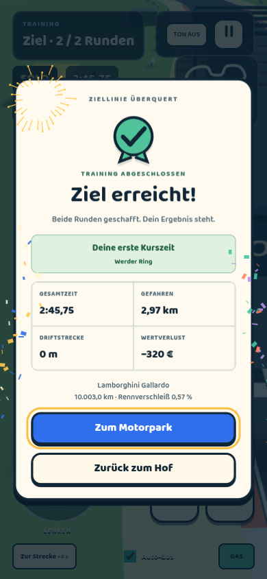

# Trainingsziel nach zwei Runden · v473

Training beendet die Fahrt nach zwei vollständigen Vorwärtsrunden mit Zeitwertung, Ergebnis und der bestehenden Zielfeier. Die Trainingskarte benennt das Ziel ausdrücklich; nach dem Einlauf zeigt der Rundenzähler „Ziel · 2 / 2 Runden“.

Die Zwei-Runden-Wertung war bereits vorhanden. Eine Lücke konnte sie verhindern: Der befahrbare Auslauf reicht bis 6,5 m neben den Asphalt, die Kontrollpunkte erfassten jedoch nur Asphalt plus 3 m. Wer außen vorbeifuhr, konnte deshalb einen Kontrollpunkt und damit die Rundenzählung verpassen. Das Training erfasst nun den gesamten befahrbaren Korridor mit 5 cm numerischer Reserve. Alle Kontrollpunkte müssen weiterhin vorwärts in Reihenfolge passiert werden; zweimaliges Pendeln über Start/Ziel genügt nicht.

`Q.p.training` ist eine reine Laufzeitmarkierung aus dem gewählten Modus. Im Monatsrennen bleibt die bisherige Torbreite erhalten. Kein neuer Spielstandzustand, keine Änderung an Preisgeldern, Monatslimit, Bestzeitsicherung, Kilometer- oder Verschleißbuchungen. Die Fahrzeugformen472 bleiben enthalten.

Geprüft:

- `node trainingsziel-v473.test.js`: 18 Prüfgruppen auf drei Kursen; neun vollständige Läufe auf Mittellinie/beiden Außenrändern, kein vorzeitiges Ziel, keine weitere Fahrt nach Ende, Rückwärtsfahrt/Pendeln/Rücksetzen ohne geschenkte Runden, Monatsmodus weiterhin eng.
- `node trainingsziel-v473.browser.js`: tatsächliches Training auf Werder, Hafen und Kurvenwerk; beide Runden mit der Fahrphysik gefahren (über 2,5 km je Lauf), nach Runde eins geht es weiter. Für die abschließende Zielpassage wird das Auto gezielt an den Außenrand gesetzt und fährt dort selbst über die Linie. Ergebnis, Feier, Bestzeit/Ende der aktiven Fahrt, unverändertes Geld und kein verbrauchter Monatsstart geprüft. [Messprotokoll](assets/trainingsziel-v473/pruefung.json), [Hafen](assets/trainingsziel-v473/hafen-trainingsziel.png), [Kurvenwerk](assets/trainingsziel-v473/kurven-trainingsziel.png).
- Bestehende Prüfungen `autorennbahn-v461.test.js`, `gallardo-umbau-v467.test.js` und `zielankunft-v469.test.js` bestanden; vollständige freie Fahrten auf allen drei Kursen weiterhin erfolgreich.

Browser: Chromium/SwiftShader bei 390 × 844 CSS-Pixeln, kein echtes iPhone/Safari. Gesamt-/SW473; nur racedrive/racing auf Asset473.
