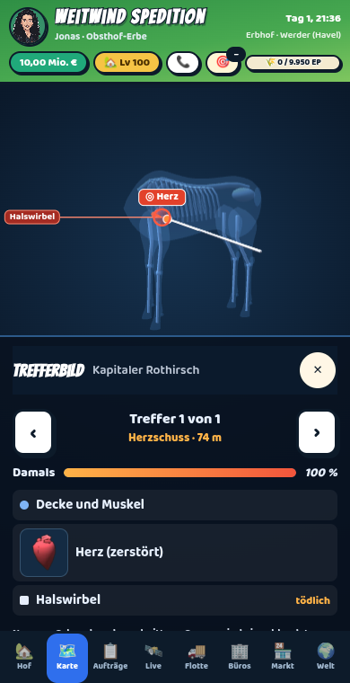
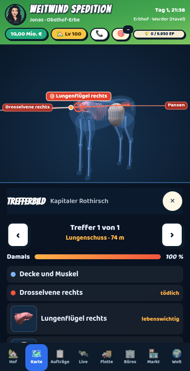

# Trefferbeschriftung v388

Das primär getroffene Organ hat im 3D-Bild genau ein Schild am Trefferring. Es wird nicht zusätzlich in einer Randspalte wiederholt. Bei einem Kanal durch beide Lungen heißt das gemeinsame Schild „Lunge (beidseitig)“; die Liste enthält weiterhin die tatsächlich betroffenen einzelnen Lungenflügel.

Der gesonderte Todesursachenblock entfällt. In der Organliste steht bei vollständiger aufgezeichneter Wirkung „Herz (zerstört)“, ohne zusätzliches „tödlich“ in derselben Zeile. Geringere gespeicherte Wirkung bekommt diesen Zusatz nicht. Andere tatsächliche Organkontakte und Knochen bleiben in Durchschussreihenfolge sichtbar.

## Tierseite und gespeicherte Daten

Die Tiere blicken lokal nach+Z, oben ist+Y. Die anatomisch rechte Seite ergibt sich aus Vorwärts×Oben, also−X; links ist+X. Die bisherige Benennung war gespiegelt. Die Namen beider Lungen, paariger Nieren sowie Halsarterien/-venen werden jetzt aus dieser Tierseite abgeleitet. Bildschirmseite und Kameradrehung spielen dafür keine Rolle. Die Lungenmodelle verwenden passend dazu rechts vier und links drei Lappen.

Bestehende interne Organ-IDs bleiben stabile Speicherschlüssel, auch wenn ihr historisches L/R-Suffix die falsche Benennung widerspiegelte. Es werden keine gespeicherten Organe vertauscht oder Tiermodelle als Ganzes gespiegelt. Das Trefferbild liest die korrekten Namen aus der aktuellen Anatomie.

Außerdem berücksichtigt die Ansicht beim erneuten Auslesen eines gespeicherten Schusskanals dessen `stop`-Eindringtiefe. Organe hinter dem Geschossende werden nicht mehr eingeblendet. Die Ansicht arbeitet mit einer Kopie: damalige Wirkung, Medaille, Wertung und gespeicherte Schussdaten bleiben erhalten. Die Flucht-/Kollapslogik wird nicht geändert.

## Prüfung

- `node trefferklarheit-v388.test.js`: sechs einseitige Lungenkanäle (Hirsch/Keiler/Fasan, links/rechts), übereinstimmende Hauptschilder und Listen, keine primären Doppelschilder, kompakter Herzstatus, Schussstopp vor der gegenüberliegenden Lunge und unveränderte gespeicherte Aufnahme.
- `node trefferbild-v357.test.js` und `node anatomie-v367.test.js`: elf Prüfgruppen zu Organoberflächen, realen Kanal-Kontakten, Transformationen, Herzlage und erhaltenden Altaufnahmen. Die bisherigen Erwartungen an doppelte Hauptschilder und gespiegelte Nierennamen sind an die korrigierte Darstellung angepasst.
- `node trefferklarheit-v388.browser.js`: vollständige mobile Ansicht390×760 in Chromium/SwiftShader, Herz und beide Lungenflügel. Kein Todesursachenblock, jeweils ein Primärschild, Herzstatus in der Liste, richtige Tierseite in Schild und Liste, keine Seitenfehler. Kein echtes iPhone/Safari getestet.

Basis main c697106 (PR101). Offene Landschafts-/Insel-/Händler-/Rahmenvertrags-PRs bleiben eigenständig. Version388 vermeidet die bereits vergebene387. Nur hunt-Asset388 sowie Gesamt-/Offlineversion388 ändern; andere Assetversionen aus main erhalten. Kein automatisches Mergen oder Veröffentlichen.
