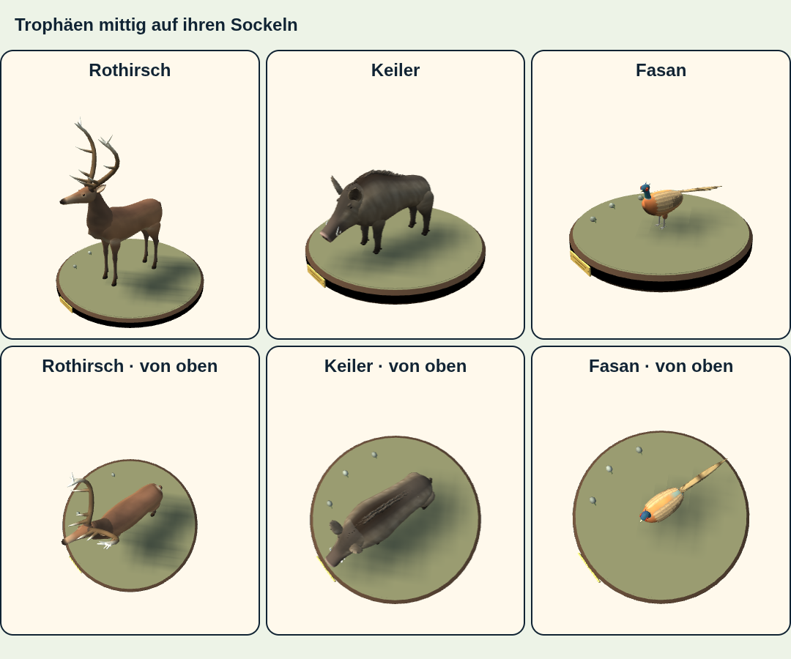

# v443 – Trophäen mittig auf dem Sockel

Die Außenmaße von Geweih, Kopf oder Schwanz verschoben bislang die Standmitte. Hirsch, Keiler und Fasan werden jetzt über die gemeinsame Aufstandsfläche ihrer Hufe beziehungsweise Füße zentriert. Damit passt die Korrektur auch zu unterschiedlichen gespeicherten Geweihformen und Tiergrößen.

Der Sockelradius und die belegte Hof-Fläche bleiben gleich. Das vollständige Tier wird bei Bedarf gleichmäßig verkleinert, damit auch ausladende Teile auf den bisherigen Sockel passen. Keine Verzerrung oder Änderung individueller Körper-/Geweihmerkmale. Die Unterseite der Füße/Hufe liegt weiterhin auf der Sockeloberseite. Wert, Medaille, gespeicherter Datensatz sowie Aufstellen/Einlagern bleiben erhalten.

Geprüft mit `trophy-layout-v310.test.js` (36 Modelle, Altbestände, zehn Geweih-Sonderformen, sechs vermessene Sockel-/Standflächen inklusive Gleichmaß und Sockelradius), `trophy-exhibits-v328.test.js` (acht Prüfgruppen zur tatsächlichen Lager-/Objekt-/Spielstandlogik) und `hunt-presentation-v315.test.js` (24 Präparate und acht Seitenlagen).

`trophy-center-v443.browser.js` rendert alle drei tatsächlichen Präparate mit Sockel schräg und von oben in Chromium. Keine JavaScriptfehler; kein echter iPhone-/Safari-Test. Keine zusätzlichen Geometrien oder laufenden Berechnungen beim Drehen: Die Korrektur erfolgt beim ohnehin nötigen Modellaufbau. Basis mainccf4a2a einschließlich Organ-Korrektur442, Gesamt-/SW443, hunt443.

