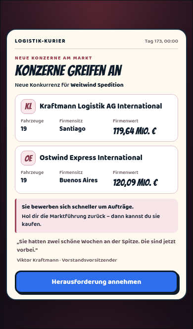
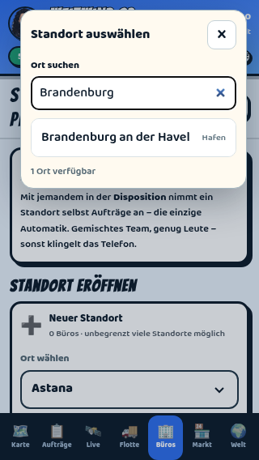
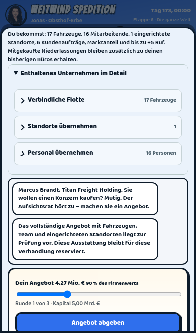

# Unternehmensansichten und Standorte v356

Basis: GitHub main `9e6320d`, zuvor gemergte PRs #72 und #73. Zu Beginn und
vor dem Upload waren keine weiteren Pull Requests offen.

## Vier Anpassungen

- Flotte, Standorte und Personal starten in Angebotsdetails und Kaufbeleg
  einzeln eingeklappt. Unter Standorten und Personal sind einzelne Orte
  zusätzlich separat aufklappbar.
- Die Konzern-Kampfansage enthält weiter beide Firmen, Flottenzahl, Sitz,
  Firmenwert, Erklärung und Zitat. Die bisherige große Titelseite wird durch
  eine kompakte Meldung ersetzt; der Abschlussbutton bleibt erreichbar.
- Übernommene Fahrzeuge hatten den passenden Netzknoten, aber keine konkrete
  Standortadresse. `vehSpot` erzeugte deshalb einen zufälligen Stellplatz im
  Ort. Neue und ältere offene Angebote bekommen jetzt feste Parkdaten:
  Straßenfahrzeuge am Bürohof, andere Verkehrsmittel am passenden Terminal.
- Die Ortsauswahl beim Eröffnen eines Standorts verwendet ein suchbares
  Auswahlfenster ohne Emojis. Gleich große Schrift, natürliche Zeilenhöhen,
  Umbruch langer Namen, Tastatursteuerung, Escape und Fokus-Rückkehr ersetzen
  das auf dem iPhone nur eingeschränkt gestaltbare native Optionsfenster.

## Bestehende Spielstände

`C.parking356` markiert eine einmalige Korrektur. Nur Übernahmefahrzeuge, die
noch keinen Auftrag abgeschlossen haben, untätig am eigenen Standort stehen
und keine bewusste Kunden-/Parkadresse besitzen, werden korrigiert. Laufende
Fahrten, benutzte Fahrzeuge, fremde Orte, Kundenparkplätze und selbst gekaufte
Fahrzeuge werden nicht versetzt. Preise, Eigentum, Bestände und gespeicherte
Kaufbelege bleiben erhalten. Schema 353 der Übernahmepakete bleibt kompatibel.

## Prüfung

```sh
node company-parking-v356.test.js
node company-acquisition-v355.test.js
node company-values-v306.test.js
node office-limits.test.js
node office-value-v322.test.js
node review-v282.test.js
```

Alle sechs Prüfdateien bestehen: darunter sechs neue Park-/Bestandsschutzfälle,
18 Übernahmefälle und zwölf Bewertungsfälle. Die Adressprüfungen verwenden die
echten Adress- und Terminalfunktionen des Spiels.

Mit lokalem HTTP-Server und installiertem Playwright/Chromium:

```sh
node company-ui-v356.browser.js
node company-acquisition-v355.browser.js
```

Browserprüfung: Konzernmeldung ohne Scrollen bei 390×664, 375×667, 320×520,
844×390 und 1280×800; bei doppelter Schriftgröße vertikaler Fallback ohne
horizontalen Überlauf. Klappbereiche unabhängig bedienbar. Ortsauswahl:
Suche, lange Namen, Tastatur, Escape, kein Geldabzug, kein Wegzeichnen durch
Büro-Refresh, keine Unterbrechung durch wartende Konzernmeldung. Echter Kauf
von 17 Lkw: alle an exakt derselben Adresse wie der zugeordnete Betriebshof.
Zusätzlich besteht der vollständige bisherige Kaufablauf mit Premiumkauf,
Speichern/Laden, Beleg-Wiederöffnung, reduzierter Bewegung und 3D-Büro.

Die Büro-Tutorials sind im erzeugten Testspielstand bereits abgeschlossen,
entsprechend dem fortgeschrittenen Spielstand der Screenshots. Kein Test auf
einem echten iPhone mit Safari, kein Mobilhardware-Leistungsnachweis.

## Vorschau

Ausschließlich generierte Testdaten.






