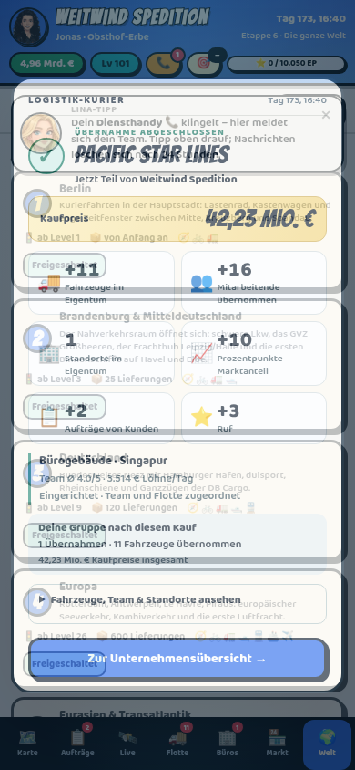
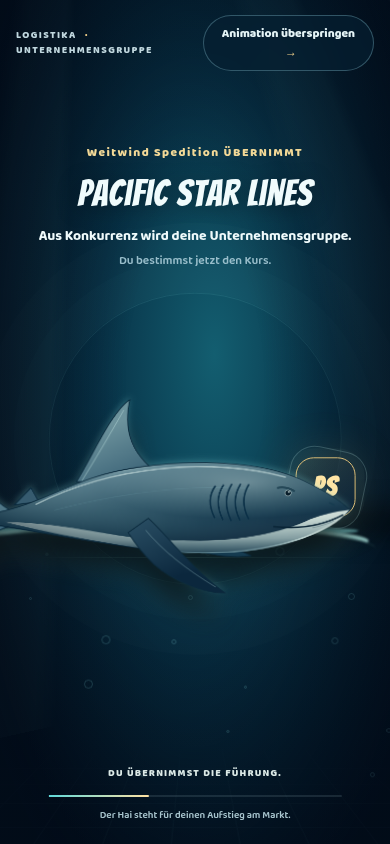
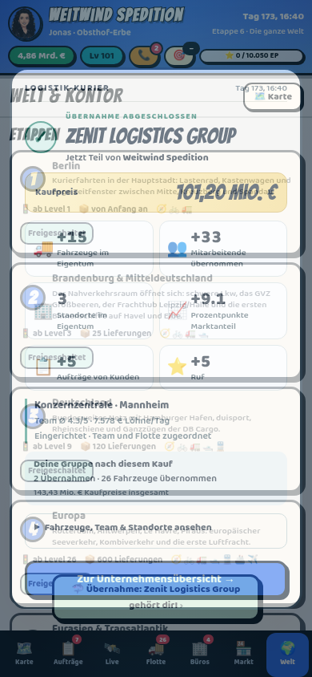

# Unternehmenskauf v355 – Prüfung und Umsetzung

Grundlage: „Logistika 2.pdf“, sieben Seiten, sowie GitHub `main` auf
`bceb8c7` (v352). Vor Beginn waren keine Pull Requests offen. Während des Uploads erschien
Claudes PR #72 (v353/v354, Kopf `bed6700`). Er wurde in diesen Arbeitsbranch
integriert; beide Seiten der gemeinsamen Lade- und CSS-Dateien bleiben erhalten.
Diese Lieferung verwendet deshalb Version 355. main wurde nicht zusammengeführt
oder veröffentlicht.

## Befunde

1. **Inszenierung:** Der bisherige Hai hatte keine ausreichend erkennbare
   Verbindung zwischen Käufer, Übernahmeziel und erworbenen Werten.
2. **Abschluss:** Zeitungsüberschrift, Logos, Preis und Konzernbilanz verbrauchten
   unnötig viel Höhe. Die Zusammenfassung erforderte mobiles Scrollen.
3. **Substanz:** Neue Firmen erhielten unabhängig von ihrer Größe erst beim
   Abschluss zufällig zwei bis vier Mitarbeiter. Das Angebot enthielt kein
   vollständiges festes Team und keine verbindliche Standortausstattung.
4. **Reproduzierter Personalverlust:** Stand am Zielort bereits ein eigenes
   Büro, verkaufte `corpHqOpen` den mitgekauften Sitz automatisch und löschte
   dessen reserviertes Personal. Mit der unveränderten v352-Funktion und zwei
   reservierten Mitarbeitern reproduziert: null Mitarbeiter erhalten,
   Reservierung gelöscht, 430.200 € Immobilienerlös statt Standortübernahme.

Die PDF beweist keinen allgemeinen Fahrzeugverlust: Der Bericht nennt elf
Fahrzeuge und zwei Mitarbeiter, Singapur zeigt ebenfalls elf und zwei.
`2/12` ist eine Belegungs-/Kapazitätsangabe. Die Animation und der Bericht
zeigen zudem unterschiedliche Unternehmen. Diese Befunde wurden nicht als
Nachweis eines einzelnen fehlerhaften Kaufs ausgegeben.

## Änderungen

- Konkretes, gespeichertes Angebot mit reservierten Fahrzeugkennungen,
  Zuständen, benannten Mitarbeitern, Qualifikationen, Löhnen, eingerichteten
  Betriebsstandorten und tatsächlich erzeugten Kundenaufträgen.
- Dasselbe Paket bleibt beim Wiederöffnen, Laden und Etappenwechsel erhalten.
  Nach dem Abschluss dokumentiert es ein unveränderlicher Kaufbeleg.
- Vorprüfung aller Kennungen, Zuordnungen und Kapazitäten; gemeinsame Zahlung
  und Übertragung. Fehlgeschlagenes Speichern nimmt den gesamten Kauf zurück,
  einschließlich einer bereits formulierten Zustimmung im Verhandlungsdialog.
- Mitgekaufte Niederlassungen bleiben auch am selben Ort zusätzlich bestehen.
  Die normalen Gründungsgrenzen bleiben für selbst eröffnete Büros erhalten.
  Gesperrte Orte werden mit ihrem vollständigen Team reserviert.
- Größere Betriebsstandorte und erfahrenere Teams für wertvolle Flotten.
  Fahrer und Disposition werden nach den bestehenden Leistungsregeln geplant.
  Fehlende Verkehrsknoten werden durch bereits eingepreiste Außenstellen ergänzt.
- Unterscheidbare Schwerlast-, Kühlketten- und Lkw-Flotten. Immobilien und
  tatsächlicher Fahrzeugwert bestimmen den Preis, der Firmenwertaufschlag ist
  begrenzt. Die Preisuntergrenze verhindert Gewinn durch sofortigen Weiterverkauf.
- Eigenes Weißhai-Motiv mit Flossenauftakt, kräftigem Vorbeizug, sichtbarer
  Eingliederung des übernommenen Zeichens in die eigene Marke und Abschluss
  mit den tatsächlich erworbenen Werten. Ton respektiert die bestehende
  Einstellung; Überspringen löst keinen weiteren Kauf aus.
- Kompakter Beleg mit Kaufpreis, sechs Kennzahlen, Standort-/Teamüberblick und
  aufklappbaren Details; später unter Welt → Übernahmen → Kaufbeleg abrufbar.
- Büroübersicht benennt Personalplätze und Fahrzeugzuordnung und zeigt den
  Herkunftsbetrieb zusätzlicher Niederlassungen.
- Alte Käufe ohne belastbare Historie werden nicht mit erfundenen Assets
  rückwirkend aufgefüllt. Die vorhandene Legacy-Reparatur bleibt erhalten.

## Verifikation

```sh
node company-acquisition-v355.test.js
node company-values-v306.test.js
node office-limits.test.js
node office-value-v322.test.js
node review-v282.test.js
node office-appearance-v298.test.js
node worker-motion-v351.test.js
node farmteam-v349.test.js
node fixes-v354.test.js
node village-life-v343.test.js
# Der historische Jagdtest erwartet die Projektwurzel eine Ebene höher:
mkdir -p .qa-v355
cp hunt.test.js .qa-v355/hunt.test.js
node .qa-v355/hunt.test.js
```

18 gezielte Übernahmeszenarien und zwölf Firmenwertszenarien bestehen.
Die zusätzlichen oben genannten Prüfdateien bestehen ebenfalls.
Unter anderem geprüft: gleichbleibende Angebote, vollständige IDs/Qualitäten,
volle und doppelte Standorte, gesperrte Orte, mehrere Käufe, Wiederholungsschutz,
Speicherfehler, ungültige Preise, alte Spielstände und sehr große spätere Flotten.

Browsercheck mit installiertem Playwright/Chromium und lokalem HTTP-Server:

```sh
python3 -m http.server 8000 --bind 127.0.0.1
# In einem zweiten Terminal:
node company-acquisition-v355.browser.js
```

Der Browsercheck bedient Schieber und Kaufbutton. Er prüft Animation,
Überspringen, reduzierte Bewegung, einen simulierten Sichtbarkeitswechsel,
Speichern/Laden, Kaufbeleg-Wiederöffnung, aufgeklappte Details, lange Namen,
Schrift-Fallback und verdoppelte Schriftgrößen. Die Zusammenfassung passt bei
390×844, 375×667, 320×568 und 1280×800 ohne Scrollen; 844×390 hat höchstens einen
Pixel Rundungsüberlauf. Bei großer Schrift bleibt vertikales Scrollen möglich.
Keine JavaScript-Laufzeitfehler im geprüften Ablauf.

Zwei tatsächliche Browserkäufe mit generierten Testdaten:

| Kauf | Preis | Fahrzeuge | Mitarbeiter | Standorte |
| --- | ---: | ---: | ---: | ---: |
| Pacific Star Lines | 42.234.600 € | 11 | 16 | 1 |
| Zenit Logistics Group | 101.198.200 € | 15 | 33 | 3 |

Beim Premiumkauf wurden der tatsächliche Personalbestand und die
Konzernzentrale mit Barista-Küche überprüft, einschließlich gültiger
3D-Raumgeometrie aller drei Etagen. Bereits vorhandene Erfolgsprämien sind
separate Buchungen; sie verändern nicht den vereinbarten Kaufpreis.

**Testgrenze:** Headless Chromium mit verschiedenen Fenstergrößen ist kein
Test auf einem echten iPhone mit Safari und kein Leistungsnachweis auf
Mobilhardware.

**Bestehender Testfehler:** `office-workers-v284.test.js:22` greift bei einer
außerhalb des sichtbaren Bereichs liegenden Sprechblase auf `null[0]` zu.
Derselbe Fehler wurde mit unveränderten Dateien von `main@bceb8c7`
reproduziert. `officefp.js` wird durch diesen Branch nicht geändert.

## Vorschau

Generierte Testkäufe; kein echter Nutzer-Spielstand.






