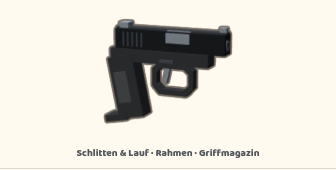
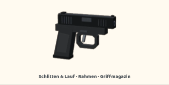
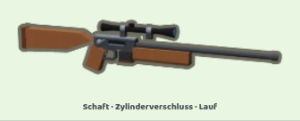
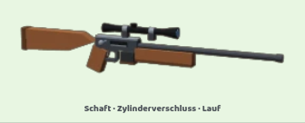

# v425 – Glock 17 und dünnere Waffenkonturen

Verglichen mit der offiziellen [GLOCK G17 Gen5](https://eu.glock.com/en/products/pistols/g17-gen5), einschließlich Hersteller-Abbildung mit Front Serrations und Maßzeichnung (202 mm Gesamtlänge, 139 mm Höhe). Die vorhandene Spiel-Glock hatte eine abweichende Griffneigung, hohe Visierblöcke und ein zu auffälliges helles Auswurffenster.

Gezielt angepasst: nach hinten geneigter Griff mit anschließender Magazinbodenplatte, flachere Visierung, dezenteres Auswurffenster und vordere Schlittenrillen passend zur aktuellen Herstellerreferenz. Grundaufbau, Typ, Farben, Abzugsbügel und offene Mündung bleiben erhalten.

Die zusätzliche Thumbnail-Kontur der zehn Waffen ist von 1,1 % auf 0,25 % der Bildkante reduziert (rund 77 % dünner). Andere Modelle verwenden unverändert die bisherige Standardkontur. Kein Stauchen der Waffengeometrie. Waffenbilder erhalten einen neuen Cache-Schlüssel; weiterhin einmalig erzeugte und wiederverwendete Vorschaubilder.

| Glock vorher | Glock angepasst |
| --- | --- |
|  |  |

| Mauser vorher | Dünnere Kontur |
| --- | --- |
|  |  |

Geprüft: sieben bestehende Waffen-Prüfgruppen und geometrische Öffnungs-/Budgetprüfungen bestanden. Chromium/SwiftShader in 320×640, 390×760, 844×390 und 1100×900: alle zehn Modelle vollständig sichtbar, keine Überläufe/JavaScriptfehler, Auswahl funktioniert. 20 Wiederöffnungen ohne neue Waffen-Meshes/Renderdurchläufe. [Messwerte](assets/v425/messwerte.json). Kein echter Handy-/Safari-Test oder Geräte-FPS-Test.

Gesamt-/SW425, weapons/worldview425; andere Assetstände erhalten. Keine Änderung an Waffenwerten, Kauf, Trefferwirkung oder Spielständen.
