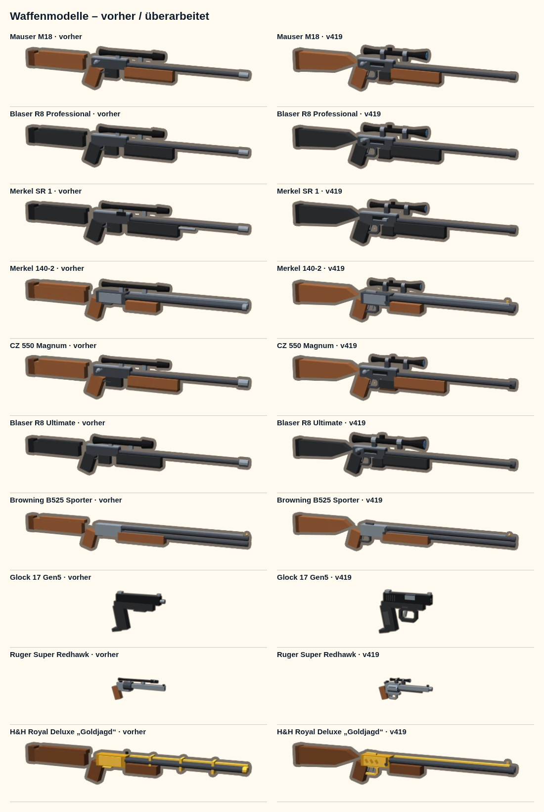
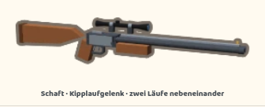
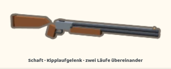
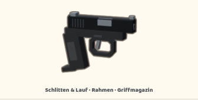
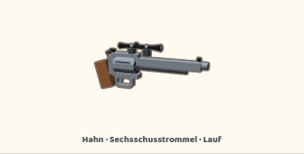
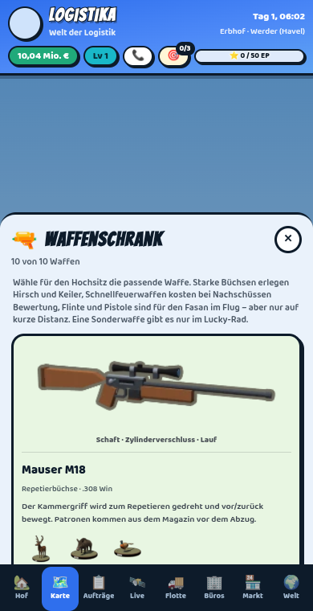

# v419 – Vorhandene Waffen klarer darstellen

Die zehn bestehenden Waffen behalten ihre Grundformen, Materialfarben und den kantigen Logistika-Look. Die Änderung verfeinert die vorhandenen Modellfunktionen in `weapons.js` und ihre bestehende Waffenschrank-Vorschau. Der Waffenbestand und die Spielmechanik bleiben erhalten.

Die alten Modelle hatten geschlossene Mündungskappen, kaum sichtbare Abzugsbügel und wenig unterscheidbare Systeme. Schaftkonturen, offene Bügel mit Abzügen, vertiefte Lauföffnungen und getrennte Zielfernrohrmontagen machen den Aufbau deutlicher. Repetierer zeigen Kammergriff, Auswurffenster und Magazin. Bei Doppelbüchse und Bockflinte sind Gelenk, Entriegelungshebel und die jeweilige Laufanordnung erkennbar. Die Pistole erhält Schlittenrillen, Auswurffenster und eine offene Schlittenfront um den Lauf; der Revolver eine freistehende Sechsschusstrommel, Hahn und Ausstoßer. Goldverzierungen sitzen am Gehäuse, statt die Läufe mit großen Querstücken zu verdecken.

Die Karten zeigen das Modell größer aus einer seitlichen Dreiviertelansicht. Eine Bauteilzeile und eine kurze Funktionsbeschreibung helfen bei der Einordnung. Langwaffen und Kurzwaffen werden passend eingepasst; die Tier-Eignungsbildchen aus v416 bleiben erhalten. Es gibt keine neue Bedienfolge oder Ladeanimation.

| Doppelbüchse | Bockflinte |
| --- | --- |
|  |  |

| Pistole | Revolver |
| --- | --- |
|  |  |

## Prüfung und Leistung

- `node weapons-v383.test.js`: alle sieben bestehenden Gruppen für Katalog, Energie/Eignung, Durchschuss, Feuerfolge, Kauf, Auswahl und Modelle bestanden.
- `node weapons-v419.test.js`: zehn endliche, deterministische Modelle ohne Save-Eingriff; alle 13 tatsächlichen Lauföffnungen per Strahltest mit Tiefe und Metallrand; alle zehn Bügel haben einen freien Innenraum. 512–1.192 Dreiecke pro Modell, insgesamt 7.584 (Prüfgrenzen 1.500 je Waffe / 8.500 insgesamt).
- `node weapons-v419.browser.js`: echter Waffenschrank in Chromium/SwiftShader, 320×640, 390×760, 844×390 und 1.100×900. Alle zehn Vorschaubilder vollständig geladen; sichtbare Modellpixel innerhalb der Bildfläche, kein horizontaler Überlauf oder JavaScriptfehler. Ausrüsten und Zurückwechseln über die vorhandenen Knöpfe geprüft.
- Die Vorschauen werden einmal über den gemeinsamen Bildchenrenderer erzeugt und mit 288 Pixeln gecacht. Keine eigenen WebGL-Canvas pro Karte, keine laufende Modellanimation. 20 erneute Öffnungen erzeugten null weitere Waffen-Meshes und null Waffen-Renderdurchläufe; kein Kontextverlust oder Eingriff in die Waffenauswahl. [Browsermesswerte](assets/v419/messwerte.json).
- Syntax von Waffen und Service Worker sowie Assetverweise geprüft. Kein Test auf einem echten Handy/iPhone/Safari und keine Geräte-FPS-Messung.

Basis ist main `69f990c` mit der bereits zusammengeführten Liefertruhe415 und den Tierbildern416. Gesamt-/SW/LOGI_V419, nur `weapons.js` und `style.css` neu auf Asset419. Jagd412, Gebirge414 und alle anderen Assets bleiben auf ihren bisherigen Ständen. Lieferung über eigenen Pull Request, kein automatisches Merge oder Deployment.
