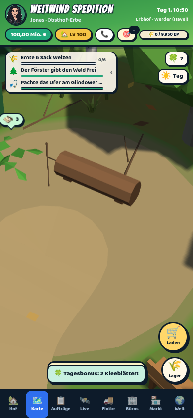

# Alter Waldplatz v409

Die Änderung betrifft das südliche Ende des westlichen Waldwegs (`FWORLD.paths[2]`) und die verbliebenen Schwarm-Effekte des alten Fangplatzes `bachsteg` (ursprünglich −87,3 / −59,4). Der frühere Steg wird nach der Flussverlegung bereits nicht mehr aufgebaut; der Holzstamm stammt aus der automatisch gezeichneten Wegend-Lichtung.

## Örtliche Korrektur

- Nur der Stamm an diesem Wegende dreht sich um 90 Grad um die Hochachse. Position und Höhe bleiben gleich; die Wegfläche wird nicht gedreht. Alle anderen Wegenden behalten die bisherige Ausrichtung.
- Am Ziel `bachsteg` erscheinen keine Fischschwarm-Blase, kein Schwarm-Ereignisknopf und keine Schwarm-Spritzer mehr. Das gilt auch für gespeicherte Ereignisse, ohne den gespeicherten Zustand zu verändern.
- Neue Schwarm-Ereignisse wählen diesen alten Platz nicht mehr. Alle bisherigen Ziele am Hauptsee bleiben möglich.
- Hauptsee, Seebach, Teich, Gebirge und Fluss werden geometrisch nicht verändert. Die übrigen Wasseranimationen, springenden Fische, Boote, Fanggründe, Fischmodelle und Fangchancen bleiben erhalten. Keine Fangbuch-/Inventar-/Spielstandmigration.

## Prüfung

`node waldplatz-v409.test.js`: echte `FWM.forestPath`-Geometrie mit/ohne optionale Vierteldrehung verglichen. Breitenachsen des Stamms tauschen, Mittelpunkt/Höhe/Farbe bleiben gleich; Standardoption und Wege ohne Endbank ergeben identische Netze.

`node waldplatz-v409.browser.js`: Chromium/SwiftShader, 390 × 844, echter Hofaufbau einschließlich Landschaft. Ein gespeichertes `bachsteg`-Ereignis erzeugt weder Weltblase, Ereignisknopf noch Spritzer und wird dabei nicht umgeschrieben. Gegenprobe mit demselben Ereignis an „Tiefe Mitte“: Weltblase am richtigen Ort, Knopf und Spritzer aktiv, identische Fangchancen. Auswahlprüfung neuer Schwärme über alle verfügbaren Ziele, nur `bachsteg` ausgeschlossen. Keine JavaScript-Seitenfehler.

Server: `python3 -m http.server 8003 --bind 127.0.0.1`, URL über `LOGISTIKA_TEST_URL`, Bildordner über `LOGISTIKA_ARTIFACT_DIR` einstellbar.

`node wasseroptik-v386.test.js` bestanden: Wasseranschlüsse, Inselkante, Falllippen, Zoom-/Geometriebudget und Tiere. Syntax `erbe.js`, `woodmodels.js`, `worldview.js`, `sw.js` sowie `git diff --check`. Kein Test auf echtem iPhone/Safari.

Eigenständiger PR auf main6e83609; enthält nur diese örtliche Korrektur und die zugehörigen Versionen/Prüfnachweise. Andere noch offene PRs bleiben separat.
