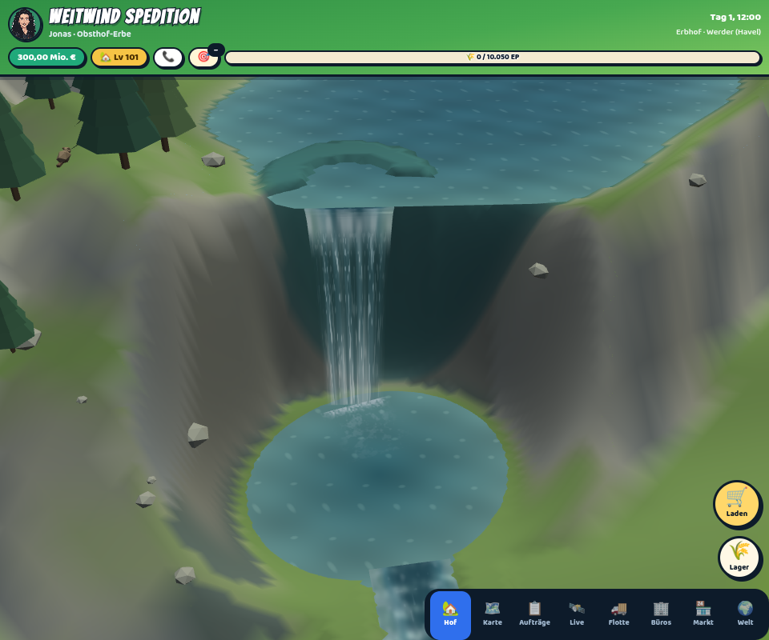
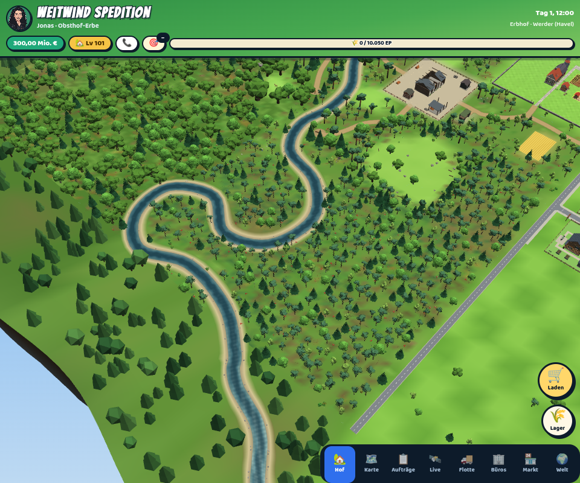
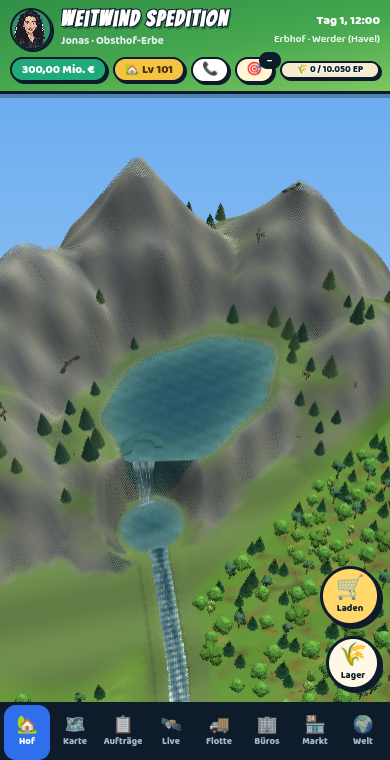

# Wasserfall und Mäander – v380

## Recherche und Gestaltung

Geprüfte Online-Quellen:

- [National Park Service: Waterfalls in Yosemite](https://www.nps.gov/yose/planyourvisit/waterfalls.htm): fallendes Wasser, Gischt bei kräftigem Abfluss, nasser Fels und Übergang vom Fall zum Fluss. Die Seite zeigt reale Fälle wie Vernal Fall.
- [Waterfall](https://en.wikipedia.org/wiki/Waterfall): Beschleunigung an der Fallkante, freier Fall und Erosion am Fuß. Ein großer horizontaler Versatz bei geringem Höhenunterschied wäre eine Rutsche, kein freier Wasserfall.
- [Plunge pool](https://en.wikipedia.org/wiki/Plunge_pool): ausgekolktes Becken unter dem Einschlag, turbulentes Wasser und unregelmäßiger Felsrand.
- [Meander](https://en.wikipedia.org/wiki/Meander): gegensinnige Bögen, Abtragung am äußeren Prallhang und Ablagerung am inneren Gleithang. Mäander werden unter anderem über das Verhältnis von Laufstrecke zu direkter Talstrecke beschrieben.

Die Gestaltung übernimmt diese Merkmale im Maßstab der Spielinsel, ohne externe Fotos oder neue Texturen im Spiel zu laden. Es handelt sich um eine grafische Wasser-/Geländedarstellung, keine vollständige Strömungssimulation.

## Neue Wasserführung

**Bergsee → kurzer Auslauf → großer freier Wasserfall → Auffangbecken → Talüberlauf → bestehender Oberlauf/Brücke → neue Mäander → südlicher Insel-Wasserfall.**

Die frühere Quellanlage wird bei vorhandener Berglandschaft nicht mehr aufgebaut: weder Quelltopf und Felsblöcke noch der serpentinenartige Bergbach, alte Kaskaden, Quellhangflora und deren Effekte. `WV.springFx`/`WV.springRun` werden beim Aufbau geleert. Die bisherigen Bibliotheksfunktionen bleiben für isolierte ältere Prüfstände verfügbar; sie erscheinen nicht zusätzlich auf der Insel. Alte Hangmasken sperren nicht mehr die entfernte Anlage.

Die neue Fallkante liegt auf Höhe10,35, das Becken auf0,12. Der horizontale Versatz beträgt nur rund1,7 bei etwa10,2 Fallhöhe. Die Geometrie folgt `y = y0 − ½gt²`, mit `g=9,81` und steigender Geschwindigkeit. Der See wird an der Fallkante begrenzt, statt über die Felswand hinauszuschweben. Die Fallbreite geht von etwa4,1 auf3,1 zurück.

Das Becken ist etwa13,6 ×12 groß, mit vertieftem Boden und einem offenen Überlauf. Fall und Aufprall verwenden dieselben bewährten Materialien wie die bisherigen kleinen Wasserfälle: zeitlich mitgeführte Strähnen, belüftetes Wasser, wandernder Aufprallschaum und Druckwellen. Hinzu kommen höchstens18 Spritzer und2 schwache Gischtwolken pro Sekunde, nur bei naher Kamera. Aus der Ferne entstehen keine neuen Sprühpartikel.

Der Überlauf durchschneidet den Beckenrand tatsächlich und schließt am unveränderten bisherigen Flussanfang `(31,2; −105,6)` an. Beide Geländestufen werden entlang dieser schmalen Wasserfläche gezielt verfeinert. Eine Prüfung gegen die **tatsächlichen Dreiecke** beider Stufen verhindert, dass einzelne Teile beim Herauszoomen unter dem Gelände verschwinden. Die Strömungskoordinate wird vom Überlauf in den Fluss fortgesetzt.

## Neue Flussbögen

Oberlauf und bestehende Brücke bleiben an Ort und Stelle. Die großen Talbögen liegen westlich davon, überwiegend jenseits der bestehenden Waldwege. Die Wasserfläche bleibt3,45 Einheiten breit; nur die trockenen Uferstreifen variieren in den Biegungen. Die innere Bank ist etwas breiter, die äußere etwas schmaler. Das Verhältnis von geglätteter Laufstrecke zur direkten Verbindung beträgt dort ungefähr1,78.

Der letzte Kontrollpunkt verschiebt sich von `(-164;−64)` nach `(-164;−18)`. Der tatsächliche Austritt an der gekrümmten Inselkante liegt bei ungefähr `(-202,8;37,7)` und damit deutlich weiter südlich. Der äußere Wasserfall bleibt erhalten und schließt in Flussbreite an. Nördlich des westlichen Austritts entsteht mehr zusammenhängende Fläche.

## Spielstände und Leistung

`F.river380` versetzt ausschließlich vorhandene fällbare Bäume, deren Standort vom neuen westlichen Flussbett überdeckt wird, zum nächsten passenden freien Uferplatz. IDs, Art, Wachstum, Zustand und Arbeit bleiben erhalten. Es wird kein Baum gelöscht. Findet sich kein Platz, bleibt der Baum erhalten und die Migration darf später erneut suchen. Bereits passende Bäume bleiben unverändert; erfolgreich abgeschlossene Umstellung ist idempotent.

Gelände und Wasser bleiben feste, gecachte Meshes. Die Fernstufe umfasst einschließlich See, Fall, Becken, Überlauf, Bergwald und Adlern 7.022 Dreiecke in13 Drawcalls; harte Prüfschranke10.000. Der alte detaillierte Quellhang wird dafür nicht mehr erzeugt. Keine Wasserphysik-Berechnung, dynamische Netzverfeinerung oder neue Shaderprogramme je Bild. Partikel und Zeitschritte sind begrenzt.

## Prüfung

- `node bergwasserfall-v380.test.js`: freier Fall unter Erdbeschleunigung, Ufer und Beckenboden, Verbindung zum bisherigen Fluss, beide tatsächlichen Geländestufen ohne verdeckten Überlauf, 133 Querschnitte mit konstanter Wasserbreite (Abweichung unter1e−6), Mäandermaß und südlicher Randaustritt. Außerdem sieben trockene Tierwege, verbundene Beine/Hufkontakt über1.800 Schritte, 200 Zoomwechsel ohne Meshwachstum sowie erhaltende/idempotente Baumumstellung.
- `node bergwasserfall-v380.browser.js`: vollständige Insel in Chromium/SwiftShader, mobile und große Ansicht, Wasserfall-/Mäanderbilder, Nacht, Tierbewegung, entfernte Altanlage und wiederholte Zoomwechsel ohne Kontextverlust oder neue GPU-Meshes. Nach der letzten Beckenrandkorrektur zusätzlich Kurzlauf mit `LOGISTIKA_QUICK=1`.
- Bestehende13 Arbeiter-/Werkzeugprüfungen, Inselrand- und Wasseraufprallprüfungen bestanden; Syntax-/Assetabgleich.

Nicht auf echtem iPhone/Safari geprüft. Die Ressourcenbegrenzung und die Browserprüfungen belegen kein garantiertes Tempo auf jedem Handy. Die ältere v375-Prüfung, die ausdrücklich den nun entfernten Serpentinenbach erwartet, wird für diese Wasserführung durch die v380-Prüfung ersetzt.

Basis main `ca16b9c` (v379). Eigene Lieferung380; keine automatische Zusammenführung nach main oder Veröffentlichung.

[Messdaten des abschließenden Browserlaufs](assets/v380/messwerte.json)
