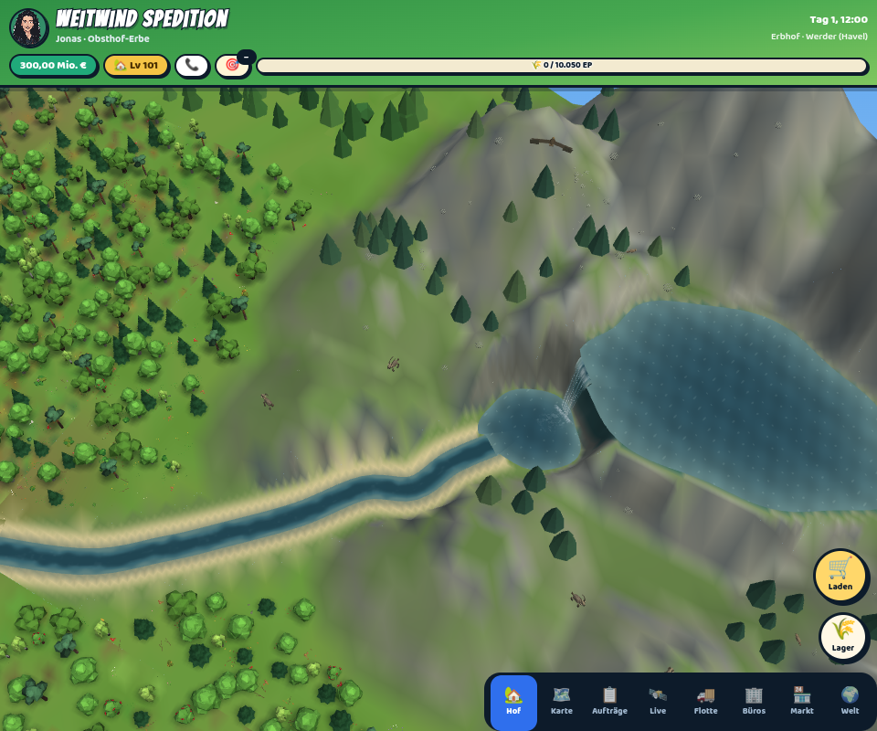
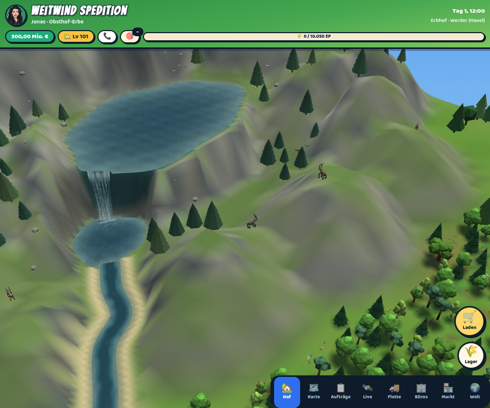
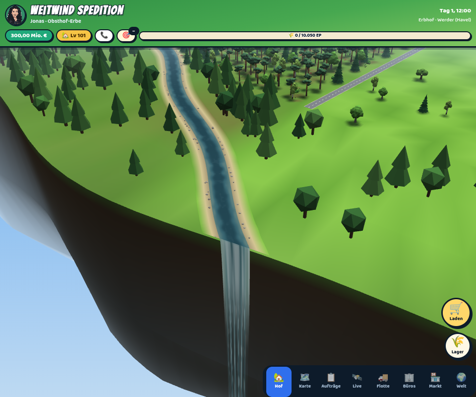
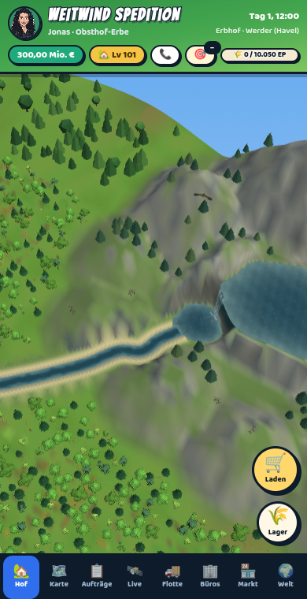

# Wasseranschlüsse und Vorberge – v384

Die Überarbeitung behebt die im Screenshot sichtbare Lücke im Talüberlauf, den unruhigen geraden Wasserstreifen und die kantigen See-/Beckenübergänge. Zusätzlich entstehen sechs kleinere Berge vor dem hohen Gebirgskamm. Der Fluss fällt an der tatsächlichen Kante der schwebenden Insel ab.

## Ursachen und Änderung

Der alte Überlauf war ein separates Band. Sein Geländeprofil endete mit einem erhöhten Abschluss vor dem Hauptfluss; die bisherige Prüfung erfasste nur die Mittellinie. Außerdem blieb der alte ebene Wiesenboden unter Teilen des tiefer ausgeschnittenen Ufers sichtbar. Eine Überblendung unterschiedlicher Geländeformen erzeugte im mittleren Zoom Rastermuster.

Jetzt läuft **ein gemeinsames Flussmesh** vom Auffangbecken durch einen sanft gebogenen Überlauf bis zum Inselrand. Wasser, ausgehobenes Bett und Ufer beziehen sich auf dieselbe geglättete Linie. Sie führt über den früheren Anschluss hinaus; dort gibt es keinen abschließenden Uferwall mehr. Das Wasser bleibt 3,45 Einheiten breit und nutzt die ruhigere Flussdarstellung statt der bisherigen durchgehenden Stromschnellen. Die bestehenden Mäander, die Brücke und die Waldwege behalten ihre Lage.

Die Bergdecke ersetzt auch den alten Wiesenboden in ihrem fest begrenzten Bereich. Ihre Uferfarben liegen direkt im Geländenetz; kein zweites flaches Sandband durchschneidet den Hang. See und Kolk besitzen unregelmäßige gemeinsame Wasser-/Geländeumrisse. Die jeweiligen Auslasspunkte werden von beiden anschließenden Wasserflächen geteilt. Der Bergsee erhält eine schmale Falllippe; das überlagerte kurze Wasserband im See entfällt. Die freie Fallbahn unter Erdbeschleunigung und der Aufprallschaum bleiben erhalten.

## Kleinere Berge und Tiere

Sechs vorgelagerte Berge mit nominellen Gipfelhöhen von 9 bis 17 ergänzen die hohen Gipfel. Felsrippen, gestufte Höhenfarben, Schutt und einzelne Nadelbäume gliedern die Hänge. Fünf kleine Geländeterrassen bieten den vorhandenen Steinböcken trockene Bereiche zum Gehen und Äsen. Ihre tatsächlichen Wege werden gegen das gezeichnete Gelände, Wasser und Vegetation geprüft. Hufe und beide Beinsegmente behalten Bodenkontakt. Die zwei Murmeltiere und zwei Adler bleiben Teil der Landschaft; die Tierzahl steigt nicht.

Die Gestaltung führt die in [v380 dokumentierten Naturvorbilder](WASSERLANDSCHAFT-v380.md#recherche-und-gestaltung) fort: Gebirgssee, Felsstufe, Kolk und anschließender Talfluss. Sie bleibt eine stilisierte Landschaft im Logistika-Look, keine vollständige Erosions- oder Strömungssimulation.

## Austritt an der Inselkante

Die sichtbare Felskante besteht aus geraden Polygonsegmenten. Deren Kontur wird nun auch für den Wasserbeschnitt verwendet; die theoretische Randkurve allein genügte dafür nicht. Ufer und Wasser enden genau an dieser Kontur. Die Randpunkte des beschnittenen Wassers bilden unmittelbar die obere Kante des Wasserfalls, über die gesamte Breite. Damit entfallen der Luftspalt, überstehende rechteckige Ufer und die starren weißen Gischtklötze. Der Fall nutzt bewegte Wassersträhnen. Auch die Breite des zweiten, östlichen Insel-Wasserfalls stimmt jetzt mit seinem schmaleren Bach überein.

## Spielstände und Grafikbudget

`F.mountains384` verschiebt ausschließlich gespeicherte Bäume, deren Standort vom neuen Gebirge oder Überlauf überdeckt wird, zu einem freien Platz am Hangfuß. Der Platz muss Wege, Wasser, andere Bäume und die neue Bergfläche freihalten. Kennung, Baumart, Größe, Wachstum, Schaden und Arbeitszustand bleiben erhalten. Unbetroffene Bäume bleiben an Ort und Stelle. Bei Platzmangel wird nichts gelöscht; die Umstellung kann beim nächsten Laden erneut suchen. Geld, Gebäude, Inventar und Aufträge werden nicht verändert. Die vorherige Flussumstellung `F.river380` bleibt bestehen.

Ein einziges adaptives Geländenetz ersetzt die zwei unterschiedlich geformten Geländestufen. Es bleibt beim Zoomen unverändert; See, Becken und Flussbett können dadurch keine abweichenden Zwischenformen oder Rasterlöcher zeigen. Nur Vegetation, Kleinteile und Tiere verwenden weiterhin Fernstufen. Der neue feste Boden hat 8.282 Dreiecke gegenüber 23.388 im bisherigen Nahgelände. Die gesamte eigene Berglandschaft benötigt aus der Ferne 12.838 Dreiecke in 12 Drawcalls, mit Prüfschranke 14.000. Damit ist die Fernlast höher als in v380 (7.022), während Nahlast und gespeicherte Geländedaten sinken. Die Mehrlast ist fest begrenzt und wächst nicht mit Zoomwechseln.

Keine neuen Meshes, Texturen oder Shaderprogramme pro Bild. Spritzer/Gischt bleiben auf die Nähe beschränkt; die Zahl der Tiere bleibt gleich. Im vollständigen Browserlauf entstanden nach dem Aufwärmen bei 24 Zoomwechseln keine zusätzlichen GPU-Meshes und kein WebGL-Kontextverlust. Diese Prüfung ist kein Nachweis einer bestimmten Bildrate auf einem Handy.

## Prüfung

- `node wasserlandschaft-v384.test.js`: 45 Querschnitte mit jeweils elf Punkten vom Becken bis hinter den alten Flussanschluss gegen die tatsächlichen Geländedreiecke; Wasserbreite auf allen Flussstationen mit Abweichung unter 1e−6. Wasserumrisse beider Becken bis unmittelbar ans Ufer frei, exakt gemeinsame Auslasspunkte. Geometrie an der echten Inselkontur und gemeinsame Falllippen beider äußerer Wasserfälle. Der alte Wiesenboden liegt im ersetzten Bereich nicht mehr über dem Ufer.
- Derselbe Test prüft sieben trockene Tierwege, Hufkontakt und verbundene Beine über 1.800 Schritte, Abstand zwischen den Tieren, 200 Zoomwechsel ohne Meshwachstum, das feste Fernbudget und die erhaltende/idempotente Baummigration einschließlich fehlendem freien Platz.
- `node wasserlandschaft-v384.browser.js`: vollständiges Spiel in Chromium/SwiftShader, 390×760 und 960×800, Seiten-/Nah-/Rück-/Inselansicht, sechs Vorberge, Tierbewegung, Tag/Nacht und Ich-Perspektive. Ein absichtlich an einem alten Standort gespeicherter Baum wird mit echten Platzregeln korrekt versetzt. Nach dem Szenenaufbau bleiben Bäume, Objekte und Geld unverändert; 24 Zoomwechsel ohne neue Meshes oder Kontextverlust; keine Seitenfehler. [Messdaten](assets/v384/messwerte.json).
- Bestehende 13 Bewegungs-/Werkzeugprüfungen (`worker-motion-v351.test.js`) sowie Wasseraufprall und Kaskadenanschlüsse (`water-impact-v325.test.js`, `water-seams-v297.test.js`) bestanden. Syntax und Asset-/Cacheversionen geprüft.

Die v384-Landschaftsprüfung ersetzt die älteren v375/v380-Annahmen über zwei Geländestufen und einen separat endenden Überlauf. Kein Test auf echtem iPhone/Safari erfolgt.

Basis main `5d0076e` (v380). Offene Jagd-/Waffen-PRs #98–#100 bleiben eigenständig. Lieferung v384 vermeidet die dort bereits vergebene Nummer v383. Keine automatische Zusammenführung nach main und keine Veröffentlichung.
