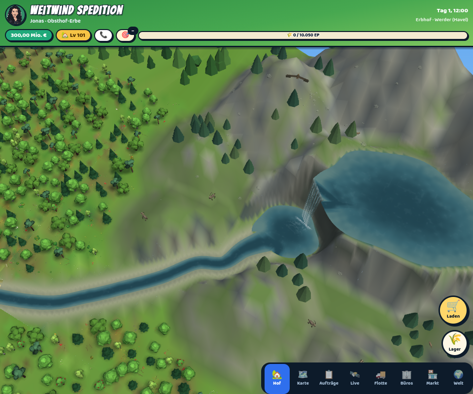
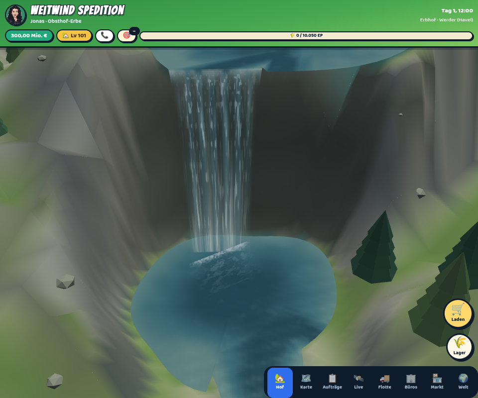

# Gebirge und Wasseroptik v386

Die verwaschenen Hänge erhalten dezente Felsfacetten, ruhigere Schichtfarben und gedecktere Kiesufer. Die Bergdecke übernimmt am Rand die tatsächlichen Waldbodenfarben aus `worldGround` einschließlich Waldpatches; die rechteckigen Farbwechsel am Fluss entfallen.

Der Bergsee liegt auf Höhe15 statt10,4, der Fall ist etwa6,4 statt4,1 Einheiten breit. Seeufer, Bett, freie Fallbahn und Auffangbecken werden gemeinsam angepasst. Der Fall beschleunigt weiterhin unter Erdbeschleunigung. Seine Strähnen setzen früher ein, statt lange wie eine geschlossene Folie zu wirken. Der Kolk ist größer und sein sechs Einheiten breiter Auslauf verengt sich allmählich auf die bestehende Flussbreite3,45. Die Breitenfunktion gilt für Wasser, Bett und beide Ufer; die vorhandenen Mäander und die Inselkante bleiben bestehen.

See und Kolk verwenden dieselbe Wasserpalette und Beleuchtung wie der Fluss. Im Becken laufen kleine Wellen in Weltkoordinaten; so entstehen keine zum Fächerzentrum gestreckten Glanzstreifen. Am Auslauf werden Fließkoordinaten und Ufertiefe weich an den Fluss angeschlossen. Unterschiedliche Tiefen und Schaum bleiben sichtbar, ein Wechsel zwischen zwei Wasserfarben entfällt.

Am Aufprall liegen breitere bewegte Schaumadern und größere, auslaufende Druckwellen. Die Spritzer folgen der Schwerkraft, schwache Gischt steigt auf. Begrenzt auf nahe Kamera: maximal30 Spritzer und4 Gischtteilchen pro Sekunde, kurze Lebensdauer; in der Fernansicht keine neuen Partikel. Kein neues Netz und keine Textur wird pro Bild erzeugt. Die eigene Fernlast beträgt13.035 Dreiecke/12 Drawcalls (v384:12.838). Der Zeitschritt und die Tierzahl bleiben begrenzt.

Prüfung:

- `node wasseroptik-v386.test.js`: echte Wasser-/Geländedreiecke, Breitenverlauf und gemeinsame Lippen, vergrößerte Fallmaße, vollständig im Kolk liegende Gischtfläche, Hufkontakte über1.800 Schritte, 200 Zoomwechsel ohne Meshwachstum, unveränderte Spielstände und erhaltende bestehende Baummigration.
- `LOGISTIKA_QUICK=1 node wasseroptik-v386.browser.js`: vollständiges Spiel in Chromium/SwiftShader, mobile390×760 und große960×800 Ansicht, Nacht/Ich-Perspektive, Tiere, acht Zoomwechsel ohne neue GPU-Meshes oder Kontextverlust. Zusätzlich unterschiedliche Wasserpixel bei feststehender Kamera und zwei Animationszeiten geprüft. Keine Seitenfehler, Bäume/Gebäude/Geld erhalten. [Messdaten](assets/v386/messwerte.json).
- `water-impact-v325.test.js` und `water-seams-v297.test.js` bestanden; Syntax und Cacheversionen geprüft. Die v386-Prüfung ersetzt die alte Annahme einer überall konstanten Breite unmittelbar am Beckenauslauf.

Kein Test auf einem echten iPhone/Safari; keine garantierte Bildrate auf jedem Gerät. Stilisiertes Wasser, keine vollständige Strömungssimulation. Keine neue Spielstandmigration, keine Kosten-/Auftragsänderung. `F.mountains384` und die vorhandene Flussumstellung bleiben bestehen.

Basis main c697106, einschließlich PR101. Paralleler Inselrand-PR102/v385 bleibt separat; eigene Version386. Beim Zusammenführen beide worldview-Änderungen und alle jeweils neuen Assets erhalten. Nicht automatisch veröffentlicht.
