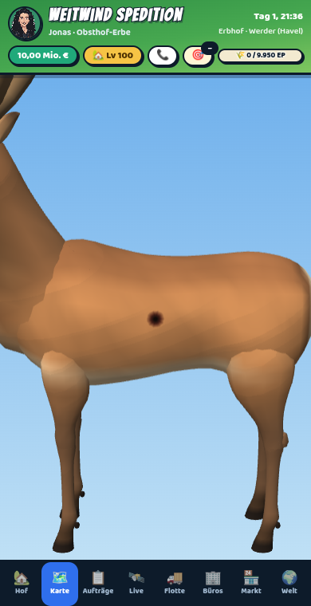
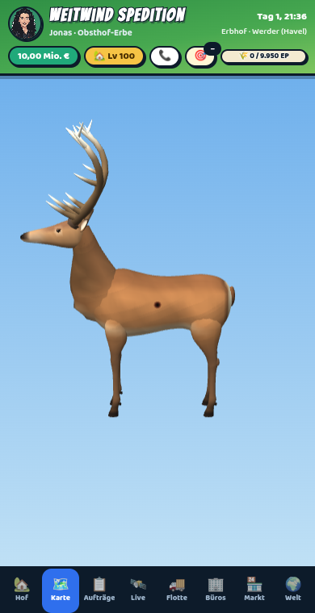

# Wundoptik v400

Die Wunde soll klein und zurückhaltend auf dem Fell sitzen. Der dunkle Kern läuft über einen gedämpften rotbraunen Rand in die Fellfarbe des jeweiligen Tiers aus. Der Radius beträgt 0,032 Modelleinheiten (vorher 0,06); die tatsächliche Größe skaliert mit dem Tier. Der Ausschuss behält den bisherigen Größenfaktor 1,35.

## Oberfläche und Befestigung

`woundSpot` verwendet die tatsächlichen sichtbaren Rumpf-, Hals- und Hauptmodelle einschließlich Fellvariante und Größenmerkmalen. Zwei projizierte Tangenten liefern die lokale Hautnormale. Jeder Ringpunkt wird auf das Netz projiziert; Punkte ohne Oberflächenkontakt entfallen. Der minimale Abstand von 0,0012 Modelleinheiten verhindert Flimmern. Die Fläche hängt am Rumpf-, Hals- oder Kopfknoten und folgt dessen Pose. Eine auf der abgewandten Hautseite liegende Eintrittsstelle wird naturgemäß vom Körper verdeckt; dort erscheint nur bei echtem Durchschuss ein separater Ausschuss.

Die Geometrie entsteht einmal bei der Wunde: maximal 264 Dreiecke, 145 verschiedene Oberflächenprojektionen pro Fläche. Es gibt keine neuen Partikel oder Berechnungen pro Animationsbild. Trefferwirkung, Organe, Eindringtiefe und gespeicherte Daten bleiben unverändert.

## Vorschau aus dem Testbrowser

Detail mit weichem Fellübergang:

Seitenansicht:

## Prüfung

- `node wundoptik-v400.test.js`: 18 Oberflächen (Hirsch/Keiler/Fasan, Körper/Hals/Haupt, beide Seiten). Jeder Wundpunkt wird unabhängig gegen die Dreiecke des tatsächlichen Modells gemessen; Abstand unter 0,0015. Richtiger Elternknoten, endliche Geometrie, kein Ausschuss bei unzureichender Eindringtiefe.
- `node wundoptik-v400.browser.js`: Chromium/SwiftShader, 390 × 760, echte Tierknoten und WebGL-Geometrie. Eintritt, Schrägansicht und Gegenseite gerendert; Rotation und abgeschlossener Fall. Zwei befestigte Wundflächen beim Durchschuss, keine JavaScript-Seitenfehler. Start mit `python3 -m http.server 8001 --bind 127.0.0.1`; Bildordner über `LOGISTIKA_ARTIFACT_DIR` einstellbar.
- `node trefferklarheit-v388.test.js`, `node trefferbild-v357.test.js`, `node anatomie-v367.test.js`: bestanden; anatomische Seite, kein Doppelschild, Eindringgrenze, echte Organkontakte und historische Daten erhalten.
- Syntaxprüfung für `hunt.js`, Versions-/Asset-Abgleich und `git diff --check`.

Kein Test auf einem echten iPhone/Safari, keine gemessene Mobilgeräte-Bildrate. Gegenüber main510ae1b wird der bestehende PR110 aktualisiert; keine automatische Zusammenführung oder Veröffentlichung.
