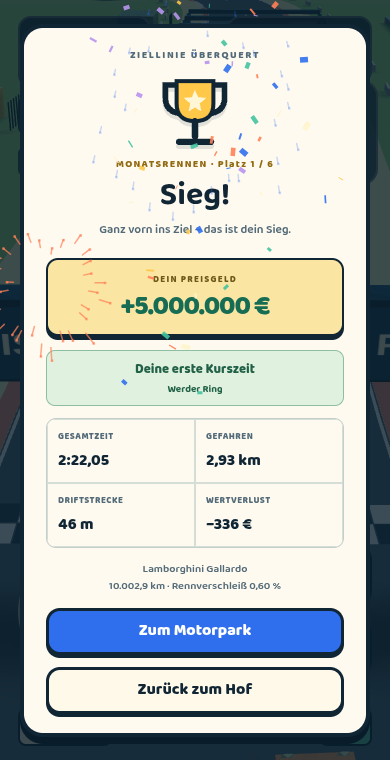
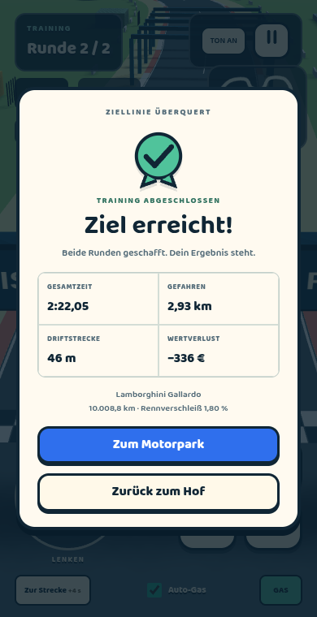

# Zielfeier und Freifahren · v469

Beim Abschluss beider Runden startet direkt an der Ziellinie eine kurze Feier mit farbigem Konfetti und fünf Feuerwerksbursts. Das Ergebnis bleibt sofort bedienbar. Sieger erhalten einen goldenen Pokal, Platz zwei/drei einen silbernen/bronzenen; die übrigen Zielankünfte und das Training eine grüne Auszeichnung. Platzierung, tatsächlich gutgeschriebenes Preisgeld, erste Kurszeit/neue Bestzeit und die bisherigen Fahrdaten bleiben klar lesbar. Es gibt keine zusätzlichen Geld-, Kleeblatt- oder Erfahrungspunkte-Gewinne durch die Inszenierung.

Die Effekte sind eine eigene 2D-Ebene im bisherigen Farbstil, keine zusätzlichen Insel-/WebGL-Objekte. Auf dem Handy werden 110 Konfettiteile, auf breiteren Ansichten 150 verwendet; fünf zeitlich versetzte Bursts haben je 30 Funken. Pixeldichte maximal 1,5. Nach 4,6 Sekunden endet die Zeichenarbeit und das Canvas wird entfernt. Die Knöpfe sind jederzeit erreichbar; die Ebene nimmt keine Eingaben an. Bei aktivem Spielton erklingt ein kurzer Vierklang. Alle Quellen werden beim Verlassen beendet und getrennt. Bei reduzierter Bewegung bleiben Auszeichnung und Ergebnis statisch, ohne Konfetti-/Feuerwerks-Canvas oder Pop-Animation.

Die Feier startet je Lauf einmal. Eine Zwischenrunde, Abbrechen und Zurücksetzen starten sie nicht. Schlägt das Speichern fehl, bleibt die bestehende Wiederholen-Meldung erhalten; Preisgeld wird erst nach erfolgreicher Sicherung angezeigt. Wiederholtes Speichern erzeugt keine zweite Feier und keine doppelte Gutschrift. Die Erkennung einer persönlichen Bestzeit verwendet den Stand vor der Ergebnisbuchung, ohne alte Bestzeiten zurückzusetzen.

## Nitro und Drift außerhalb des Asphalts

**Ursache:** Beide Funktionen waren an `on` (Asphalt) gekoppelt. Außerdem fällt der Lenkeinschlag bei fast null Bewegung praktisch aus. Mit der Fahrzeugnase gegen die Leitplanke blieb der Wagen deshalb auch unter Gas stehen: im reproduzierten alten GT3-Fall nach sechs Sekunden nur rund 0,018 rad Richtungsänderung, Nitro weiterhin 100 und keine Rückkehr auf den Asphalt.

**Korrektur:** Nitro funktioniert auch im Auslauf, bei normalem Verbrauch und zusätzlichem Verschleiß. Drift funktioniert dort schon ab 3 m/s; auf Asphalt gelten weiterhin die bisherigen modellabhängigen Schwellen. Unter Gas bleibt im Kies bei geringer Geschwindigkeit eine begrenzte Lenkhilfe aktiv, mit gehaltenem Drift etwas kräftiger. Ein geparktes Auto dreht ohne Gas nicht auf der Stelle. Das hilft, sich von beiden Leitplanken wegzudrehen und zurückzufahren.

Kieswiderstand, äußere Leitplanke, Kontrollpunkte, Rundenzählung und das vorhandene Zurücksetzen mit vier Sekunden Strafe bleiben erhalten. Es gibt keine Teleportation und keinen geschenkten Kontrollpunkt. Höchstgeschwindigkeiten, Antritte und Gegnerprofile aus v468 bleiben erhalten.

## Technik und Prüfung

`racefinish.js` vor `racing.js` laden, auch im Service-Worker. `Q.goalShown`, `Q.goalFx`, `Q.previousBest` und `Q.personalBest` leben nur in der laufenden Szene, nicht im Spielstand. `destroyScene()` beendet den Effekt; Sichtbarkeitswechsel beendet ihn ebenfalls. Basis main `86adb33` nach dem Merge von PR169. Keine Migration. Gesamt-/SW469; nur racedrive, racefinish, racing und style auf Asset469, Fahrprofile468 und Gallardo-/Streckenassets467 bleiben erhalten.

- `node zielankunft-v469.test.js`: sieben Gruppen, Nitro/Drift im Kies für verschiedene Antriebe, leeres Nitro, Bremse/kein Gas, geparktes Auto, Grenzen/Kontrollpunkte, normales Zurücksetzen und Eingabestopp nach dem Ziel. **30 Freifahrversuche** mit 356, GT3, M2, Gallardo und G 63, beide Leitplanken auf allen drei Kursen; Rückkehr auf Asphalt nach **3,38–4,98 Sekunden**, ohne Rücksetzen/Strafe/geschenkte Kontrollpunkte.
- `zielankunft-v469.browser.js`: eine echte Zwischen- und letzte Zielpassage aus vorbereitetem Rennzustand; keine Feier nach Runde eins, sichtbare Canvas-Pixel, einmalige Gutschrift, automatisches Effektende, Speicherfehler/Wiederholen, korrekte Bronzeanzeige/Preisgeld bei Platz drei, Stummschaltung und Beenden aller Audioquellen, unmittelbares Schließen während der Feier, Zwei-Finger-Nitro/Drift im Kies, Abbruch ohne Feier, Training ohne Preisgeld und reduzierte Bewegung. Keine Seitenfehler. Ergebnis bei 320, 390 und 980 Pixeln ohne horizontalen Überlauf. Die vorbereiteten Rennwerte dienen den reproduzierbaren Ergebnisbildern.
- Regressionen `autorennbahn-v461.test.js` und `gallardo-umbau-v467.test.js`: Kurs, Fahrphysik, Modelle, Umbaukosten und Spielstand erhalten.
- `autorennbahn-v461.fahrt.browser.js`: zusätzlich vollständiger Lauf mit freier Fahrphysik und KI, echte Desktop-Eingabe, Ton/Pause, Ergebnis und Gutschrift.
- `autorennbahn-v461.browser.js`: Kauf/Rodung, Touch, Verschleiß, Speicherung, einmaliges Preisgeld, Monatswechsel und Wiederverkauf.

Browser: Chromium mit SwiftShader. Kein physischer iPhone-/Safari-Test, keine Messung echter Handy-Bildrate oder Lautsprecherwiedergabe.
