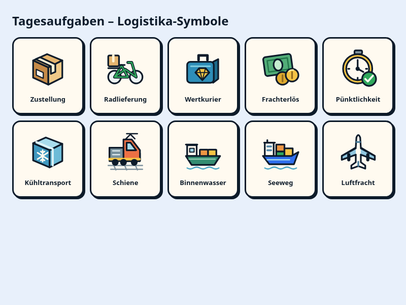
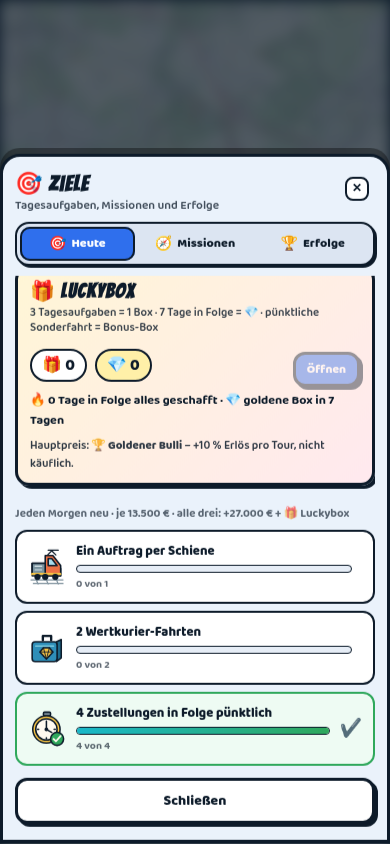

# v420 – Tagesaufgaben mit passenden Logistika-Symbolen

Der Verkehrsauftrag zeigte vorher stets das Schiffs-Emoji – selbst bei „Ein Auftrag per Schiene“. Die Symbole links in den Tagesaufgaben sind jetzt eigene Vektorzeichnungen mit dunkler Kontur, Spielpalette und leichter räumlicher Darstellung. Bahn, Binnenschiff, Seeschiff und Flugzeug werden aus dem gespeicherten Verkehrsmittel der Aufgabe gewählt. Für Wertkurier steht ein Wertkoffer, für Pünktlichkeit eine Uhr; Zustellung, Rad, Erlös und Kühlung sind ebenfalls einheitlich dargestellt.

Die Änderung betrifft die linke Symbolspalte der Tagesaufgaben. Symbole in Kopfzeile, Reitern, Luckybox, Missionen und Erfolgen bleiben erhalten. Inline-SVG benötigt weder WebGL noch externe Bilder, Schriftzeichen oder neue Bibliotheken. Fortschritt, Erledigt-Zustand, Aufgabenwahl und Belohnungen sind unverändert; keine Migration.

Geprüft mit Playwright/Chromium in 320×640, 390×844, 844×390 und 1.100×900: korrekte Lokomotive beim Schienenauftrag, Wertkoffer/Uhr, unveränderte Zähler 0/1, 0/2, 4/4 und grüner Erledigt-Zustand; kein horizontaler Überlauf oder JavaScriptfehler. Alle zehn Symbolvarianten vollständig innerhalb ihrer Bildfläche. Reiterwechsel und Schließen funktionieren, Spielstanddaten bleiben gleich. Sämtliche Ziel-/Belohnungsfunktionen sind bytegleich zum vorherigen Stand. Syntax und Assetverweise geprüft. [Messwerte](assets/v420/messwerte.json). Kein Test auf einem echten Handy/iPhone/Safari.

Gesamt-/SW/LOGI_V420, goals/style420. Die Waffenverbesserungen419 und alle anderen vorhandenen Assetstände bleiben erhalten. Ergänzung im bestehenden PR130, kein automatisches Merge oder Deployment.
